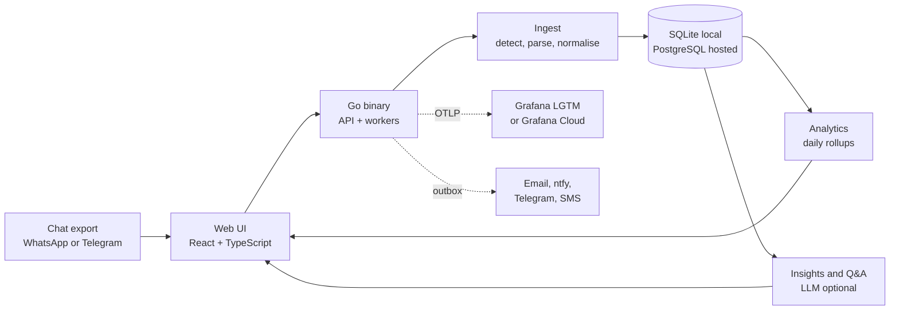

# Chat Analyzer

> Understand a two-person conversation: metrics, relationship patterns, mood and mind over time, and
> questions answered with citations, from a WhatsApp or Telegram chat export. Local-first, lean, and free to host.

**Status:** 🏗️ Milestone **M0 (foundation)** complete: Go API skeleton, React app, CI and security gates.
Chat import arrives in M1. See the [roadmap](docs/10-roadmap.md).

---

## What it does

| | |
|---|---|
| **Import** | WhatsApp `.txt`/`.zip` (Android & iOS) and Telegram Desktop `result.json`. Raw files are not kept. |
| **Measure** | Volume, share of voice, response times, who initiates, streaks, silences, activity heatmaps, sentiment and more, for a **day, week, month, year or custom range**, compared with the previous period. |
| **Interpret** | Relationship type and how it is evolving, plus the **mood and mind** of each person in any period. Every claim links to the messages behind it. |
| **Ask** | "What were we worried about in March?" Answers are grounded in the chosen period and cite the messages they rely on. |
| **Operate** | Multi-tenant workspaces, RBAC, audit log, OpenTelemetry traces/metrics/logs, dashboards and alerts as code, pluggable email/push/SMS notifications. |

## Quick start

Prerequisites: Go (any recent version; the pinned toolchain downloads itself) and Node.js 24.

```bash
make dev
```

This runs the Go API on <http://127.0.0.1:7420> and the Vite dev server with hot reload on
<http://127.0.0.1:5173>. To build the single binary with the UI embedded and run it:

```bash
make run
```

Other targets: `make test`, `make lint`, `make vuln`, `make check` (everything CI runs), `make docker`.
Configuration is via `CA_*` environment variables, documented in [`.env.example`](.env.example).

## Design at a glance



- **Backend:** Go, one small binary (`chatanalyzer serve | migrate | import | worker`).
- **Frontend:** React + TypeScript + Vite, embedded in the binary for local use.
- **Data:** SQLite locally (zero setup); PostgreSQL on Supabase or Aiven free tier when hosted.
- **AI:** Ollama locally by default. Any OpenAI-compatible endpoint or Anthropic can be plugged in, or no LLM at all.
- **Hosting at $0:** Vercel (web and Go functions) or a free container host, free Postgres, Grafana Cloud free, GitHub Actions.

## Documentation

All design documentation lives in [`docs/`](docs/). Start with the requirements.

| # | Document | What's inside |
|---|---|---|
| 01 | [Requirements](docs/01-requirements.md) | Vision, scope, personas, functional and non-functional requirements, acceptance criteria, open questions |
| 02 | [Architecture](docs/02-architecture.md) | C4 diagrams, backend components, interfaces, request lifecycle, sequence diagrams, deployment profiles |
| 03 | [Data model](docs/03-data-model.md) | ER diagram, schemas for SQLite and Postgres, tenant isolation with RLS, indexes, migrations |
| 04 | [Metrics catalog](docs/04-metrics-catalog.md) | Exact definition and algorithm for every metric, time-window semantics |
| 05 | [AI insights & Q&A](docs/05-ai-insights.md) | LLM providers, relationship profile, mood and mind, summarisation, grounding, Q&A orchestration |
| 06 | [Observability](docs/06-observability.md) | OpenTelemetry, metrics catalogue, logs, dashboards, alert rules, SLOs, runbooks |
| 07 | [Deployment](docs/07-deployment.md) | Local, Docker Compose and free cloud profiles, verified free-tier matrix, CI/CD, custom domain later |
| 08 | [Security & privacy](docs/08-security-privacy.md) | Threat model, controls, encryption, erasure, compliance, responsible AI |
| 09 | [Notifications](docs/09-notifications.md) | Notifier adapters (SMTP, ntfy, Telegram, SMS), outbox, providers and self-hosted mail |
| 10 | [Roadmap](docs/10-roadmap.md) | Milestones, Gantt chart, exit criteria |
| — | [WhatsApp export format](docs/parsers/whatsapp.md) | Line formats, locale handling, system messages, detection algorithm |
| — | [Telegram export format](docs/parsers/telegram.md) | `result.json` structure and mapping to the canonical schema |
| — | [Architecture decisions](docs/adr/README.md) | ADR index |
| — | [Contributing](CONTRIBUTING.md) | Repo conventions, commits, comments, tests, docs |
| — | [Security policy](SECURITY.md) | How to report a vulnerability |

## Repository layout

```text
chat-analyzer/
├── backend/          # Go module: cmd/chatanalyzer + internal/* packages
├── web/              # React + TypeScript + Vite app
├── deploy/           # docker-compose, Vercel config, Grafana dashboards and alert rules (M5/M6)
├── docs/             # All documentation (this index)
├── .github/          # CI, CodeQL, release-please, Dependabot
├── Dockerfile        # Container image (static binary on distroless)
├── Makefile          # Developer entry points (`make help`)
├── README.md
├── CONTRIBUTING.md
└── SECURITY.md
```

## Privacy first

Chats contain another person's words too. By default everything stays on your machine, raw exports are
discarded after import, hosted LLMs need explicit opt-in, and message content never appears in logs or
telemetry. See [Security & privacy](docs/08-security-privacy.md).

## License

[Apache-2.0](LICENSE).
