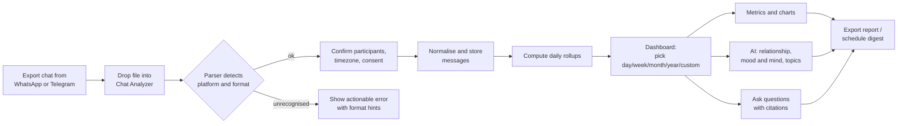
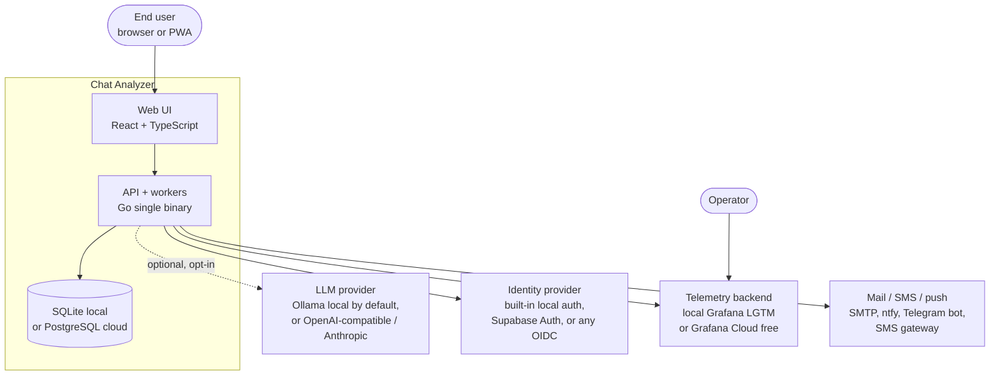

# Chat Analyzer — Requirements Specification

| Field | Value |
|---|---|
| Document | Product & Software Requirements Specification (PRD + SRS) |
| Status | **Draft v0.2 — for review** (v0.2 folds in findings from the design docs; see [revision history](#18-revision-history)) |
| Date | 2026-10-24 |
| Owner | Product owner (repo owner) |
| Related | [Architecture](02-architecture.md) · [Data model](03-data-model.md) · [Metrics catalog](04-metrics-catalog.md) · [AI insights](05-ai-insights.md) · [Roadmap](10-roadmap.md) |

> **How to read this document.** Every requirement has a stable ID (e.g. `FR-ING-003`) so that code, tests,
> issues and other docs can reference it. Priority uses MoSCoW (**M**ust / **S**hould / **C**ould / **W**on't-now)
> and a delivery phase (`MVP`, `P2`, `P3`, `Future`). Phases are defined in [§13](#13-release-phases).

---

## Table of contents

1. [Vision and problem statement](#1-vision-and-problem-statement)
2. [Goals, non-goals and success metrics](#2-goals-non-goals-and-success-metrics)
3. [Personas and primary use cases](#3-personas-and-primary-use-cases)
4. [Scope](#4-scope)
5. [System context](#5-system-context)
6. [Functional requirements](#6-functional-requirements)
7. [Analytics: metrics and time windows](#7-analytics-metrics-and-time-windows)
8. [AI insights: relationship, mood and mind, Q&A](#8-ai-insights-relationship-mood-and-mind-qa)
9. [Non-functional requirements](#9-non-functional-requirements)
10. [Multi-tenancy, identity and access](#10-multi-tenancy-identity-and-access)
11. [Privacy, security and compliance](#11-privacy-security-and-compliance)
12. [Technology constraints and key decisions](#12-technology-constraints-and-key-decisions)
13. [Release phases](#13-release-phases)
14. [MVP acceptance criteria](#14-mvp-acceptance-criteria)
15. [Risks and mitigations](#15-risks-and-mitigations)
16. [Open questions](#16-open-questions)
17. [Glossary](#17-glossary)
18. [Revision history](#18-revision-history)

---

## 1. Vision and problem statement

People carry years of their most important relationships inside chat apps, but those apps offer no way to
*understand* a conversation: how it has changed, who carries it, what moods it went through, or what was
being said during a particular week. Chat exports exist (WhatsApp `.txt`/`.zip`, Telegram Desktop JSON), but
they are raw text dumps.

**Chat Analyzer** turns an exported **one-to-one conversation** into:

- **Hard metrics** — volume, balance, response times, initiations, activity rhythms, streaks, silences —
  computed for any time window (day, week, month, year, custom range).
- **Interpretation** — what kind of relationship the chat reflects, how it is evolving, and the *mood and
  mind* of each person in a chosen period, always backed by evidence from the messages.
- **Conversation with the chat** — natural-language questions over a chosen period
  ("What were we arguing about in March?", "When did she first mention the new job?"), answered with citations.

The product is **local-first** (works fully offline on a laptop, nothing leaves the machine), **lean** (a
single small Go binary plus a static web UI), and can be **deployed for free** on hobby tiers of FOSS-friendly
cloud services, while being built to **enterprise standards**: multi-tenancy, RBAC, audit, observability,
alerting and pluggable notifications from day one.

## 2. Goals, non-goals and success metrics

### 2.1 Goals

| ID | Goal |
|---|---|
| G-1 | Import a WhatsApp or Telegram export of a two-person chat in under a minute, with zero manual cleanup. |
| G-2 | Give accurate, explainable metrics for any time window and compare it with the previous window. |
| G-3 | Provide evidence-backed AI interpretation (relationship type, mood and mind, topics) that never invents facts. |
| G-4 | Let users ask questions about a period of the chat and get cited answers. |
| G-5 | Run 100% locally with no network access required (when a local LLM or no LLM is used). |
| G-6 | Deploy a hosted instance at **$0/month** using free tiers; no custom domain required. |
| G-7 | Be operable: every request and job is traced, measured and alertable from the first release. |

### 2.2 Non-goals (for now)

- Live syncing with WhatsApp (no personal API exists) — **export-based only**. Live Telegram sync via the official
  client API is a `Future` item (FR-ING-030).
- Group chats with more than two participants (detected and handled gracefully, not analysed — see FR-ING-012).
- Media content analysis (photos, video, voice notes) — `P3`/`Future`; the MVP only *counts* media placeholders.
- Clinical, diagnostic or legal conclusions. The product describes communication patterns; it does not diagnose
  people (see [§11.5](#115-responsible-ai)).
- Native mobile apps (a responsive PWA is the mobile story until `Future`).

### 2.3 Success metrics (product KPIs)

| ID | KPI | MVP target |
|---|---|---|
| K-1 | Import success rate on real-world exports (no parser error, ≥99% lines attributed) | ≥ 98% of files |
| K-2 | Time from file drop to first dashboard (100k messages, local) | ≤ 15 s |
| K-3 | Q&A answers that contain at least one valid citation | ≥ 95% |
| K-4 | Hosting cost of the reference cloud deployment | $0 / month |
| K-5 | Mean time to detect (MTTD) an API outage in the hosted deployment | ≤ 5 min |

## 3. Personas and primary use cases

| Persona | Description | Key needs |
|---|---|---|
| **P1 — Reflective individual** | Wants to understand a relationship (partner, friend, parent) through their chat history. | Privacy, simple upload, emotional insights, "what happened in that month". |
| **P2 — Curious data nerd** | Enjoys stats; wants precise numbers and exports. | Exact metric definitions, CSV/JSON export, custom ranges. |
| **P3 — Professional practitioner** *(P2 phase)* | Coach/counsellor/researcher who analyses chats **shared with explicit consent** by clients. | Multi-tenant workspace, roles, audit trail, data retention controls. |
| **P4 — Operator / admin** | Runs the self-hosted or cloud instance. | Health dashboards, alerts, quotas, backups, easy upgrades. |

### 3.1 Primary user journey

## 4. Scope

### 4.1 In scope for MVP

- Import: WhatsApp `.txt` and `.zip` (text only; media files ignored but counted), Telegram Desktop `result.json`.
- Exactly two human participants per chat (system messages excluded).
- Deterministic analytics over day / week / month / year / custom ranges in a user-chosen timezone.
- Lexicon-based sentiment + optional LLM-based emotion, mood and mind summaries.
- Relationship-type inference with confidence and evidence.
- Q&A over a selected range using hybrid retrieval (full-text + optional embeddings) and analytic tools.
- Local single-user mode **and** hosted multi-tenant mode from the same codebase.
- Observability (traces, metrics, logs), health checks, alert rules, dashboards — as code.
- Email notifications via SMTP (works with any free provider or a self-hosted mailbox).

### 4.2 Deferred (see [§13](#13-release-phases))

Media analysis, voice-note transcription, group chats, more platforms (Signal, Instagram, iMessage, Discord,
Messenger), SMS notifications, SSO/SAML, shared reports, mobile apps, live Telegram sync.

## 5. System context

---

## 6. Functional requirements

### 6.1 Ingestion (`FR-ING`)

| ID | Requirement | Priority | Phase |
|---|---|---|---|
| FR-ING-001 | Accept file upload by drag-and-drop, file picker, and CLI (`chatanalyzer import <file>`). | M | MVP |
| FR-ING-002 | Auto-detect platform and format from content (not filename): WhatsApp Android, WhatsApp iOS, Telegram Desktop JSON. | M | MVP |
| FR-ING-003 | WhatsApp: support both line formats (`dd/mm/yy, hh:mm - Name: text` and `[dd/mm/yy, hh:mm:ss] Name: text`), 12h/24h clocks, locale date orders (DMY/MDY/YMD) inferred statistically, multi-line messages, and invisible Unicode marks (U+200E, U+202F, BOM). | M | MVP |
| FR-ING-004 | WhatsApp: recognise system lines and placeholders (encryption notice, `<Media omitted>`, `image omitted`, `This message was deleted`, `<This message was edited>`, missed calls, location shares, contact cards) and map them to typed events, not text. | M | MVP |
| FR-ING-005 | WhatsApp `.zip`: read `_chat.txt`/`*.txt` inside the archive; enumerate media files for counts only (MVP); never extract executables; enforce zip-bomb limits (entries, ratio, total size). | M | MVP |
| FR-ING-006 | Telegram: parse `result.json` including `text` as string or entity array, `text_entities`, `reply_to_message_id`, `edited`, `forwarded_from`, `media_type`, `sticker_emoji`, `reactions`, and `service` messages. Use `date_unixtime` as the source of truth for time. | M | MVP |
| FR-ING-007 | Normalise all platforms into one canonical message schema (see [Data model](03-data-model.md)). | M | MVP |
| FR-ING-008 | Participant mapping screen: show detected senders, let the user mark "this is me", rename/alias, and merge senders that are the same person (e.g. phone number vs. saved name). | M | MVP |
| FR-ING-009 | Timezone: WhatsApp exports carry device-local time without offset; ask for (and default to the browser's) IANA timezone at import. Telegram uses UTC epoch. | M | MVP |
| FR-ING-010 | Re-import / incremental update: importing a newer export of the same chat de-duplicates by a content fingerprint (`sha256(sender, timestamp, normalised text, ordinal)`) and appends only new messages. | S | MVP |
| FR-ING-011 | Import report: lines parsed, lines skipped (with reasons and line numbers), detected date format, participants, date range, warnings. | M | MVP |
| FR-ING-012 | If more than two human senders are detected, warn and offer: pick two participants to analyse, or cancel. Full group support is `P3`. | M | MVP |
| FR-ING-013 | Streaming parser: memory use must not grow with file size beyond the current batch (target: 200 MB export in < 150 MB RSS). | M | MVP |
| FR-ING-014 | Raw export files are **not persisted** by default; only normalised messages are stored. Opt-in "keep original" setting for re-processing. | M | MVP |
| FR-ING-015 | Telegram Desktop HTML export (`messages*.html`). | C | P2 |
| FR-ING-016 | Resumable, chunked uploads (parts ≤ 4 MB, checksummed) so serverless request-body limits (Vercel Functions: ~4.5 MB) never cap export size; local mode streams directly. | M | MVP |
| FR-ING-017 | Optional in-browser pre-parse: the web app extracts the text file from a `.zip` and uploads only it, which shrinks uploads and keeps media on the device. | S | MVP |
| FR-ING-020 | Media inventory: store media metadata (type, filename, size, timestamp, sender) from zip / Telegram export. | S | P2 |
| FR-ING-021 | Parsers for additional platforms behind a `Parser` plugin interface (Signal, Instagram JSON, Messenger JSON, iMessage, Discord). | C | P3 |
| FR-ING-030 | Live Telegram sync via the official Telegram client API (user-authorised session, TDLib/MTProto). | W | Future |

### 6.2 Chat library (`FR-LIB`)

| ID | Requirement | Priority | Phase |
|---|---|---|---|
| FR-LIB-001 | List chats in the current workspace with participants, platform, date range, message count, last import. | M | MVP |
| FR-LIB-002 | Rename chat, set cover emoji/colour, archive, and **hard delete** (chat + messages + derived data + embeddings + cached insights). | M | MVP |
| FR-LIB-003 | Message browser: virtualised infinite scroll, jump-to-date, full-text search with highlight, filter by sender/type. | M | MVP |
| FR-LIB-004 | Deep links: every message has a permalink used by citations in insights and Q&A answers. | M | MVP |
| FR-LIB-005 | Tags and bookmarks on messages ("first date", "big fight"). Bookmarks appear as annotations on timelines. | S | P2 |

### 6.3 Analytics dashboard (`FR-ANA`)

| ID | Requirement | Priority | Phase |
|---|---|---|---|
| FR-ANA-001 | Window selector: **Day, Week, Month, Year, All time, Custom range** with prev/next stepping. | M | MVP |
| FR-ANA-002 | Comparison with the previous equivalent window (Δ absolute and %), and with the chat's all-time baseline. | M | MVP |
| FR-ANA-003 | All metrics in [§7](#7-analytics-metrics-and-time-windows) per participant and combined. | M | MVP |
| FR-ANA-004 | Charts: volume timeline, share-of-voice, response-time distribution, hour × weekday heatmap, sentiment timeline, streak calendar, gap/silence chart, top emoji/words. | M | MVP |
| FR-ANA-005 | Every chart point is drill-down-able to the underlying messages. | S | MVP |
| FR-ANA-006 | Configurable parameters per chat: conversation gap threshold (default 6 h), week start day (default Monday), "late night" hours (default 00:00–05:00), stop-word language(s). | S | MVP |
| FR-ANA-007 | Export metrics as CSV/JSON and the dashboard as a printable report (PDF via browser print). | S | P2 |
| FR-ANA-008 | Compare two custom ranges side-by-side (e.g. "Jan 2024 vs Jan 2025"). | C | P2 |

### 6.4 AI insights (`FR-AI`) — detailed in [§8](#8-ai-insights-relationship-mood-and-mind-qa)

| ID | Requirement | Priority | Phase |
|---|---|---|---|
| FR-AI-001 | Relationship profile: inferred relationship type(s) with confidence, key signals and evidence. | M | MVP |
| FR-AI-002 | Mood and mind for each participant over any window: dominant emotions, sentiment trajectory, energy, stressors, what was on their mind, notable moments — with citations. | M | MVP |
| FR-AI-003 | Period summary ("What happened this month?") built hierarchically (day → week → month → year). | M | MVP |
| FR-AI-004 | Topic timeline: recurring topics per window and when they appear/disappear. | S | MVP |
| FR-AI-005 | Q&A over a selected window with citations, follow-up questions, and "not enough evidence" answers. | M | MVP |
| FR-AI-006 | Every AI output shows model, prompt version, window, generation time, and a "regenerate" action; outputs are cached. | M | MVP |
| FR-AI-007 | Works without any LLM: deterministic insights (lexicon sentiment, keyword topics, rule-based relationship signals) degrade gracefully. | M | MVP |
| FR-AI-008 | Notable-event detection: spikes, unusually long silences, sentiment drops, first/last occurrences. | S | P2 |
| FR-AI-009 | Weekly/monthly digest of a chat delivered by email/push (opt-in). | C | P2 |

### 6.5 Workspace, users and administration (`FR-ADM`)

| ID | Requirement | Priority | Phase |
|---|---|---|---|
| FR-ADM-001 | Local mode: single implicit user and workspace, optional passphrase lock. | M | MVP |
| FR-ADM-002 | Hosted mode: sign-up/sign-in, a personal workspace (tenant) created automatically. | M | MVP |
| FR-ADM-003 | Invite members to a workspace with roles (see [§10](#10-multi-tenancy-identity-and-access)). | S | P2 |
| FR-ADM-004 | Workspace settings: retention policy, allowed LLM providers, default timezone, quotas. | S | MVP |
| FR-ADM-005 | Audit log viewer (who imported, viewed, exported, deleted, asked what — question text is stored only if the tenant enables it). | M | MVP |
| FR-ADM-006 | Self-service data export (all chats + insights as JSON) and account/workspace deletion. | M | MVP |
| FR-ADM-007 | Platform admin console (operator): tenants, usage, quotas, feature flags, job queue state. | S | P2 |

### 6.6 Notifications (`FR-NOT`)

| ID | Requirement | Priority | Phase |
|---|---|---|---|
| FR-NOT-001 | Pluggable `Notifier` interface with channel adapters; channel chosen by configuration, not code. | M | MVP |
| FR-NOT-002 | Email via generic SMTP (Brevo/Resend/Mailjet free tiers, Gmail app passwords, or a self-hosted mailbox such as Stalwart / Mailu / Mailcow; Mailpit for local dev) **and** via an HTTP `email-api` adapter (Resend/Brevo/Mailjet) for hosts that block SMTP ports (e.g. Render free). | M | MVP |
| FR-NOT-003 | Events: import finished/failed, insight ready, quota warning, security events (new sign-in, workspace invite), operator alerts. | M | MVP |
| FR-NOT-004 | Transactional outbox: notifications are written in the same DB transaction as the event and delivered by a worker with retries and idempotency keys. | M | MVP |
| FR-NOT-005 | Push via **ntfy** (FOSS, free) and **Telegram bot** messages. | S | P2 |
| FR-NOT-006 | SMS via pluggable adapter: self-hosted Android SMS gateway (FOSS) first, paid providers (e.g. Twilio) optional. | C | P3 |
| FR-NOT-007 | Per-user notification preferences, quiet hours, unsubscribe links. | S | P2 |
| FR-NOT-008 | Templates versioned in the repo (Markdown → HTML + plain-text), i18n-ready. | S | MVP |

### 6.7 Public API and integrations (`FR-API`)

| ID | Requirement | Priority | Phase |
|---|---|---|---|
| FR-API-001 | Versioned REST API (`/api/v1`) described by an OpenAPI 3.1 spec committed to the repo; the web UI uses only this API. | M | MVP |
| FR-API-002 | Typed TypeScript client generated from the OpenAPI spec. | S | MVP |
| FR-API-003 | Streaming responses (SSE) for Q&A and long-running insight generation. | M | MVP |
| FR-API-004 | Personal access tokens / workspace API keys with scopes. | C | P2 |
| FR-API-005 | Outbound webhooks (import.completed, insight.ready) signed with HMAC. | C | P3 |

---

## 7. Analytics: metrics and time windows

### 7.1 Time windows

- **Windows:** `day`, `week` (ISO-8601 by default, configurable start day), `month`, `year`, `all`, `custom[from,to)`.
- All bucketing happens in the **chat's analysis timezone** (IANA name), stored per chat and overridable per view.
- DST transitions must not double-count or drop messages (bucket on local calendar date, not on 24 h intervals).
- **Design rule:** the analytics engine pre-computes **daily rollups per participant**; every window is an
  aggregation over daily rollups. Metrics that cannot be summed (medians, percentiles, distinct counts) store
  mergeable fixed-bucket histograms or are computed on demand from messages with a cache.
- Rollups are keyed by timezone. Viewing a chat in a timezone other than its analysis timezone is served from
  messages on demand (short windows) or from a lazily built secondary rollup set.

### 7.2 Metric catalogue (summary)

Full formulas, edge cases and examples live in [04-metrics-catalog.md](04-metrics-catalog.md). IDs are stable.

| ID | Metric | Per person | Notes |
|---|---|---|---|
| M-001 | Messages sent | ✔ | Human messages only; system events excluded. |
| M-002 | Share of voice | ✔ | % of messages, words and characters. |
| M-003 | Words / characters / avg message length | ✔ | Unicode-aware word segmentation; emoji counted separately. |
| M-004 | Active days and activity rate | — | Days with ≥1 message / days in window. |
| M-005 | Current and longest streak | — | Consecutive active days. |
| M-006 | Longest silence and gap distribution | — | Largest inter-message gap; histogram. |
| M-007 | Conversations (sessions) | — | New session when gap > threshold (default 6 h). Count, avg length, avg duration. |
| M-008 | Initiations | ✔ | Who sends the first message of a session; initiation ratio. |
| M-009 | Conversation enders | ✔ | Who sends the last message of a session. |
| M-010 | Response time | ✔ | Time from the other person's last message to this person's reply within a session: median, p90, distribution. |
| M-011 | Reply rate | ✔ | Share of the other person's turns that received a reply within the session; a session's closing turn counts as unreplied only if it asked a question. |
| M-012 | Turns and double-texting | ✔ | Consecutive messages by the same sender; double-text = new turn by same sender after ≥ N min with no reply. |
| M-013 | Activity heatmap | ✔ | Hour-of-day × weekday counts. |
| M-014 | Late-night activity | ✔ | Share of messages in configured late-night hours. |
| M-015 | Emoji usage | ✔ | Count, top-N, emoji per message, affection emoji subset. |
| M-016 | Top words and phrases | ✔ | Stop-word filtered, multilingual (incl. romanised Hindi/"Hinglish" list), bigrams. |
| M-017 | Questions asked | ✔ | Heuristic: `?` and interrogative openers per language. |
| M-018 | Links shared | ✔ | Count and top domains. |
| M-019 | Media shared (placeholders) | ✔ | By type: image, video, audio/voice, sticker, GIF, document. |
| M-020 | Deleted and edited messages | ✔ | From platform markers. Telegram exports omit deleted messages, so "deleted" is shown as n/a there. |
| M-021 | Calls | ✔ | WhatsApp missed/voice/video call markers, Telegram `phone_call` service messages. |
| M-022 | Sentiment (lexicon) | ✔ | Mean and distribution of compound score; positive/neutral/negative share. Forwarded messages are excluded from all text-feeling metrics (M-022–M-024) and from AI mood input. |
| M-023 | Affection markers | ✔ | Configurable phrase + emoji lexicon ("love you", "miss you", ❤️ …). |
| M-024 | Conflict markers | ✔ | Configurable lexicon + sentiment dips + all-caps bursts. |
| M-025 | Reciprocity / balance index | — | 1 − normalised imbalance across volume, initiations and response time. |
| M-026 | Engagement score | — | Composite 0–100 of frequency, reciprocity, responsiveness and session depth (weights documented). |
| M-027 | Trend | ✔ | Δ vs previous window and slope over the window for M-001, M-010, M-022. |

## 8. AI insights: relationship, mood and mind, Q&A

Detailed design: [05-ai-insights.md](05-ai-insights.md).

### 8.1 Principles (apply to every AI feature)

1. **Grounded:** every claim must cite message IDs; uncited claims are stripped by a post-validator.
2. **Bounded:** the LLM only sees messages in the selected window (plus a compact statistical context).
3. **Honest about uncertainty:** each insight carries `confidence ∈ {low, medium, high}` and an
   "insufficient data" state (default: < 30 messages per participant in the window).
4. **Non-clinical, non-judgemental language;** no diagnoses, no moral verdicts.
5. **Deterministic first:** numbers come from the analytics engine, never from the LLM.
6. **Private by default:** in local mode, only a local LLM (Ollama) or no LLM. Hosted LLMs require explicit
   per-workspace opt-in with a clear notice of where data goes, and optional PII redaction before sending.
7. **Cost-bounded:** results cached by `(chat, window, feature, prompt_version, model)`; per-tenant token quotas.

### 8.2 Relationship profile (FR-AI-001)

- **Output:** primary type + secondary types with confidence, from: `romantic partner`, `close friend`,
  `friend`, `family — parent/child`, `family — sibling`, `family — other`, `colleague / professional`,
  `client / service`, `acquaintance`, `transactional / logistics`, `estranged / declining`.
- **Signals (combined):** affection markers, pet names, emoji profile, late-night share, response-time
  symmetry, topic mix (work/logistics vs personal), formality, language of address (e.g. "mom", "bro", "sir"),
  reciprocity, longevity and continuity.
- **Evolution:** relationship *phase* per period (e.g. "getting to know", "close and frequent", "cooling",
  "reconnecting") shown on a timeline.

### 8.3 Mood and mind (FR-AI-002)

For a selected participant and window the system returns:

| Field | Description |
|---|---|
| `overall_mood` | Short label + 1–2 sentence narrative. |
| `emotions` | Distribution over joy, love/affection, gratitude, excitement, calm, sadness, anxiety/stress, anger/frustration, boredom (from per-message classification, aggregated). |
| `sentiment_trajectory` | Daily lexicon/LLM sentiment series and inflection points. |
| `on_their_mind` | Top themes/concerns (work, health, family, plans, the relationship itself…) with example citations. |
| `energy_engagement` | Derived from volume, message length, responsiveness vs the person's own baseline. |
| `notable_moments` | Up to N moments (spikes, conflicts, celebrations) with citations. |
| `shift_vs_previous` | How this window differs from the previous window. |
| `confidence` | Low / medium / high with reason. |

### 8.4 Q&A over a period (FR-AI-005)

- The user selects a window (or the question implies one: "last summer") and asks in natural language.
- The **Q&A orchestrator** routes between:
  - **Analytic tools** (deterministic): `count_messages`, `response_time_stats`, `who_initiated`, `find_first_mention`,
    `activity_on(date)`, etc. — for quantitative questions.
  - **Retrieval** (hybrid): full-text (SQLite FTS5 / Postgres `tsvector`) + optional vector search
    (pgvector hosted; brute-force cosine in Go locally, because the pure-Go SQLite driver cannot load
    sqlite-vec) over session-based message chunks in the window — for qualitative questions.
  - **Summaries cache**: pre-built day/week/month summaries for broad questions.
- Answers stream via SSE, contain inline citations linking to the message browser, and say
  "I couldn't find evidence for that in this period" rather than guessing.
- Conversation memory per Q&A thread; threads are scoped to a chat and are deletable.

---

## 9. Non-functional requirements

### 9.1 Performance and leanness (`NFR-PERF`)

| ID | Requirement |
|---|---|
| NFR-PERF-001 | Local binary size ≤ 40 MB (web UI embedded); idle RSS ≤ 60 MB; cold start ≤ 1 s. |
| NFR-PERF-002 | Parse + store + rollup 100k messages ≤ 15 s on a 2020-era laptop (local, SQLite). |
| NFR-PERF-003 | Dashboard API for any window p95 ≤ 300 ms local, ≤ 800 ms hosted (excluding cold starts). |
| NFR-PERF-004 | Web UI initial JS ≤ 250 KB gzipped; route-level code splitting; charts lazy-loaded. |
| NFR-PERF-005 | Q&A first token ≤ 3 s with a hosted LLM; ≤ 10 s with a local 7–8B model on Apple Silicon. |
| NFR-PERF-006 | Supported scale per chat: 1M messages; per tenant (free plan): configurable, default 5 chats / 500k messages. A ~500 MB free-tier database holds only one or two tenants at that quota ([sizing](03-data-model.md#8-sizing-vs-free-tiers)), so public free instances should lower `CA_QUOTA_MESSAGES`. |

### 9.2 Reliability and operability (`NFR-REL`, `NFR-OBS`)

| ID | Requirement |
|---|---|
| NFR-REL-001 | Hosted availability SLO 99.5% monthly for the API (free tiers allow cold starts; SLO measured on warm requests + synthetic checks). |
| NFR-REL-002 | Imports and insight generation are idempotent, resumable jobs; a crash never leaves a half-imported chat visible. |
| NFR-REL-003 | Graceful degradation: LLM, telemetry backend or mail outage never breaks import or analytics. |
| NFR-REL-004 | Database migrations are versioned, forward-only, and run automatically (or via `chatanalyzer migrate`). |
| NFR-REL-005 | Backups: documented procedure + scheduled encrypted `pg_dump` for hosted (Supabase Free has **no** automatic backups); local DB is a single file the user can copy. |
| NFR-OBS-001 | **Traces:** OpenTelemetry for every HTTP request, DB query, job, LLM call and outbound notification; W3C trace context propagated from the browser. |
| NFR-OBS-002 | **Metrics:** RED (rate, errors, duration) per route; USE for runtime; business metrics (imports, messages parsed, LLM tokens/cost, notifications sent) exported via OTLP and a Prometheus `/metrics` endpoint. |
| NFR-OBS-003 | **Logs:** structured JSON (`log/slog`) with `trace_id`, `tenant_id` (hashed in hosted mode), `request_id`; **message content is never logged**. |
| NFR-OBS-004 | **Health:** `/healthz` (liveness), `/readyz` (DB + migrations), `/version` (build info). |
| NFR-OBS-005 | **Dashboards and alerts as code** (Grafana JSON + alert rules in repo) for: error rate, latency SLO burn, job backlog/failures, LLM error/cost, DB size vs free-tier limit, synthetic uptime. |
| NFR-OBS-006 | **Alert routing** through the Notifier (email / ntfy / Telegram) and Grafana contact points. |
| NFR-OBS-007 | Frontend telemetry (errors, web vitals) — opt-in, no message content, sampled. |
| NFR-OBS-008 | Telemetry is fully local in local mode (or disabled); no phone-home. |

### 9.3 Maintainability and quality (`NFR-MNT`)

| ID | Requirement |
|---|---|
| NFR-MNT-001 | Monorepo; Go backend and TS frontend with lint/format/type-check gates in CI (GitHub Actions, free for public repos). |
| NFR-MNT-002 | Unit-test coverage ≥ 80% for parsers and analytics; golden-file tests with **synthetic** fixtures for every supported export variant. Real chats never enter the repo. |
| NFR-MNT-003 | Granular code comments: every exported Go symbol and TS module has a doc comment; non-obvious logic (date inference, sessionisation, sketches) is explained inline. |
| NFR-MNT-004 | Architecture Decision Records in `docs/adr/` for every significant choice. |
| NFR-MNT-005 | Conventional Commits; automated changelog; semantic versioning. |
| NFR-MNT-006 | Security scanning in CI: `govulncheck`, `gosec`, `npm audit`/`osv-scanner`, Trivy for images, CodeQL; SBOM (CycloneDX) per release. |

### 9.4 Usability and accessibility (`NFR-UX`)

| ID | Requirement |
|---|---|
| NFR-UX-001 | Responsive PWA (works on phones), light/dark themes. |
| NFR-UX-002 | WCAG 2.2 AA; charts have tabular fallbacks. |
| NFR-UX-003 | i18n-ready UI strings; analytics support Unicode scripts and mixed-language text. |
| NFR-UX-004 | Clear empty, loading, error and "insufficient data" states. |

### 9.5 Cost (`NFR-COST`)

| ID | Requirement |
|---|---|
| NFR-COST-001 | The reference hosted deployment costs $0/month on free tiers (see [Deployment](07-deployment.md)). |
| NFR-COST-002 | Every third-party component is FOSS or has a FOSS self-hosted alternative documented. |
| NFR-COST-003 | The system tracks and caps LLM token usage per tenant; alerts at 80% of quota. |
| NFR-COST-004 | No vendor lock-in: every external service is behind an interface with at least one self-hostable implementation. |

## 10. Multi-tenancy, identity and access

| ID | Requirement | Phase |
|---|---|---|
| MT-001 | **Tenant = workspace.** Every tenant-owned row carries `tenant_id`; every query is tenant-scoped in the repository layer. | MVP |
| MT-002 | PostgreSQL deployments additionally enforce isolation with **Row-Level Security** keyed on a per-request `app.tenant_id` setting. | MVP |
| MT-003 | A user can belong to multiple workspaces; the active workspace is explicit in every API call (`X-Tenant-ID` or path). | MVP |
| MT-004 | Roles: `owner`, `admin`, `analyst` (import + analyse), `viewer` (read-only); permission checks centralised in a policy module. | MVP (owner only) / P2 (all) |
| MT-005 | Per-tenant quotas (chats, messages, LLM tokens, storage) and rate limits; noisy-neighbour protection on job queues. | MVP |
| MT-006 | Per-tenant data-encryption key (envelope encryption) for message bodies — see [§11](#11-privacy-security-and-compliance). | P2 |
| MT-007 | Authentication providers behind an interface: `local` (built-in, Argon2id passwords, sessions), `supabase` (Supabase Auth JWT), generic `oidc` (Keycloak, Zitadel, Authentik, Google…). | MVP: local + supabase |
| MT-008 | MFA (TOTP) for local auth; SSO/SAML for enterprise tenants. | P2 / P3 |
| MT-009 | Tenant lifecycle: create, suspend, export, delete (hard delete with 30-day grace, configurable). | MVP |

## 11. Privacy, security and compliance

### 11.1 Data classification

Chat content is **highly sensitive personal data of two people, only one of whom is the user**. It is
classified **Restricted** and handled accordingly.

### 11.2 Privacy requirements (`PRV`)

| ID | Requirement |
|---|---|
| PRV-001 | Local mode makes **no outbound network calls** unless the user configures a remote LLM/telemetry/mail endpoint; enforced by an egress allow-list and an automated test. |
| PRV-002 | Import consent screen: the user confirms they are a participant (or have consent) and acknowledges the other person's privacy. |
| PRV-003 | Hosted LLM use requires explicit per-workspace opt-in, shows the provider's data-usage policy (some free tiers may train on inputs), and supports PII redaction (phone, email, address, card-like numbers) before sending. Providers whose free tier trains on or human-reviews inputs (e.g. unpaid Gemini API) are **blocked for chat content by default**. |
| PRV-004 | Data minimisation: raw exports not kept by default (FR-ING-014); Q&A question text is kept out of the audit log unless the tenant enables it (Q&A threads themselves are the user's data and are deletable). |
| PRV-005 | Retention policies per workspace (e.g. delete chats after N days of inactivity). |
| PRV-006 | Right to erasure: deleting a chat removes messages, derived rollups, embeddings, cached insights and Q&A threads within 24 h, including from search indexes; backups age out per documented schedule. |
| PRV-007 | Telemetry never contains message text, participant names or phone numbers. |
| PRV-008 | Hosted sign-up is limited to adults (18+), the strictest of the targeted regimes (DPDP requires verifiable parental consent below 18). |

### 11.3 Security requirements (`SEC`)

| ID | Requirement |
|---|---|
| SEC-001 | TLS everywhere in hosted mode (provided by the platform); HSTS; secure, HttpOnly, SameSite cookies. |
| SEC-002 | Encryption at rest: platform disk encryption + application-level envelope encryption of message bodies (P2); local mode optional passphrase encryption (P2). Search indexes and embeddings derived from bodies are Restricted data too; with envelope encryption, keyword search moves to a per-tenant blind token index (ADR before P2). |
| SEC-003 | OWASP ASVS L2 as the baseline; CSRF protection, strict CSP, input size limits, upload type sniffing, zip-bomb guards. |
| SEC-004 | Prompt-injection hardening: chat content is untrusted data in prompts; tools exposed to the LLM are read-only and tenant-scoped. |
| SEC-005 | Secrets only via environment / secret store; never in the repo; `.env.example` documents all variables. |
| SEC-006 | Audit log (append-only) for auth events, imports, exports, deletions, role changes, admin actions. |
| SEC-007 | Dependency and container scanning in CI (NFR-MNT-006); signed release artefacts (cosign) in P2. |
| SEC-008 | Rate limiting per IP and per tenant; account lockout and breached-password checks for local auth. |

### 11.4 Compliance targets

Designed to make compliance achievable for operators: **GDPR** (EU), **India DPDP Act 2023**, and the
**CCPA**. Provide a data-processing description, records of processing, DSAR export, and deletion flows.
The project itself does not claim certification.

### 11.5 Responsible AI

- Disclaimers on relationship and mood outputs ("patterns in text, not a judgement of a person").
- Sensitive-content handling: if messages suggest self-harm, abuse or danger, the UI shows a gentle,
  non-diagnostic resources panel instead of an analytical verdict on that content.
- No features designed for covert surveillance of another person (e.g. no "monitor your partner" flows,
  no live tracking).

---

## 12. Technology constraints and key decisions

These are binding for the design docs; each will have an ADR in [`docs/adr/`](adr/).

| Area | Decision | Rationale |
|---|---|---|
| Backend | **Go** (≥ 1.22, stdlib `net/http` routing, `log/slog`), single binary `chatanalyzer` with subcommands `serve`, `migrate`, `import`, `worker`, `version`. | Low memory, fast start, easy distribution. |
| Frontend | **React + TypeScript + Vite**, TanStack Query, Tailwind CSS + shadcn/ui (MIT), Recharts for charts. Built assets embedded into the Go binary via `embed` for local mode, served from Vercel/CDN in hosted mode. | Preferred stack; lean static bundle. |
| Repo layout | Monorepo: `backend/` (Go module), `web/` (React app), `deploy/` (compose, Vercel, Grafana, alert rules), `docs/`. | One place for code, infra and docs. |
| Storage | **SQLite** (pure-Go `modernc.org/sqlite`, FTS5) for local profile; **PostgreSQL ≥ 15** (Supabase or Aiven free tier) for hosted, with `pgvector` + `tsvector`. A `store` interface hides the difference; migrations via `goose`. | Zero-dependency local; managed free Postgres in cloud. |
| Jobs | DB-backed job table (no external broker). Two execution modes: `inprocess` workers (local / container hosts) and `pump` (batch steps driven by the polling UI, with a daily cron for housekeeping, because Vercel Hobby cron runs at most once a day). | Works on free serverless tiers without Redis. |
| AI | `LLMProvider` interface (`CA_LLM_PROVIDER`, default `none` so the binary works with nothing installed; first-run setup detects a local Ollama and offers to enable it): `ollama` (recommended local), `openai-compatible` (Groq, OpenRouter, Gemini OpenAI-compat endpoint, LM Studio, vLLM, llama.cpp server), `anthropic`, `none`. Embeddings via the same interface. | Free and local by default, pluggable. |
| Sentiment (deterministic) | Lexicon-based (VADER-style) with multilingual + emoji lexicons, extensible per language. | Works offline at zero cost. |
| Auth | `AuthProvider` interface: `local`, `supabase`, `oidc`. | Free hosted auth; FOSS self-hosted option. |
| Observability | **OpenTelemetry** SDK (traces, metrics, logs) → OTLP. Local: `grafana/otel-lgtm` all-in-one (Grafana, Loki, Tempo, Prometheus/Mimir) via Docker Compose. Hosted: Grafana Cloud free tier (or self-hosted LGTM). Error tracking optional via GlitchTip (FOSS, Sentry-compatible). | Vendor-neutral FOSS standard. |
| Notifications | `Notifier` interface with adapters: `smtp`, `email-api`, `ntfy`, `telegram`, `sms-gateway`, `log` (dev). Mailpit for local email testing. | Free channels first; self-hostable. |
| Hosting (reference, $0) | Web: Vercel Hobby (or Cloudflare Pages / Netlify). API: Vercel Go Functions (`pump` jobs) **or** a free container host (Render / Koyeb) running `serve` with in-process workers. DB: Supabase or Aiven Postgres free. Telemetry: Grafana Cloud free. CI: GitHub Actions. Default `*.vercel.app` domain; custom domain later. | All free; see [07-deployment.md](07-deployment.md) for limits verified on 2026-10-24 and caveats: Vercel Hobby is non-commercial and cannot link GitHub-organisation repos, its Go runtime is Beta, Render free blocks SMTP ports, Koyeb may now require a card. |
| Config | Environment variables prefixed `CA_` (12-factor), with an optional `config.yaml` for local mode. | Same binary everywhere. |
| API contract | OpenAPI 3.1 in `backend/api/openapi.yaml`; TS client generated into `web/src/api/`. | Contract-first, typed frontend. |
| License | **Apache-2.0** (Q-5); all dependencies must be OSI-approved. | Permissive, patent grant, enterprise-friendly. |

## 13. Release phases

| Phase | Theme | Highlights |
|---|---|---|
| **MVP** | Local-first core + hosted skeleton | WhatsApp + Telegram JSON import, analytics for all windows, deterministic + LLM insights, Q&A with citations, local mode, hosted single-owner workspaces, OTel + dashboards + alerts, SMTP notifications, CI/CD, docs. |
| **P2** | Team & polish | Roles and invites, envelope encryption, Telegram HTML, media inventory, ntfy/Telegram notifications, digests, range comparison, exports, admin console, API keys, MFA. |
| **P3** | Breadth | Media analysis (local vision models, whisper.cpp voice-note transcription), group chats, more platforms, SMS, SSO/SAML, webhooks. |
| **Future** | Reach | Native/mobile apps, live Telegram sync, shareable reports, multi-chat comparisons. |

Detailed milestones: [10-roadmap.md](10-roadmap.md).

## 14. MVP acceptance criteria

1. Importing each synthetic fixture (WhatsApp Android EN-US & EN-GB, iOS with U+202F, Telegram JSON with entities)
   produces the expected canonical messages (golden tests pass).
2. Re-importing the same file adds zero messages; importing a longer export adds only new ones.
3. For a fixture chat, every metric M-001…M-027 matches hand-computed expected values for a day, week, month,
   year and custom window, including a DST boundary.
4. With `CA_LLM_PROVIDER=none`, the dashboard, deterministic sentiment and rule-based relationship signals work.
5. With Ollama, relationship profile, mood and mind and Q&A return outputs whose every claim cites a message in
   the selected window; uncited claims are rejected by the validator.
6. In local mode with no remote endpoints configured, an egress test confirms zero outbound connections.
7. In hosted mode, user A cannot read any of user B's data via API, even by guessing IDs (automated
   tenant-isolation tests, including RLS tests against Postgres).
8. Traces for an import show parse → store → rollup spans; a forced error fires an alert that reaches the
   configured email/ntfy channel within 5 minutes.
9. A fresh clone can be run locally with one command, and deployed to the free cloud profile by following
   [07-deployment.md](07-deployment.md) without paying or adding a card (where the provider allows).
10. All docs are linked from the central README and all Mermaid diagrams render on GitHub.

## 15. Risks and mitigations

| Risk | Impact | Mitigation |
|---|---|---|
| WhatsApp export format drift across app versions/locales | Import failures | Format-detection scoring, tolerant parser, fixture corpus, "report a format" flow that collects a *redacted* line pattern only. |
| Free-tier limits change or services pause idle projects (e.g. Supabase pauses inactive free projects) | Hosted outage | Provider-neutral design, documented alternatives, keep-alive synthetic check, DB size alerts. |
| Serverless time and body limits vs large imports | Timeouts, rejected uploads | Chunked uploads (FR-ING-016), streaming parser + `pump` job mode processing batches within the time budget. |
| Vercel Go runtime is Beta | Hosted API breakage | Same binary runs on a container host (`cloud-free-container` profile). |
| LLM hallucination or harmful interpretation | Trust / harm | Grounding + citation validator, confidence, disclaimers, sensitive-content handling. |
| Privacy of the non-consenting participant | Ethical / legal | Local-first default, consent screen, minimisation, no hosted LLM without opt-in, erasure. |
| Hosted free LLM tiers training on data | Privacy | Default to local LLM; per-provider warnings; redaction; allow "no LLM". |
| Mixed languages / romanised scripts reduce sentiment accuracy | Poor insights | Pluggable lexicons, LLM-based classification when available, confidence reporting. |

## 16. Open questions

All questions were resolved on 2026-10-24 by accepting the proposed defaults. They stay listed so the
reasoning is traceable; reopen one by changing its status.

| # | Question | Decision | Status |
|---|---|---|---|
| Q-1 | Is the hosted instance personal/non-commercial, or offered to others commercially? (Affects Vercel Hobby eligibility.) | Personal / non-commercial; Cloudflare Pages documented as the alternative if that changes. | Decided |
| Q-2 | Primary languages in the chats? | English + romanised Hindi (Hinglish) lexicons in MVP; more via lexicon files. | Decided |
| Q-3 | Preferred hosted LLM, if any? | Ollama locally (opt-in); `openai-compatible` adapter for hosted providers; providers that train on free-tier inputs blocked by default. | Decided |
| Q-4 | Who are the tenants in the enterprise scenario? | Workspaces that can be personal or shared (organisations such as coaching practices in P2). | Decided |
| Q-5 | Project license? | **Apache-2.0** (`LICENSE` at repo root). | Decided |
| Q-6 | GitHub repository name/visibility? | Public, under a personal account (Vercel Hobby cannot link organisation-owned repos). | Decided |
| Q-7 | Primary API host for the free cloud profile? | Vercel Go Functions + `pump` jobs; container host (`cloud-free-container`) as the fallback. | Decided |

## 17. Glossary

| Term | Meaning |
|---|---|
| **Chat** | One imported conversation between two participants (may span multiple imports). |
| **Participant** | A human sender in a chat; one may be marked as "me". |
| **Session / conversation** | A run of messages with no gap longer than the session threshold. |
| **Turn** | Consecutive messages by the same participant. |
| **Window** | The time range under analysis (day/week/month/year/all/custom). |
| **Daily rollup** | Pre-aggregated per-participant, per-local-day statistics used to answer any window quickly. |
| **Insight** | A cached AI or rule-based interpretation for a chat + window + feature. |
| **Tenant / workspace** | The isolation boundary for data, quotas, billing and roles. |
| **Pump mode** | Job execution where short batch steps are triggered by the polling UI (plus a daily housekeeping cron), for serverless hosts. |
| **LGTM** | Grafana's Loki (logs), Grafana (UI), Tempo (traces), Mimir/Prometheus (metrics) stack. |

## 18. Revision history

| Version | Date | Changes |
|---|---|---|
| 0.1 | 2026-10-24 | First draft. |
| 0.2 | 2026-10-24 | Changes found while writing the design docs: chunked uploads and in-browser zip extraction (FR-ING-016/017) for serverless body limits; HTTP email adapter for SMTP-blocked hosts; UI-driven pump mode; timezone-keyed rollups; brute-force local vector search instead of sqlite-vec; M-011/M-020/M-022 clarifications; 18+ hosted sign-up (PRV-008); blind-index note for encrypted search; unpaid-training LLM providers blocked by default; `CA_LLM_PROVIDER` defaults to `none`. |
