# Between Us — Architecture

| Field | Value |
|---|---|
| Document | Software Architecture Description (C4-style) |
| Status | **Draft v0.1 — for review** |
| Date | 2026-10-24 |
| Owner | Product owner (repo owner) |
| Related | [Requirements](01-requirements.md) · [Data model](03-data-model.md) · [Metrics catalog](04-metrics-catalog.md) · [AI insights](05-ai-insights.md) · [Observability](06-observability.md) · [Deployment](07-deployment.md) · [Security & privacy](08-security-privacy.md) · [Notifications](09-notifications.md) · [Roadmap](10-roadmap.md) · [WhatsApp format](parsers/whatsapp.md) · [Telegram format](parsers/telegram.md) · [ADRs](adr/README.md) |

> This document describes **how** the requirements in [01-requirements.md](01-requirements.md) are met.
> Decisions that shaped it are recorded as ADRs in [`docs/adr/`](adr/README.md). Requirement IDs
> (`FR-*`, `NFR-*`, `MT-*`, `SEC-*`, `PRV-*`) are referenced inline.

---

## Table of contents

1. [Architectural drivers](#1-architectural-drivers)
2. [Level 1 — System context](#2-level-1--system-context)
3. [Level 2 — Containers](#3-level-2--containers)
4. [Level 3 — Backend components](#4-level-3--backend-components)
5. [Frontend structure](#5-frontend-structure)
6. [Repository layout](#6-repository-layout)
7. [Request lifecycle](#7-request-lifecycle)
8. [Key runtime flows](#8-key-runtime-flows)
9. [Key interfaces](#9-key-interfaces)
10. [Jobs: in-process and pump modes](#10-jobs-in-process-and-pump-modes)
11. [Deployment profiles](#11-deployment-profiles)
12. [Configuration model](#12-configuration-model)
13. [Cross-cutting concerns](#13-cross-cutting-concerns)
14. [Extension points](#14-extension-points)

---

## 1. Architectural drivers

| Driver | Source | Architectural response |
|---|---|---|
| Local-first, offline, private | G-5, PRV-001 | Single Go binary with embedded SPA and SQLite; every external service is optional and behind an interface; egress allow-list. |
| Lean | NFR-PERF-001..004 | stdlib HTTP, pure-Go SQLite, no broker, static SPA, daily rollups instead of heavy OLAP. |
| $0 hosted | G-6, NFR-COST-001 | Same binary runs as Vercel Go Function or free container; Postgres on Supabase/Aiven free; jobs work without long-lived workers (`pump`). |
| Enterprise-grade multi-tenancy | MT-001..009 | `tenant_id` on every row, repository-level scoping, Postgres RLS, central policy module, audit log, quotas. |
| Explainable AI | §8.1 | Numbers from analytics engine only; LLM outputs validated for citations; cache keyed by prompt version. |
| Operability | NFR-OBS-001..008 | OpenTelemetry everywhere, dashboards/alerts as code, health endpoints, alert routing via Notifier. |
| Format variety | FR-ING-002..006 | Content-based detection with scoring, streaming parsers producing one canonical model. |

## 2. Level 1 — System context

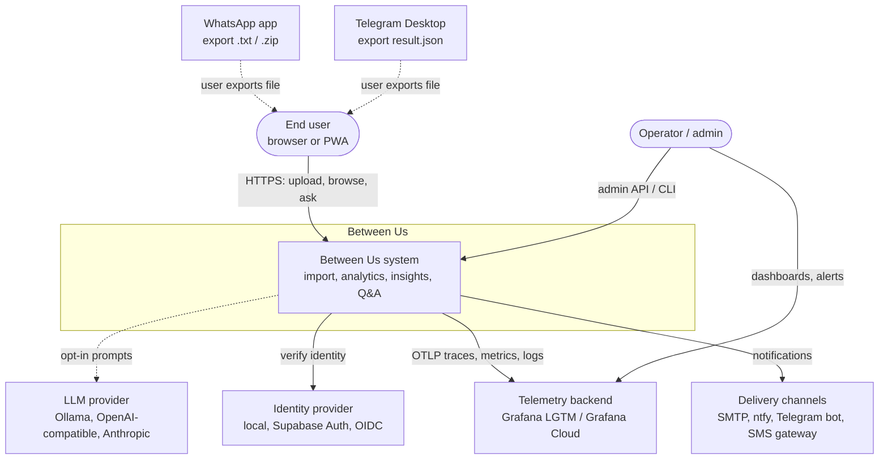

The system never talks to WhatsApp or Telegram servers in MVP; the user is the only bridge (non-goal: live sync, FR-ING-030).

## 3. Level 2 — Containers

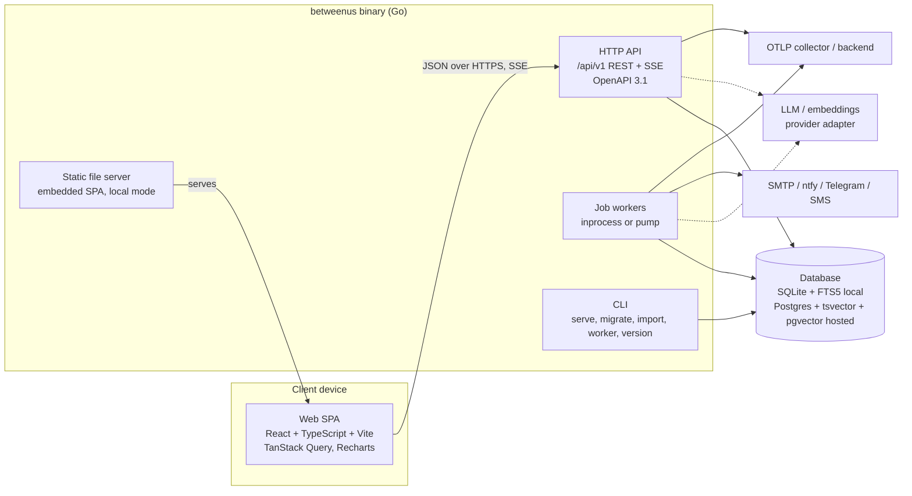

| Container | Technology | Responsibility | Scales by |
|---|---|---|---|
| Web SPA | React, TS, Vite, Tailwind, shadcn/ui, Recharts | All UI; talks only to `/api/v1` (FR-API-001). | CDN (static). |
| HTTP API | Go `net/http` (1.22 patterns), `log/slog`, OTel | Auth, tenancy, CRUD, analytics queries, Q&A streaming, job enqueue. | Stateless replicas / serverless instances. |
| Job workers | Same binary, `internal/jobs` | Import processing, rollups, insight generation, embeddings, notifications outbox, retention sweeps. | Concurrency per tenant; pump steps. |
| CLI | Same binary, subcommands | Local import, migrations, admin tasks. | n/a |
| Database | SQLite (modernc) / PostgreSQL ≥ 15 | System of record, job queue, outbox, FTS, vectors. | Vertical; free tier sizes in [§8 of data model](03-data-model.md#8-sizing-vs-free-tiers). |

## 4. Level 3 — Backend components

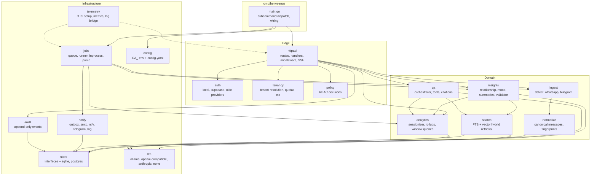

### 4.1 Package responsibilities

| Package | Responsibility | Key requirements |
|---|---|---|
| `cmd/betweenus` | Parses subcommands (`serve`, `migrate`, `import`, `worker`, `version`), loads config, builds the dependency graph explicitly (no DI framework). | §12 |
| `internal/config` | Loads `CA_*` env vars and optional `config.yaml`; validates; exposes typed `Config`. Secrets never logged. | SEC-005 |
| `internal/httpapi` | Route table (`GET /api/v1/chats/{id}/metrics`), handlers, middleware chain, problem+json errors, SSE writer, OpenAPI conformance tests. Also exports `Handler()` used by the Vercel adapter. | FR-API-001..003 |
| `internal/auth` | `AuthProvider` implementations; session cookies (local) and JWT/JWKS verification (supabase, oidc); Argon2id hashing; TOTP (P2). | MT-007, MT-008, SEC-008 |
| `internal/tenancy` | Resolves active tenant from `X-Tenant-ID`, checks membership, injects `tenancy.Scope` into `context.Context`; quota checks; sets `app.tenant_id` on Postgres connections. | MT-001..005 |
| `internal/policy` | Pure functions `Can(subject, action, resource) bool` with a role → permission matrix; single place for authorization. | MT-004 |
| `internal/ingest/detect` | Reads the first N KiB, scores candidate parsers, returns best match + confidence. | FR-ING-002 |
| `internal/ingest/whatsapp` | Streaming line parser: date-order inference, multi-line joins, system/placeholder classification, zip handling with bomb guards. | FR-ING-003..005, FR-ING-013 |
| `internal/ingest/telegram` | Streaming JSON decoder (`json.Decoder` token mode) over `messages[]`; entity flattening; service messages. | FR-ING-006 |
| `internal/normalize` | Maps parser output to canonical `Message`; participant mapping; timezone conversion; fingerprinting for dedup. | FR-ING-007..010 |
| `internal/store` | Repository interfaces + `sqlite` and `postgres` implementations; transactions; migrations (goose, embedded SQL). | NFR-REL-004 |
| `internal/analytics` | Sessionizer, per-message features (words, emoji, sentiment), daily rollup builder, window aggregation, mergeable sketches, metric registry M-001..M-027. | §7, FR-ANA-* |
| `internal/insights` | Relationship profile, mood & mind, hierarchical summaries, topic timeline; prompt templates (versioned); citation validator; cache. | FR-AI-001..007 |
| `internal/qa` | Q&A orchestrator: intent routing, read-only tenant-scoped tools, retrieval, streaming answer with citations, thread memory. | FR-AI-005, SEC-004 |
| `internal/search` | Hybrid retrieval: FTS5/`tsvector` + optional vectors (sqlite-vec / pgvector), reciprocal-rank fusion, window filter. | §8.4 |
| `internal/llm` | `LLMProvider` + `Embedder` adapters, retries, token accounting, PII redaction hook, egress allow-list. | §8.1, PRV-001, PRV-003 |
| `internal/jobs` | Job table queue (`SELECT … FOR UPDATE SKIP LOCKED` on Postgres, single-writer on SQLite), handlers registry, `inprocess` and `pump` runners, retries with backoff, per-tenant fairness. | NFR-REL-002 |
| `internal/notify` | Transactional outbox writer, delivery worker, channel adapters, templates. | FR-NOT-* |
| `internal/telemetry` | OTel SDK setup (traces, metrics, logs), `slog` handler bridging trace IDs, redaction of attributes, Prometheus `/metrics`. | NFR-OBS-001..008 |
| `internal/audit` | Append-only audit event writer and query API. | SEC-006, FR-ADM-005 |

### 4.2 Dependency rules

- `domain` packages depend on `store`/`llm` **interfaces**, never on concrete drivers.
- Only `cmd/betweenus` imports concrete implementations (`store/sqlite`, `store/postgres`, `llm/ollama`…).
- `httpapi` contains no business logic beyond validation and mapping.
- A `go vet`-style import-boundary check (e.g. `go-arch-lint` or a small test using `go/packages`) enforces this in CI.

## 5. Frontend structure

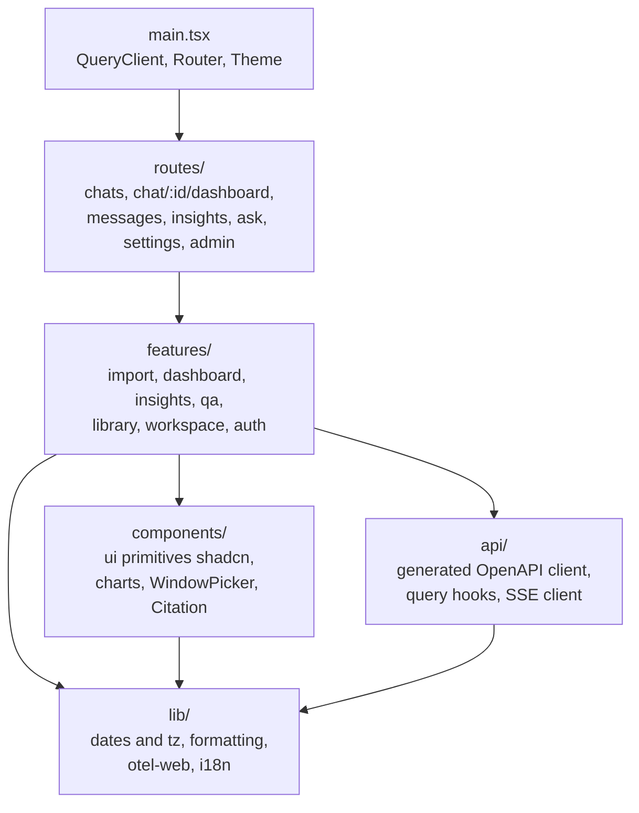

| Folder | Contents |
|---|---|
| `web/src/routes/` | Route modules (lazy loaded, NFR-PERF-004). Each route only composes features. |
| `web/src/features/` | Vertical slices: `import/` (dropzone, participant mapping, consent, import report), `dashboard/` (window state, metric cards, charts), `insights/`, `qa/` (thread UI, streaming renderer, citation chips), `library/` (chat list, virtualised message browser), `workspace/`, `auth/`. |
| `web/src/components/` | Shared presentational components; charts wrap Recharts and always offer a table fallback (NFR-UX-002). |
| `web/src/api/` | `openapi-typescript` generated types + thin fetch client; TanStack Query hooks; `EventSource`/fetch-stream SSE helper. |
| `web/src/lib/` | Window math mirroring the backend (display only — the server is authoritative), timezone helpers (`Intl`), formatting, OTel web (opt-in, NFR-OBS-007). |

**Window state** lives in the URL (`?w=month&at=2025-03&tz=Asia/Kolkata`) so every view is linkable and the back button works.

## 6. Repository layout

```text
between-us/
├── README.md                     # central entry point, links every doc
├── docs/                         # all .md documentation (this folder)
│   ├── adr/                      # architecture decision records
│   └── parsers/                  # export format specifications
├── backend/                      # Go module
│   ├── cmd/betweenus/         # main package and subcommands
│   ├── internal/
│   │   ├── config/  httpapi/  auth/  tenancy/  policy/
│   │   ├── ingest/{detect,whatsapp,telegram}/
│   │   ├── normalize/  analytics/  insights/  qa/  search/
│   │   ├── store/{sqlite,postgres}/  store/migrations/{sqlite,postgres}/
│   │   ├── llm/{ollama,openaicompat,anthropic,none}/
│   │   ├── jobs/  notify/{smtp,ntfy,telegram,smsgw,log}/
│   │   └── telemetry/  audit/
│   ├── api/openapi.yaml          # API contract (FR-API-001)
│   ├── vercel/                   # thin Vercel Go Function adapter (api/index.go)
│   ├── testdata/fixtures/        # synthetic exports only (NFR-MNT-002)
│   └── webdist/                  # embed target populated by the web build
├── web/                          # React + TS + Vite app
│   └── src/{routes,features,components,api,lib}/
├── deploy/
│   ├── compose/                  # docker-compose: postgres, otel-lgtm, mailpit, ollama
│   ├── grafana/{dashboards,alerts}/
│   ├── vercel/                   # vercel.json, build scripts
│   └── docker/                   # Dockerfile for container hosts
├── scripts/                      # dev helpers (fixture generation, codegen)
└── .github/workflows/            # CI: lint, test, scan, build, release
```

## 7. Request lifecycle

Every API request passes the same middleware chain (outermost first):

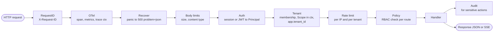

| Step | Notes |
|---|---|
| RequestID | Accepts an incoming ID only from trusted proxies; otherwise generates ULID. |
| OTel | `otelhttp`-style server span, route template as span name (never raw path with IDs), RED metrics (NFR-OBS-002). |
| Recover | Converts panics to RFC 9457 `application/problem+json`; records error on span. |
| Body limits | Per-route max body (uploads streamed with a hard cap); MIME sniffing (SEC-003). |
| Auth | Produces `auth.Principal{UserID, Provider, AMR}`; public routes (`/healthz`, `/readyz`, `/version`, auth endpoints) skip it. |
| Tenant | Local mode injects the single implicit tenant (FR-ADM-001). Postgres: `SET LOCAL app.tenant_id` inside the request transaction (MT-002). |
| Rate limit | Token buckets in memory (single instance) or DB-backed counters (serverless). |
| Policy | Route declares required permission, e.g. `chat:import`. |

## 8. Key runtime flows

### 8.1 Import (FR-ING-001..014)

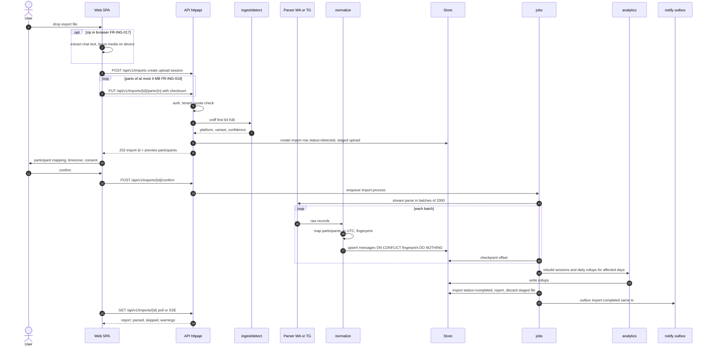

Notes:
- Uploads are chunked and resumable (FR-ING-016) because Vercel Functions cap request bodies at ~4.5 MB; in local mode the same API is used but parts can be large. Detection runs once the first part arrives.
- The staged upload lives in a temp file (local) or a DB large-object / short-TTL storage bucket (hosted), and is deleted after processing (FR-ING-014, [ADR-0010](adr/0010-raw-exports-not-persisted.md)).
- Messages become visible only when the import is `completed`; queries filter `import.status` via the chat's `visible_through_import_id` (NFR-REL-002).
- Checkpoints make the job resumable; in `pump` mode each step processes as many batches as fit the time budget.

### 8.2 Dashboard window query (FR-ANA-001..005)

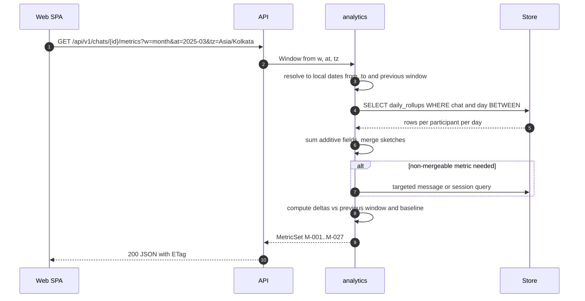

Daily rollups make any window O(days) instead of O(messages) ([ADR-0007](adr/0007-daily-rollups.md)).

### 8.3 Insight generation with cache (FR-AI-001..006)

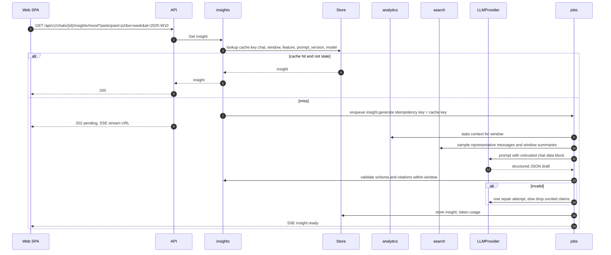

With `BU_LLM_PROVIDER=none` the same path produces deterministic insights (FR-AI-007).

### 8.4 Q&A with tool routing and SSE (FR-AI-005)

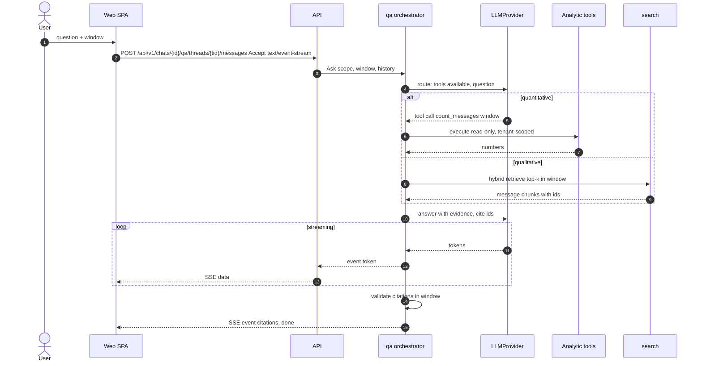

The LLM can only call read-only tools that receive the tenant scope from context, never from model output (SEC-004).

### 8.5 Pump-mode job execution on serverless

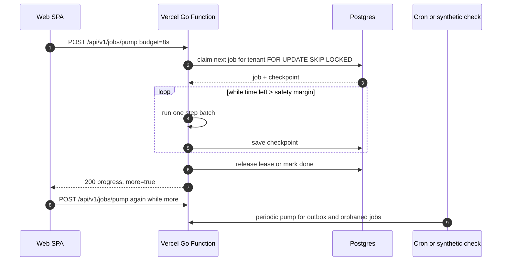

## 9. Key interfaces

All interfaces live next to their consumers in `internal/…` and take `context.Context` first. Snippets are illustrative; the code is the source of truth once written.

```go
// Package ingest defines how chat export formats are recognised and parsed.
package ingest

// Detection is the result of sniffing an export's leading bytes.
type Detection struct {
	Platform   Platform // PlatformWhatsApp or PlatformTelegram
	Variant    string   // e.g. "whatsapp-android-dmy-24h", "telegram-json"
	Confidence float64  // 0..1; values below 0.6 are reported as "unrecognised"
}

// Parser converts one export format into a stream of raw records.
// Implementations must be streaming (FR-ING-013): memory use is bounded by
// the batch size, never by the file size.
type Parser interface {
	// Name is a stable identifier used in import reports and metrics.
	Name() string
	// Sniff inspects up to the first 64 KiB and scores how likely this parser
	// can handle the input. It must not consume the underlying reader.
	Sniff(head []byte) Detection
	// Parse reads the export and calls emit for every record in file order.
	// Unparseable lines are reported via emit with Kind=RecordSkipped so the
	// import report can list them (FR-ING-011).
	Parse(ctx context.Context, r io.Reader, opts ParseOptions, emit func(RawRecord) error) error
}
```

```go
// Package store holds persistence interfaces. Every method takes a
// tenancy.Scope (via ctx) and must filter by tenant_id (MT-001).
package store

// Store is the aggregate of repositories plus transaction control.
type Store interface {
	// InTx runs fn in a transaction. On Postgres it also executes
	// SET LOCAL app.tenant_id so RLS policies apply (MT-002).
	InTx(ctx context.Context, fn func(ctx context.Context, tx Tx) error) error
	Chats() ChatRepo
	Messages() MessageRepo
	Rollups() RollupRepo
	Insights() InsightRepo
	Jobs() JobRepo
	Outbox() OutboxRepo
	Audit() AuditRepo
	// Ping reports readiness for /readyz (NFR-OBS-004).
	Ping(ctx context.Context) error
	Close() error
}

// MessageRepo stores canonical messages.
type MessageRepo interface {
	// UpsertBatch inserts messages, skipping ones whose fingerprint already
	// exists in the chat (FR-ING-010). Returns the number actually inserted.
	UpsertBatch(ctx context.Context, chatID ID, msgs []Message) (int, error)
	// Range streams messages of a chat in [from, to) ordered by sent_at, ordinal.
	Range(ctx context.Context, chatID ID, from, to time.Time, fn func(Message) error) error
	// Search runs full-text search inside a window and returns ranked IDs.
	Search(ctx context.Context, chatID ID, q string, w Window, limit int) ([]Hit, error)
}
```

```go
// Package llm abstracts chat-completion and embedding providers so the
// product stays local-first and vendor-neutral (ADR-0005).
package llm

// Provider generates text. Implementations: ollama, openaicompat, anthropic, none.
type Provider interface {
	// Name returns e.g. "ollama:llama3.1:8b" for cache keys and telemetry.
	Name() string
	// Complete runs one request. When req.Stream is set, onToken receives
	// deltas as they arrive; the final Response is returned either way.
	Complete(ctx context.Context, req Request, onToken func(string)) (Response, error)
	// Capabilities reports tool calling, JSON mode and context window so the
	// orchestrator can choose a strategy.
	Capabilities() Capabilities
}

// Embedder turns text into vectors for semantic search. Optional: when nil,
// search falls back to full-text only.
type Embedder interface {
	Name() string
	Dimensions() int
	Embed(ctx context.Context, texts []string) ([][]float32, error)
}
```

```go
// Package notify delivers notifications through pluggable channels.
package notify

// Notifier sends one rendered notification over a single channel.
// Delivery is driven by the outbox worker, which handles retries; Send must
// be idempotent for the same msg.IdempotencyKey where the channel allows.
type Notifier interface {
	Channel() Channel // ChannelEmail, ChannelNtfy, ChannelTelegram, ChannelSMS, ChannelLog
	Send(ctx context.Context, msg Message) error
}
```

```go
// Package auth authenticates requests. Implementations: local, supabase, oidc.
package auth

// Provider turns credentials on a request into a Principal.
type Provider interface {
	Name() string
	// Authenticate returns ErrUnauthenticated when no valid credentials are
	// present; it never returns a partially populated Principal.
	Authenticate(ctx context.Context, r *http.Request) (Principal, error)
	// Routes mounts provider-specific endpoints (login, callback, logout).
	Routes(mux *http.ServeMux)
}
```

```go
// Package jobs runs durable background work stored in the jobs table.
package jobs

// Handler executes one step of a job and returns the next checkpoint.
// Done=true finishes the job. Handlers must be idempotent per step.
type Handler interface {
	Kind() string // e.g. "import.process", "insight.generate", "outbox.deliver"
	Step(ctx context.Context, job Job) (StepResult, error)
}

// Runner decides when steps execute.
//   - inprocess: goroutine pool polls the queue (local, container hosts).
//   - pump: steps run inside an HTTP request until the budget is spent
//     (serverless hosts with time limits, ADR-0004).
type Runner interface {
	Start(ctx context.Context) error
	// Pump runs steps until budget elapses; returns whether work remains.
	Pump(ctx context.Context, budget time.Duration) (more bool, err error)
}
```

## 10. Jobs: in-process and pump modes

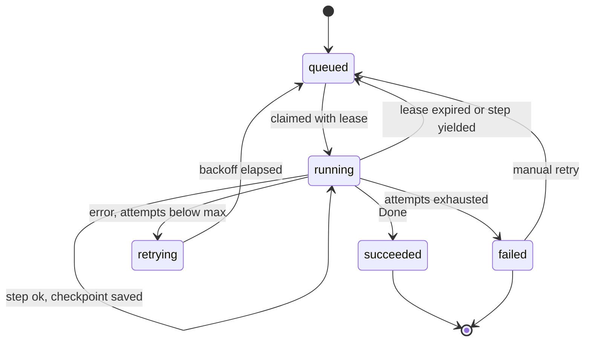

| Aspect | `inprocess` | `pump` |
|---|---|---|
| Where | `serve` or `worker` process | Inside `/api/v1/jobs/pump` requests |
| Trigger | Poll every 500 ms + `LISTEN/NOTIFY` (Postgres) | Client polling during active imports; synthetic check (every 60 s) and the daily Vercel cron for background kinds such as the outbox and retention |
| Concurrency | `BU_JOBS_CONCURRENCY` workers, max per tenant `BU_JOBS_PER_TENANT` | One job per request; fairness by oldest-per-tenant claim |
| Time limit | none (per-step timeout) | `BU_PUMP_BUDGET_MS` (default 20 s) below the platform limit |
| Leases | `lease_until` renewed per step | Same; expired leases are reclaimed |

## 11. Deployment profiles

Details, limits and step-by-step guides: [07-deployment.md](07-deployment.md).

### 11.1 `local` — single binary (default)

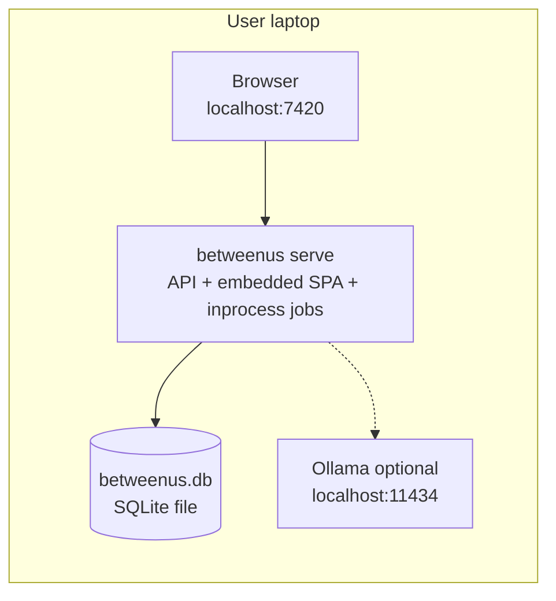

Zero external services; telemetry to stdout or disabled (NFR-OBS-008); no outbound calls (PRV-001).

### 11.2 `local-full` — Docker Compose

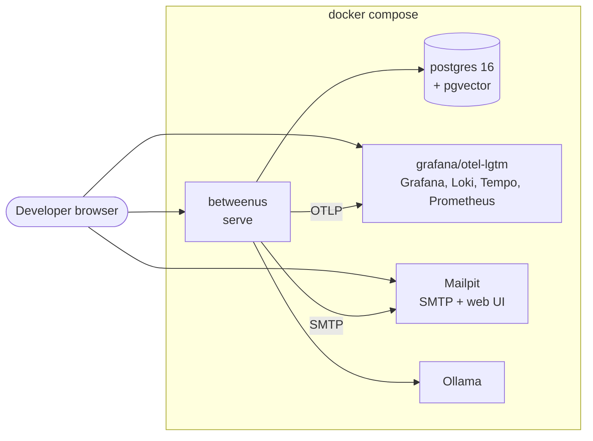

Mirrors the hosted topology for development, integration tests (RLS, outbox) and dashboard work.

### 11.3 `cloud-free` — $0 reference deployment

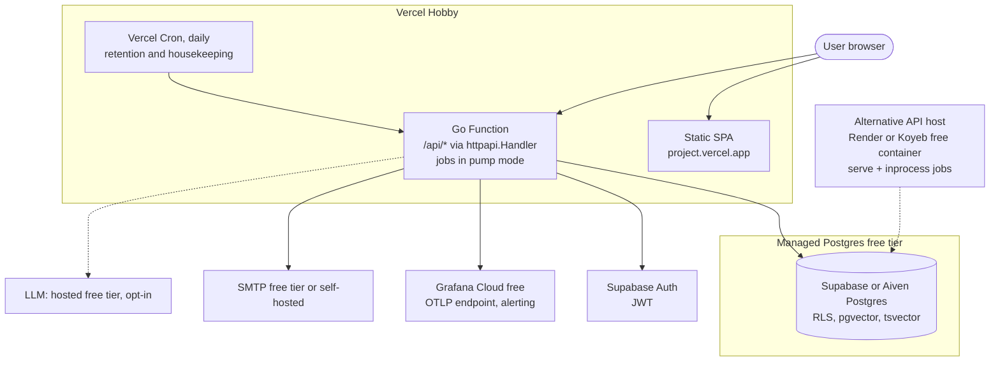

The same `httpapi.Handler()` serves both the Vercel adapter (`backend/vercel/api/index.go`) and `betweenus serve`.

## 12. Configuration model

12-factor: all configuration via environment variables with prefix `CA_`; local mode may also read `config.yaml` (env wins). `.env.example` documents every variable (SEC-005). The **authoritative variable reference** (defaults per profile) is [07-deployment.md §8](07-deployment.md#8-environment-variable-reference); this table lists the ones most relevant to the component design.

| Variable | Default | Description |
|---|---|---|
| `BU_PROFILE` | `local` | Preset (`local`, `local-full`, `cloud-free`, `cloud-free-container`) that sets safe defaults for everything below. |
| `BU_MODE` | from profile | `local` (single implicit tenant/user) or `hosted` (multi-tenant). |
| `BU_HTTP_ADDR` | `127.0.0.1:7420` | Listen address for `serve`. Local binds loopback only. |
| `BU_PUBLIC_BASE_URL` | `http://127.0.0.1:7420` | Public URL for links in notifications and OIDC callbacks. |
| `BU_DB_DRIVER` | `sqlite` | `sqlite` or `postgres`. |
| `BU_DB_DSN` | `file:betweenus.db?_pragma=journal_mode(WAL)` | Driver DSN. Postgres: use the pooler URL on Supabase. |
| `BU_DB_MAX_CONNS` | `5` | Pool size; keep low on free tiers. |
| `BU_MIGRATE_ON_START` | `true` | Run goose migrations at startup. |
| `BU_AUTH_PROVIDER` | `local` | `local`, `supabase`, `oidc`. |
| `BU_SUPABASE_URL` / `BU_SUPABASE_JWKS_URL` | — | JWKS source for JWT verification. |
| `BU_OIDC_ISSUER`, `BU_OIDC_CLIENT_ID`, `BU_OIDC_CLIENT_SECRET` | — | Generic OIDC. |
| `BU_SESSION_SECRET` | generated on first run (local) | HMAC key for session cookies; required in hosted mode. |
| `BU_LLM_PROVIDER` | `none` | `none`, `ollama`, `openai-compatible`, `anthropic`. |
| `BU_LLM_BASE_URL` | `http://localhost:11434` | Provider endpoint. |
| `BU_LLM_MODEL` | — | Chat model name. |
| `BU_LLM_API_KEY` | — | Secret for hosted providers. |
| `BU_EMBED_PROVIDER` / `BU_EMBED_MODEL` | `none` | Embeddings; `none` means FTS-only search. |
| `BU_LLM_REDACT_PII` | `true` | Redact PII before hosted LLM calls (PRV-003). |
| `BU_EGRESS_ALLOWLIST` | derived | Hosts the process may call; empty in pure local mode (PRV-001). |
| `BU_JOBS_MODE` | `inprocess` | `inprocess` or `pump`. |
| `BU_JOBS_CONCURRENCY` / `BU_JOBS_PER_TENANT` | `4` / `2` | Worker limits. |
| `BU_PUMP_BUDGET_MS` | `20000` | Max work per pump request (well under Vercel Hobby's 300 s cap). |
| `BU_UPLOAD_MAX_BYTES` | `524288000` | Upload cap (500 MB). |
| `BU_KEEP_RAW_EXPORTS` | `false` | FR-ING-014 opt-in. |
| `BU_OTEL_ENABLED` | `false` (local) | Enable OTLP export. |
| `OTEL_EXPORTER_OTLP_ENDPOINT`, `OTEL_EXPORTER_OTLP_HEADERS`, `OTEL_SERVICE_NAME` | — | Standard OTel variables (not prefixed, per spec). |
| `BU_METRICS_ADDR` | — | Optional separate Prometheus `/metrics` listener. |
| `BU_LOG_LEVEL` / `BU_LOG_FORMAT` | `info` / `json` | `text` for local dev. |
| `BU_NOTIFY_CHANNELS` | `log` | Comma list of channels: `email,push,telegram,sms,log`; `BU_EMAIL_TRANSPORT` picks `smtp` or `api` (see [09-notifications.md](09-notifications.md)). |
| `BU_SMTP_HOST`, `BU_SMTP_PORT`, `BU_SMTP_USERNAME`, `BU_SMTP_PASSWORD`, `BU_SMTP_TLS`, `BU_EMAIL_FROM` | — | SMTP adapter. |
| `BU_NTFY_URL`, `BU_TELEGRAM_BOT_TOKEN`, `BU_SMS_GATEWAY_URL` | — | Other channels (P2/P3); ntfy topics are generated per user. |
| `BU_QUOTA_CHATS`, `BU_QUOTA_MESSAGES`, `BU_QUOTA_LLM_TOKENS_MONTH` | `5`, `500000`, `2000000` | Default per-tenant quotas (MT-005). |
| `BU_RATE_LIMIT_RPS` | `10` | Per-tenant request rate. |

## 13. Cross-cutting concerns

| Concern | Approach |
|---|---|
| Errors | Domain errors (`ErrNotFound`, `ErrForbidden`, `ErrQuotaExceeded`…) mapped to problem+json in one place; never leak SQL or message content. |
| Idempotency | `Idempotency-Key` header on mutating POSTs stored 24 h; job and outbox idempotency keys. |
| Time | All timestamps stored UTC; local calendar dates computed with the chat's IANA tz (`time.LoadLocation`, tzdata embedded via `time/tzdata`). |
| Pagination | Cursor-based (`after=<sent_at,ordinal>`). |
| Caching | ETags on metric responses (hash of rollup version + params); insight cache in DB. |
| Security | See [08-security-privacy.md](08-security-privacy.md): CSP, CSRF (double-submit for cookie auth), upload guards, RLS, envelope encryption (P2). |
| Observability | See [06-observability.md](06-observability.md): span per job step, per LLM call (tokens as attributes, no prompt text), per notification. |
| Testing | Unit + golden fixtures; store contract tests run against both SQLite and Postgres; tenant-isolation suite; OpenAPI conformance; Playwright smoke for the SPA. |

## 14. Extension points

| Extension | How |
|---|---|
| New chat platform | Implement `ingest.Parser`, register in `detect`, add fixtures and a `docs/parsers/<platform>.md` spec (FR-ING-021). |
| Media analysis (P3) | New job kinds (`media.caption`, `media.transcribe`) producing `message_events`/annotations consumed by analytics and insights. |
| New metric | Add to the analytics metric registry with ID `M-0xx`, rollup fields (if additive) or sketch, catalog entry in [04-metrics-catalog.md](04-metrics-catalog.md). |
| New LLM provider | Implement `llm.Provider` (+ `Embedder`), add to egress allow-list rules and docs. |
| New notification channel | Implement `notify.Notifier`; register via `BU_NOTIFY_CHANNELS`. |
| New auth provider | Implement `auth.Provider`. |
