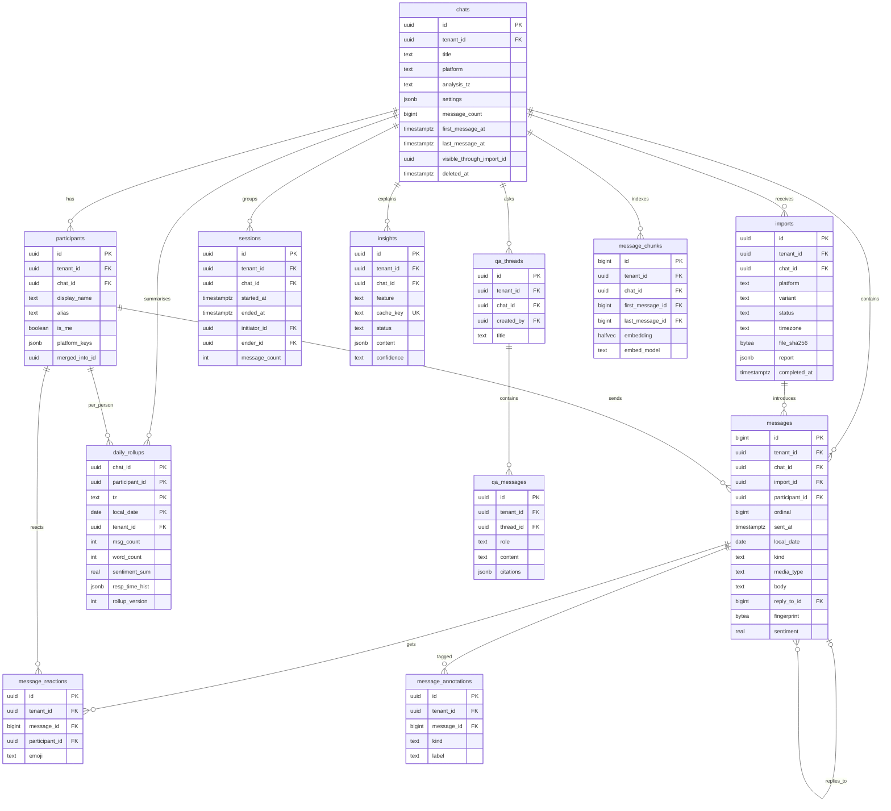
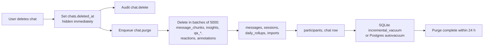

# Chat Analyzer — Data Model

| Field | Value |
|---|---|
| Document | Logical and physical data model (SQLite + PostgreSQL) |
| Status | **Draft v0.1 — for review** |
| Date | 2026-10-24 |
| Owner | Product owner (repo owner) |
| Related | [Requirements](01-requirements.md) · [Architecture](02-architecture.md) · [Metrics catalog](04-metrics-catalog.md) · [AI insights](05-ai-insights.md) · [Observability](06-observability.md) · [Deployment](07-deployment.md) · [Security & privacy](08-security-privacy.md) · [Notifications](09-notifications.md) · [Roadmap](10-roadmap.md) · [WhatsApp format](parsers/whatsapp.md) · [Telegram format](parsers/telegram.md) · [ADRs](adr/README.md) |

> Two physical dialects implement one logical model behind the `store` interface
> ([ADR-0003](adr/0003-sqlite-local-postgres-hosted.md)). Tenant isolation is enforced in the repository
> layer everywhere and additionally by Postgres Row-Level Security ([ADR-0008](adr/0008-multi-tenancy-tenant-id-rls.md)).

---

## Table of contents

1. [Conventions](#1-conventions)
2. [Canonical message schema](#2-canonical-message-schema)
3. [Entity-relationship diagrams](#3-entity-relationship-diagrams)
4. [Tables](#4-tables)
5. [Search: full-text and vectors](#5-search-full-text-and-vectors)
6. [Tenant isolation](#6-tenant-isolation)
7. [Deduplication, deletion and retention](#7-deduplication-deletion-and-retention)
8. [Sizing vs free tiers](#8-sizing-vs-free-tiers)
9. [Migrations](#9-migrations)
10. [Known tensions](#10-known-tensions)

---

## 1. Conventions

| Topic | Rule |
|---|---|
| IDs | `uuid` (UUIDv7, time-ordered) for most entities; `bigint` identity for high-volume rows (`messages`, `audit_log`, `message_chunks`) to save space. IDs are opaque strings in the API. |
| Tenant column | Every tenant-owned table has `tenant_id NOT NULL` as a real column (denormalised even when derivable through `chat_id`) so RLS policies are a single equality check (MT-001, MT-002). |
| Time | Instants are UTC: Postgres `timestamptz`, SQLite `INTEGER` Unix **milliseconds**. Calendar days are `date` / `TEXT 'YYYY-MM-DD'` computed in the chat's analysis timezone. |
| Enums | `text` with `CHECK` constraints (portable across dialects, easy to extend). |
| JSON | Postgres `jsonb`; SQLite `TEXT` validated with `json_valid()`. Used only for flexible, non-queried payloads. |
| Soft vs hard delete | `deleted_at` marks rows hidden immediately; a purge job hard-deletes (§7). |
| Naming | `snake_case`, plural table names, `*_at` for instants, `*_date` for calendar days, `*_count` for counters. |
| Schema | Postgres objects live in schema `app` (not `public`) so Supabase's auto-generated Data API does not expose them. |

### 1.1 Type mapping

| Logical | PostgreSQL | SQLite |
|---|---|---|
| uuid | `uuid` | `TEXT` (36 chars) |
| bigint id | `bigint GENERATED ALWAYS AS IDENTITY` | `INTEGER PRIMARY KEY` (rowid alias) |
| instant | `timestamptz` | `INTEGER` (Unix ms) |
| calendar day | `date` | `TEXT` (`YYYY-MM-DD`) |
| text | `text` | `TEXT` |
| bool | `boolean` | `INTEGER` (0/1) |
| real | `real` / `double precision` | `REAL` |
| json | `jsonb` | `TEXT` + `CHECK (json_valid(col))` |
| bytes | `bytea` | `BLOB` |
| int array (histograms) | `integer[]` | `TEXT` (JSON array) |
| vector | `halfvec(384)` (pgvector ≥ 0.7) | `BLOB` (little-endian float32) |
| full-text | `tsvector` generated column + GIN | FTS5 external-content virtual table |

## 2. Canonical message schema

All parsers emit raw records; `internal/normalize` converts them to this platform-neutral shape (FR-ING-007).

```go
// Message is the canonical, platform-neutral representation of one chat item.
// Exactly one row exists per logical message per chat; re-imports are
// de-duplicated through Fingerprint (FR-ING-010).
type Message struct {
	ID            int64     // surrogate key, assigned by the store
	TenantID      uuid.UUID // owning tenant (MT-001)
	ChatID        uuid.UUID
	ImportID      uuid.UUID // import that first introduced the message
	ParticipantID *uuid.UUID // nil for system events
	Ordinal       int64     // position within the chat, stable tie-breaker for equal SentAt
	SentAt        time.Time // UTC instant
	LocalDate     civil.Date // calendar day in the chat's analysis timezone
	Kind          Kind      // text | media | call | location | contact | poll | deleted | system
	MediaType     MediaType // "" | image | video | video_note | voice_note | audio | sticker | gif | document | contact | unknown
	EventType     string    // for Kind=system/call: e.g. "encryption_notice", "missed_voice_call"
	Body          string    // normalised text (NFC, invisible marks removed); empty for pure media
	ReplyToID     *int64    // Telegram reply_to_message_id resolved to our ID
	IsEdited      bool
	IsForwarded   bool      // excluded from sentiment and mood features (they are not the sender's words)
	PlatformMsgID string    // Telegram message id; empty for WhatsApp
	Fingerprint   [32]byte  // sha256, see §7.1
	Features      Features  // per-message derived values used by rollups
	Meta          map[string]any // platform extras kept for future use (entities, forwarded_from…)
}

// Features are computed once at import and stored on the row so rollups can be
// rebuilt without re-tokenising text.
type Features struct {
	CharCount, WordCount, EmojiCount int
	LinkCount, QuestionMarks         int
	Sentiment                        float32 // lexicon compound score in [-1, 1] (M-022)
	Affection, Conflict              bool    // lexicon hits (M-023, M-024)
	Emotion                          string  // per-message emotion label, filled by the insight engine (05-ai-insights.md)
}
```

## 3. Entity-relationship diagrams

### 3.1 Identity, tenancy and operations

```mermaid
erDiagram
    tenants ||--o{ memberships : has
    users ||--o{ memberships : joins
    users ||--o{ user_sessions : opens
    tenants ||--|| tenant_quotas : limits
    tenants ||--o{ usage_counters : meters
    tenants ||--o{ audit_log : records
    tenants ||--o{ jobs : queues
    tenants ||--o{ notifications_outbox : emits
    users ||--o{ notifications_outbox : receives
    tenants ||--o{ api_keys : issues
    tenants ||--o{ llm_usage : spends
    tenants ||--o{ tenant_keys : encrypts

    tenants {
        uuid id PK
        text name
        text slug UK
        text plan
        text status
        jsonb settings
        timestamptz created_at
        timestamptz deleted_at
    }
    users {
        uuid id PK
        text email UK
        text display_name
        text auth_provider
        text auth_subject
        text password_hash
        timestamptz last_login_at
    }
    memberships {
        uuid tenant_id PK
        uuid user_id PK
        text role
        timestamptz created_at
    }
    user_sessions {
        uuid id PK
        uuid user_id FK
        bytea token_hash UK
        timestamptz expires_at
    }
    tenant_quotas {
        uuid tenant_id PK
        int max_chats
        bigint max_messages
        bigint max_llm_tokens_month
        bigint max_storage_bytes
    }
    usage_counters {
        uuid tenant_id PK
        text period PK
        text metric PK
        bigint value
    }
    audit_log {
        bigint id PK
        uuid tenant_id FK
        uuid actor_user_id
        text action
        text target_type
        text target_id
        text trace_id
        timestamptz created_at
    }
    jobs {
        uuid id PK
        uuid tenant_id FK
        text kind
        text status
        jsonb checkpoint
        int attempts
        timestamptz run_after
        timestamptz lease_until
        text idempotency_key UK
    }
    notifications_outbox {
        uuid id PK
        uuid tenant_id FK
        uuid user_id FK
        text event_type
        text channel
        text status
        text idempotency_key UK
        timestamptz next_attempt_at
    }
    api_keys {
        uuid id PK
        uuid tenant_id FK
        text prefix UK
        bytea secret_hash
        text scopes
        timestamptz revoked_at
    }
    llm_usage {
        bigint id PK
        uuid tenant_id FK
        text feature
        text model
        int tokens_in
        int tokens_out
        timestamptz created_at
    }
    tenant_keys {
        uuid tenant_id PK
        int version PK
        bytea wrapped_dek
        text kek_id
    }
```



### 3.2 Chat domain



## 4. Tables

Column lists are given in Postgres types; SQLite follows [§1.1](#11-type-mapping). `tenant_id` and `created_at`/`updated_at` are present on every tenant-owned table and omitted below unless notable.

### 4.1 Identity and tenancy

**`tenants`** — the isolation boundary (MT-001).

| Column | Type | Notes |
|---|---|---|
| `id` | uuid PK | |
| `name` | text NOT NULL | |
| `slug` | text UNIQUE | URL-safe |
| `plan` | text | `free` default; drives default quotas |
| `status` | text CHECK in (`active`,`suspended`,`pending_deletion`) | MT-009 |
| `settings` | jsonb | retention days, allowed LLM providers, default tz, store-question-text flag (FR-ADM-004, FR-ADM-005) |
| `deleted_at` | timestamptz | start of 30-day grace (MT-009) |

**`users`** — global (a user can join many tenants, MT-003). Not tenant-scoped; protected by a user-scoped policy.

| Column | Type | Notes |
|---|---|---|
| `id` | uuid PK | |
| `email` | text UNIQUE (case-insensitive: `citext` or lower() index) | |
| `display_name` | text | |
| `auth_provider` | text CHECK in (`local`,`supabase`,`oidc`) | MT-007 |
| `auth_subject` | text | `sub` claim; UNIQUE (`auth_provider`, `auth_subject`) |
| `password_hash` | text NULL | Argon2id PHC string; local provider only |
| `mfa_secret_enc` | bytea NULL | TOTP secret, encrypted (P2, MT-008) |
| `last_login_at` | timestamptz | |

**`memberships`** — PK (`tenant_id`, `user_id`); `role` CHECK in (`owner`,`admin`,`analyst`,`viewer`) (MT-004).

**`user_sessions`** — local-auth sessions: `id`, `user_id`, `token_hash` (sha256 of cookie token, UNIQUE), `expires_at`, `ip_hash`, `user_agent_hash`, `revoked_at`.

**`tenant_quotas`** — PK `tenant_id`; `max_chats`, `max_messages`, `max_llm_tokens_month`, `max_storage_bytes` (MT-005, NFR-COST-003). **`usage_counters`** — PK (`tenant_id`, `period` `YYYY-MM`, `metric`), `value bigint`; incremented transactionally.

**`api_keys`** (P2, FR-API-004) — `prefix` (UNIQUE, shown to user), `secret_hash` (sha256), `scopes text[]`, `user_id`, `last_used_at`, `expires_at`, `revoked_at`.

**`tenant_keys`** (P2, MT-006) — PK (`tenant_id`, `version`); `wrapped_dek bytea` (DEK encrypted by KEK), `kek_id` (key reference in env/KMS), `rotated_at`.

### 4.2 Chat domain

**`chats`**

| Column | Type | Notes |
|---|---|---|
| `id` | uuid PK | |
| `title` | text | defaults to "A & B" |
| `platform` | text CHECK in (`whatsapp`,`telegram`) | |
| `analysis_tz` | text NOT NULL | IANA name, e.g. `Asia/Kolkata` (FR-ING-009) |
| `settings` | jsonb | analysis settings: session gap (default 6 h), week start, late-night hours, `text_languages` (default `["en","hi-Latn"]`) — full list in [04-metrics-catalog.md](04-metrics-catalog.md) (FR-ANA-006) |
| `cover` | jsonb | emoji/colour (FR-LIB-002) |
| `message_count` | bigint | maintained on import completion |
| `first_message_at`, `last_message_at` | timestamptz | |
| `visible_through_import_id` | uuid NULL | last completed import; messages from later imports are hidden until they complete (NFR-REL-002) |
| `rollup_version` | int | bumped when settings/tz change → rebuild job |
| `created_by` | uuid FK users | |
| `archived_at`, `deleted_at` | timestamptz | |

**`participants`**

| Column | Type | Notes |
|---|---|---|
| `id` | uuid PK | |
| `chat_id` | uuid FK chats ON DELETE CASCADE | |
| `display_name` | text | as in export |
| `alias` | text NULL | user rename (FR-ING-008) |
| `is_me` | boolean | at most one per chat (partial unique index) |
| `platform_keys` | jsonb | all raw sender strings / Telegram `from_id`s mapped here (merging) |
| `merged_into_id` | uuid NULL FK participants | merge history |
| `color` | text | UI |

**`imports`**

| Column | Type | Notes |
|---|---|---|
| `id` | uuid PK | |
| `chat_id` | uuid FK NULL | NULL until participants confirmed for a new chat |
| `created_by` | uuid FK users | |
| `platform`, `variant` | text | from detection (FR-ING-002) |
| `status` | text CHECK in (`uploaded`,`detected`,`confirmed`,`processing`,`completed`,`failed`,`cancelled`) | |
| `timezone` | text | tz used to interpret naive WhatsApp times |
| `time_precision` | text CHECK in (`second`,`minute`) | Android WhatsApp headers lack seconds ([metrics R-19](04-metrics-catalog.md)) |
| `file_size` | bigint | |
| `file_sha256` | bytea | detect identical re-uploads; the file itself is not kept (FR-ING-014) |
| `staged_ref` | text NULL | temp location while processing; cleared after |
| `report` | jsonb | parsed/skipped counts, skipped line numbers + reasons, date format, warnings (FR-ING-011) |
| `inserted_count`, `duplicate_count` | int | |
| `job_id` | uuid FK jobs | |
| `error` | text NULL | user-safe message |
| `started_at`, `completed_at` | timestamptz | |

**`messages`** — the largest table.

| Column | Type | Notes |
|---|---|---|
| `id` | bigint identity PK | |
| `chat_id` | uuid FK chats ON DELETE CASCADE | |
| `import_id` | uuid FK imports | first import that contained it |
| `participant_id` | uuid FK NULL | NULL for system events |
| `ordinal` | bigint | monotonically increasing per chat |
| `sent_at` | timestamptz | UTC |
| `local_date` | date | in `chats.analysis_tz` |
| `kind` | text CHECK | see §2 |
| `media_type` | text NULL | |
| `event_type` | text NULL | |
| `body` | text NULL | plaintext MVP; P2 adds `body_enc bytea` + `dek_version int` (SEC-002) |
| `reply_to_id` | bigint NULL FK messages | |
| `is_edited`, `is_forwarded`, `is_deleted_marker` | boolean | M-020 |
| `platform_msg_id` | text NULL | |
| `fingerprint` | bytea NOT NULL | UNIQUE (`chat_id`, `fingerprint`) |
| `char_count`, `word_count`, `emoji_count`, `link_count` | int | per-message features |
| `sentiment` | real | M-022 |
| `emotion`, `emotion_intensity`, `emotion_source`, `emotion_version` | text, real, text, text | per-message emotion (lexicon or LLM), see [05-ai-insights.md](05-ai-insights.md) |
| `flags` | smallint | bit set: question, affection, conflict, late_night, all_caps |
| `meta` | jsonb NULL | entities, forwarded_from, sticker emoji… |
| `search` | tsvector GENERATED (Postgres only) | §5 |

**`message_reactions`** — `message_id` FK CASCADE, `participant_id`, `emoji`, `reacted_at` (Telegram `reactions`; WhatsApp exports do not include reactions).

**`message_annotations`** — bookmarks/tags (FR-LIB-005, P2) and future media captions/transcripts (P3): `message_id`, `kind` CHECK in (`bookmark`,`tag`,`caption`,`transcript`), `label`, `body`, `created_by`.

**`sessions`** — derived by the sessionizer (M-007..M-012): `started_at`, `ended_at`, `first_message_id`, `last_message_id`, `initiator_id`, `ender_id`, `message_count`, `turn_count`, `gap_before_seconds`, `local_date_start`, `rollup_version`.

**`daily_rollups`** — the analytics foundation ([ADR-0007](adr/0007-daily-rollups.md)). PK (`chat_id`, `tz`, `local_date`, `participant_id`); the primary set uses `chats.analysis_tz`, other timezones are built lazily. The authoritative column list is in [04-metrics-catalog.md](04-metrics-catalog.md); the summary below groups it.

| Column group | Columns | Metrics served |
|---|---|---|
| Volume | `msg_count`, `word_count`, `char_count`, `emoji_count` | M-001..M-004 |
| Media & markers | `media_image`, `media_video`, `media_audio`, `media_voice`, `media_sticker`, `media_gif`, `media_document`, `media_other`, `link_count`, `question_count`, `deleted_count`, `edited_count`, `call_count` | M-017..M-021 |
| Rhythm | `hour_hist integer[24]`, `late_night_count`, `first_msg_minute`, `last_msg_minute` | M-013, M-014 |
| Conversation | `sessions_initiated`, `sessions_ended`, `turns`, `double_texts`, `replies`, `reply_opportunities` | M-008, M-009, M-011, M-012 |
| Response time | `resp_time_hist jsonb` (log-spaced buckets, mergeable), `resp_time_sum_s`, `resp_time_n` | M-010 (median/p90 from merged histogram) |
| Sentiment | `sentiment_sum`, `sentiment_n`, `sentiment_pos`, `sentiment_neu`, `sentiment_neg`, `affection_count`, `conflict_count`, `emotion_counts jsonb` | M-022..M-024, mood and mind |
| Top-N | `top_emoji jsonb`, `top_terms jsonb` (bounded top-K with counts, merged approximately) | M-015, M-016 |
| Bookkeeping | `rollup_version`, `computed_at` | |

Combined (both participants) and chat-level metrics (M-004..M-007, M-025..M-027) are computed from these rows plus `sessions` at query time.

**`insights`** — cached AI and rule-based outputs (FR-AI-006).

| Column | Type | Notes |
|---|---|---|
| `id` | uuid PK | |
| `chat_id` | uuid FK CASCADE | |
| `feature` | text | `relationship`, `mood`, `summary`, `topics`, `events` |
| `participant_id` | uuid NULL | for per-person features |
| `window_kind` | text | `day`,`week`,`month`,`year`,`all`,`custom` |
| `window_from`, `window_to` | date | local, half-open |
| `tz` | text | |
| `prompt_version`, `model` | text | `model` = `none` for deterministic |
| `cache_key` | text UNIQUE | sha256 of (chat, window, tz, feature, participant, prompt_version, model, rollup_version) |
| `status` | text | `pending`,`ready`,`failed` |
| `content` | jsonb | schema per feature, see [05-ai-insights.md](05-ai-insights.md) |
| `confidence` | text | `low`,`medium`,`high`,`insufficient` |
| `citations` | bigint[] / JSON | message IDs; validated to lie within the window |
| `tokens_in`, `tokens_out` | int | cost accounting |
| `stale_at` | timestamptz NULL | set when new messages land in the window |

**`qa_threads`** / **`qa_messages`** — threads scoped to a chat (FR-AI-005). `qa_messages`: `thread_id` FK CASCADE, `role` (`user`,`assistant`,`tool`), `content`, `window_from`, `window_to`, `citations`, `tool_calls jsonb`, `tokens_in`, `tokens_out`. Thread content is user data; it is distinct from audit logging, which stores question text only when the tenant enables it (FR-ADM-005, PRV-004).

**`message_chunks`** — retrieval units for embeddings (P2-friendly, optional in MVP): `chat_id`, `first_message_id`, `last_message_id`, `start_at`, `end_at`, `local_date_start`, `token_count`, `embedding halfvec(384)`, `embed_model`. Chunk text is reconstructed from `messages` at query time (not duplicated).

### 4.3 Operations

**`jobs`** — DB-backed queue ([ADR-0004](adr/0004-db-backed-jobs-inprocess-pump.md)).

| Column | Type | Notes |
|---|---|---|
| `id` | uuid PK | |
| `tenant_id` | uuid NULL | NULL for system jobs (retention sweep) |
| `kind` | text | `import.process`, `rollup.rebuild`, `insight.generate`, `embed.chunks`, `outbox.deliver`, `chat.purge`, `tenant.purge`, `retention.sweep` |
| `status` | text | `queued`,`running`,`retrying`,`succeeded`,`failed`,`cancelled` |
| `priority` | smallint | interactive > background |
| `payload`, `checkpoint` | jsonb | checkpoint enables resume (NFR-REL-002) |
| `attempts`, `max_attempts` | int | |
| `run_after`, `lease_until` | timestamptz | |
| `locked_by` | text | worker/instance id |
| `idempotency_key` | text UNIQUE NULL | e.g. insight cache key |
| `last_error` | text | |
| `trace_parent` | text | W3C traceparent to link job spans to the request (NFR-OBS-001) |

**`notifications_outbox`** (FR-NOT-004): `user_id`, `event_type`, `channel`, `template`, `template_version`, `payload jsonb` (no message content), `idempotency_key` UNIQUE, `status` (`pending`,`sending`,`sent`,`failed`,`suppressed`), `attempts`, `next_attempt_at`, `sent_at`, `last_error`. See [09-notifications.md](09-notifications.md).

**`audit_log`** (SEC-006) — append-only: `id bigint`, `tenant_id`, `actor_user_id`, `actor_type` (`user`,`api_key`,`system`), `action` (e.g. `chat.import`, `chat.delete`, `export.download`, `member.role_change`, `qa.ask`), `target_type`, `target_id`, `ip_hash`, `user_agent_hash`, `trace_id`, `metadata jsonb` (never message content), `created_at`. The app role has `INSERT, SELECT` only — no `UPDATE`/`DELETE`.

**`llm_usage`** (NFR-COST-003) — one row per LLM/embedding call: `feature`, `provider`, `model`, `tokens_in`, `tokens_out`, `est_cost_usd`, `latency_ms`, `outcome`, `trace_id`, `created_at`; rolled into `usage_counters` for quota checks. Never stores prompts or outputs. See [05-ai-insights.md](05-ai-insights.md).

**`idempotency_keys`** — HTTP `Idempotency-Key` store: PK (`tenant_id`, `key`), `request_hash`, `response_status`, `response_body`, `expires_at` (24 h).

### 4.4 Indexes

| Table | Index | Purpose |
|---|---|---|
| messages | UNIQUE (`chat_id`, `fingerprint`) | dedup (FR-ING-010) |
| messages | (`chat_id`, `sent_at`, `ordinal`) | window range scans, message browser cursor |
| messages | (`chat_id`, `local_date`) | rollup rebuild for affected days |
| messages | (`chat_id`, `participant_id`, `sent_at`) | per-person queries, Q&A tools |
| messages | partial (`reply_to_id`) WHERE `reply_to_id IS NOT NULL` | thread lookups |
| messages | GIN (`search`) — Postgres | full-text |
| daily_rollups | PK (`chat_id`, `tz`, `local_date`, `participant_id`) | window aggregation |
| sessions | (`chat_id`, `started_at`) | |
| insights | UNIQUE (`cache_key`); (`chat_id`, `feature`, `window_from`) | cache, invalidation |
| message_chunks | (`chat_id`, `start_at`); HNSW (`embedding halfvec_cosine_ops`) — Postgres | vector search |
| jobs | partial (`priority DESC`, `run_after`) WHERE `status IN ('queued','retrying')` | claiming |
| jobs | (`tenant_id`, `status`) | fairness, admin view |
| notifications_outbox | partial (`next_attempt_at`) WHERE `status = 'pending'` | delivery |
| audit_log | (`tenant_id`, `created_at` DESC) | viewer (FR-ADM-005) |
| participants | UNIQUE (`chat_id`) WHERE `is_me` | one "me" per chat |

## 5. Search: full-text and vectors

### 5.1 SQLite (local)

`modernc.org/sqlite` ships with FTS5. An **external-content** FTS table avoids duplicating text:

```sql
-- Full-text index over message bodies; content lives in messages.
CREATE VIRTUAL TABLE messages_fts USING fts5(
    body,
    content = 'messages',
    content_rowid = 'id',
    tokenize = 'unicode61 remove_diacritics 2'
);

-- Keep the index in sync with the base table.
CREATE TRIGGER messages_ai AFTER INSERT ON messages BEGIN
    INSERT INTO messages_fts(rowid, body) VALUES (new.id, new.body);
END;
CREATE TRIGGER messages_ad AFTER DELETE ON messages BEGIN
    INSERT INTO messages_fts(messages_fts, rowid, body) VALUES ('delete', old.id, old.body);
END;

-- Window-scoped search: always join back to messages for tenant/chat/time filters.
SELECT m.id, bm25(messages_fts) AS score
FROM messages_fts
JOIN messages m ON m.id = messages_fts.rowid
WHERE messages_fts MATCH :q
  AND m.tenant_id = :tenant AND m.chat_id = :chat
  AND m.sent_at >= :from_ms AND m.sent_at < :to_ms
ORDER BY score LIMIT :k;
```

**Vectors (local):** embeddings are stored as `BLOB` in `message_chunks` and searched by brute-force cosine similarity in Go over the window's chunks. A two-person chat of 1M messages yields roughly 50k chunks; scanning them is milliseconds. This avoids loading C extensions, which the pure-Go driver does not support.

### 5.2 PostgreSQL (hosted)

```sql
-- 'simple' config: no stemming, works for mixed scripts and romanised Hindi.
ALTER TABLE app.messages
    ADD COLUMN search tsvector
    GENERATED ALWAYS AS (to_tsvector('simple', coalesce(body, ''))) STORED;
CREATE INDEX messages_search_gin ON app.messages USING gin (search);

-- Vectors with pgvector halfvec to halve storage (pgvector >= 0.7).
CREATE EXTENSION IF NOT EXISTS vector;
CREATE INDEX message_chunks_hnsw ON app.message_chunks
    USING hnsw (embedding halfvec_cosine_ops);
```

Hybrid retrieval merges FTS and vector rankings with reciprocal-rank fusion in `internal/search` (§8.4 of requirements).

## 6. Tenant isolation

Defence in depth (MT-001, MT-002, acceptance criterion 7):

1. **Repository scoping (both dialects).** Every repository method reads `tenancy.Scope` from `context.Context` and adds `tenant_id = $1`. There is no repository method without a scope; a lint test fails if a query string on a tenant table lacks `tenant_id`.
2. **Postgres RLS.** The application connects as a non-owner role without `BYPASSRLS`; every tenant table has `FORCE ROW LEVEL SECURITY`.
3. **Per-request tenant setting.** `store.InTx` runs `SELECT set_config('app.tenant_id', $1, true)` (transaction-local, compatible with Supabase's transaction pooler).
4. **Tests.** A tenant-isolation suite creates two tenants and asserts that every API endpoint and every repository method returns nothing / 404 across tenants, run against real Postgres in CI.

```sql
-- Roles: owner runs migrations; app serves requests; worker claims jobs.
CREATE ROLE chatanalyzer_app LOGIN NOBYPASSRLS;

-- Helper: NULL when unset, so policies deny instead of erroring.
CREATE FUNCTION app.current_tenant() RETURNS uuid
LANGUAGE sql STABLE AS $$
    SELECT NULLIF(current_setting('app.tenant_id', true), '')::uuid
$$;

-- Applied to every tenant-owned table (generated by a migration loop).
ALTER TABLE app.messages ENABLE ROW LEVEL SECURITY;
ALTER TABLE app.messages FORCE ROW LEVEL SECURITY;
CREATE POLICY tenant_isolation ON app.messages
    USING (tenant_id = app.current_tenant())
    WITH CHECK (tenant_id = app.current_tenant());

-- Users are global; a user may only see their own row.
CREATE POLICY self_only ON app.users
    USING (id = NULLIF(current_setting('app.user_id', true), '')::uuid);

-- Audit log is append-only for the app role.
REVOKE UPDATE, DELETE ON app.audit_log FROM chatanalyzer_app;
```

**Cross-tenant workers.** Job claiming must see all tenants' queued jobs. Instead of granting `BYPASSRLS`, a `SECURITY DEFINER` function claims one job and returns its `tenant_id`; the worker then sets `app.tenant_id` and does the work under RLS:

```sql
CREATE FUNCTION app.claim_job(worker text, lease interval)
RETURNS SETOF app.jobs
LANGUAGE sql SECURITY DEFINER SET search_path = app AS $$
    UPDATE jobs SET status = 'running', locked_by = worker,
                    lease_until = now() + lease, attempts = attempts + 1
    WHERE id = (
        SELECT id FROM jobs
        WHERE status IN ('queued', 'retrying') AND run_after <= now()
        ORDER BY priority DESC, run_after
        FOR UPDATE SKIP LOCKED
        LIMIT 1)
    RETURNING *;
$$;
```

**SQLite** has no RLS; local mode has a single implicit tenant (FR-ADM-001), so repository scoping is sufficient there.

## 7. Deduplication, deletion and retention

### 7.1 Message fingerprint (FR-ING-010)

```text
fingerprint = sha256(
    sender_key        // normalised raw sender string or Telegram from_id
    0x1F ts_key       // see below
    0x1F norm_text    // NFC, trimmed, whitespace collapsed, U+200E/U+202F/BOM removed,
                      // edit markers stripped, media placeholders mapped to "<media:type>"
    0x1F dup_ordinal  // 0,1,2… among identical (sender_key, ts_key, norm_text) in one export
)
```

- `ts_key` for **WhatsApp** is the naive local timestamp exactly as written, **truncated to the minute** (Android exports have minute precision, iOS seconds), so re-exports from different devices or with a different chosen timezone still match.
- `ts_key` for **Telegram** is `date_unixtime`; `platform_msg_id` is also unique per chat and used as the primary match when present.
- `dup_ordinal` keeps legitimately repeated messages ("ok", "ok") within the same minute.
- Insert uses `ON CONFLICT (chat_id, fingerprint) DO NOTHING` (Postgres) / `INSERT OR IGNORE` (SQLite).

### 7.2 Deletion (FR-LIB-002, PRV-006, MT-009)



- Batched deletes keep transactions short on free-tier databases; `ON DELETE CASCADE` foreign keys act as a backstop.
- FTS rows are removed by triggers (SQLite) or with the row (Postgres generated column).
- **Tenant deletion:** status `pending_deletion` for 30 days (configurable), then `tenant.purge` deletes all tenant rows; the `audit_log` keeps pseudonymous entries (no content) per the documented retention.
- **Retention policies (PRV-005):** a daily `retention.sweep` job enqueues `chat.purge` for chats inactive longer than the tenant's `settings.retention_days`.
- **Backups** age out per [07-deployment.md](07-deployment.md); erasure is complete once the last backup containing the data expires.

## 8. Sizing vs free tiers

Estimates for planning; validate with real fixtures in MVP.

| Item | Postgres (all-in incl. indexes) | SQLite |
|---|---|---|
| One message (avg 40 chars body, tsvector, 4 indexes) | ~400 B | ~250 B (incl. FTS5) |
| 100k messages | ~40 MB | ~25 MB |
| 500k messages (default tenant quota) | ~200 MB | ~125 MB |
| Daily rollups, 10-year chat, 2 participants | ~4 MB | ~3 MB |
| Sessions, 10-year chat | ~2 MB | ~1 MB |
| Chunks: 1 per ~20 messages, `halfvec(384)` + HNSW | ~2 KB/chunk → 500k msgs ≈ 50 MB | float32 BLOB ≈ 1.6 KB/chunk ≈ 40 MB |
| Insights + Q&A | typically < 5 MB per chat | same |

**Implications.** With a ~500 MB free-tier database (planning budget; verified limits in [07-deployment.md](07-deployment.md)), one hosted instance comfortably holds **one or two tenants at the full default quota**, or many tenants with smaller chats. Mitigations: `max_storage_bytes` quota per tenant, a `DB size vs limit` alert (NFR-OBS-005), embeddings optional, smaller embedding dimension, and lowering `CA_QUOTA_MESSAGES` for public instances.

## 9. Migrations

- Tool: [`pressly/goose`](https://github.com/pressly/goose) (MIT) used as a library; SQL files embedded with `embed.FS`.
- Layout: `backend/internal/store/migrations/sqlite/NNNNN_name.sql` and `.../postgres/NNNNN_name.sql`; the **same version numbers** in both dialects so the schema version is comparable.
- Execution: automatically at startup (`CA_MIGRATE_ON_START=true`) or `chatanalyzer migrate up`; Postgres uses an advisory lock so concurrent serverless instances do not race. On Vercel, run migrations from CI before promoting a deployment instead of at cold start.
- Policy: **forward-only** in production (NFR-REL-004); `-- +goose Down` sections exist only for local development. Breaking changes follow expand → migrate data (job) → contract across releases.
- RLS policies, roles and `SECURITY DEFINER` functions are part of Postgres migrations, so a fresh database is always isolated.
- CI: store contract tests run the full migration chain on SQLite and on Postgres (service container) and compare a schema snapshot.

## 10. Known tensions

| Tension | Detail | Proposed handling |
|---|---|---|
| Envelope encryption vs server-side search (SEC-002, MT-006 vs §8.4) | Encrypting `body` makes FTS on ciphertext impossible; a plaintext `tsvector` leaks tokens. | P2 decision (ADR required): preferred option is a per-tenant **blind token index** (HMAC of normalised tokens) as proposed in [05-ai-insights.md](05-ai-insights.md); embeddings are treated as Restricted data either way. |
| Per-view timezone override (§7.1) | Rollups are computed in `chats.analysis_tz`; another tz cannot reuse them. | Override views aggregate from `messages` on demand (slower, cached); changing the chat tz triggers `rollup.rebuild`. |
| Local vector search | Pure-Go `modernc.org/sqlite` cannot load C extensions such as sqlite-vec. | Brute-force cosine in Go for local vectors (§5.1), as now stated in requirements §8.4; revisit if a WASM-based driver is adopted. |
| Free-tier database size | ~500 MB budget limits hosted tenants. | Quotas + alerts (§8). |
