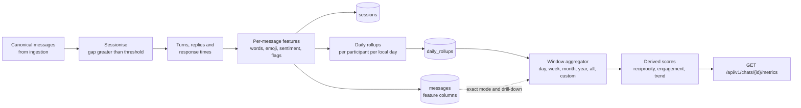

# Chat Analyzer — Metrics Catalog

| Field | Value |
|---|---|
| Document | Analytics engine design and metric definitions |
| Status | **Draft v0.1 — for review** |
| Date | 2026-10-24 |
| Owner | Analytics engine maintainers |
| Implements | `FR-ANA-001`…`FR-ANA-008`, `M-001`…`M-027`, `NFR-PERF-002`, `NFR-PERF-003` |
| Related | [Requirements](01-requirements.md) · [Architecture](02-architecture.md) · [Data model](03-data-model.md) · [AI insights](05-ai-insights.md) · [Observability](06-observability.md) · [Deployment](07-deployment.md) · [Security & privacy](08-security-privacy.md) · [Notifications](09-notifications.md) · [Roadmap](10-roadmap.md) · [WhatsApp format](parsers/whatsapp.md) · [Telegram format](parsers/telegram.md) |

> **Contract.** This document is the specification the analytics code and its tests are written against.
> Metric IDs (`M-0xx`) and rule IDs (`R-xx`) are stable; changing a formula means bumping
> `ROLLUP_VERSION` (see [§11](#11-recomputation-and-versioning)) and updating the golden tests.
> Numbers shown to users — including numbers quoted inside AI narratives — always come from this engine,
> never from an LLM ([requirements §8.1](01-requirements.md#81-principles-apply-to-every-ai-feature)).

---

## Table of contents

1. [Pipeline overview](#1-pipeline-overview)
2. [Window semantics](#2-window-semantics)
3. [General counting rules](#3-general-counting-rules)
4. [Core algorithms](#4-core-algorithms)
5. [Mergeable structures (sketches and histograms)](#5-mergeable-structures-sketches-and-histograms)
6. [Daily rollup schema](#6-daily-rollup-schema)
7. [Reference example](#7-reference-example)
8. [Metric definitions M-001 … M-027](#8-metric-definitions-m-001--m-027)
9. [Multilingual text processing](#9-multilingual-text-processing)
10. [Configuration parameters](#10-configuration-parameters)
11. [Recomputation and versioning](#11-recomputation-and-versioning)
12. [API shape](#12-api-shape)
13. [Testing strategy](#13-testing-strategy)

---

## 1. Pipeline overview

The engine is a pure-Go package (`backend/internal/analytics`) with no LLM dependency. It runs as part of
the import job (after normalisation) and again whenever rollups must be recomputed.



Stages:

| Stage | Input → output | Where stored | Complexity |
|---|---|---|---|
| Sessionise | ordered human messages → `session_id` per message | `sessions`, `messages.session_id` | O(n), single pass |
| Turns & replies | messages within sessions → `turn_index`, `is_turn_start`, `response_s` | `messages` | O(n) |
| Features | message text → words, chars, emoji, sentiment, flags | `messages` feature columns | O(n · len) |
| Daily rollups | per-message features → one row per (participant, local day) | `daily_rollups` | O(n) |
| Window aggregation | rollup rows in window → metric values | computed, cached per request | O(days) |
| Derived scores | aggregated metrics → M-025, M-026, M-027 | computed | O(1) / O(days) |

**Design rule (from [requirements §7.1](01-requirements.md#71-time-windows)):** every window query is an
aggregation over `daily_rollups`. A year is ≤ 366 rows per participant, so any window is answered in
milliseconds regardless of message count. Metrics that are not additive use the mergeable structures in
[§5](#5-mergeable-structures-sketches-and-histograms), or an exact on-demand path over the `messages`
feature columns for short windows and drill-downs.

## 2. Window semantics

### 2.1 Window kinds

All windows are **half-open intervals `[from, to)` of local calendar dates** in the chat's analysis
timezone (`chats.analysis_tz`, IANA name, e.g. `Asia/Kolkata`).

| Kind | `from` | `to` | Notes |
|---|---|---|---|
| `day` | anchor date | anchor + 1 day | Local midnight to midnight; 23 h or 25 h on DST days. |
| `week` | start of week containing anchor | `from` + 7 days | ISO-8601 by default (Monday start); `week_start` configurable per chat. |
| `month` | first day of anchor's month | first day of next month | Calendar month. |
| `year` | 1 Jan of anchor's year | 1 Jan next year | Calendar year. |
| `all` | local date of first human message | local date of last human message + 1 day | Whole chat coverage. |
| `custom` | user `from` date | user `to` date + 1 day | UI shows an **inclusive** end date; the API receives an exclusive `to`. |

- **Sub-day custom ranges** (e.g. `2026-03-02T18:00` → `2026-03-03T02:00`) are allowed through the API.
  They cannot be answered from daily rollups, so the engine uses the **exact path** over `messages`
  (§5.4). The UI only exposes day granularity in the MVP.
- **Days in window** `D = number of local calendar dates in [from, to)`. DST does not change `D`.
- **Coverage.** The response includes `coverage = |[from,to) ∩ [chat_first_day, chat_last_day]| / D` and
  `partial = true` when the window extends past the last imported message or into the future (e.g. the
  current week). Rates normalised by `D` should be read with coverage in mind; the UI greys out uncovered days.

### 2.2 Comparison windows (`FR-ANA-002`)

| Kind | Previous window | Baseline |
|---|---|---|
| `day` | previous day | all-time per-day mean |
| `week` | previous week (same `week_start`) | all-time per-week mean (per-day × 7) |
| `month` | previous calendar month | all-time per-day mean × days in this month |
| `year` | previous calendar year | all-time per-day mean × days in this year |
| `custom` (N days) | the N days immediately before `from` | all-time per-day mean × N |
| `all` | none | none |

- Additive metrics are compared **raw** (`Δ = cur − prev`, `Δ% = Δ / prev`, `null` when `prev = 0`) **and
  per day** (`cur/D_cur − prev/D_prev`) so that February vs. March is fair. The UI shows the per-day
  comparison by default for months and custom ranges of unequal length.
- Ratio/median metrics (share of voice, response time, sentiment) are compared directly.
- If the previous window has zero coverage (before the chat started), the comparison is `null`, not `0`.

### 2.3 Attribution rules — which window does a thing belong to?

Events that span time are attributed to exactly one local day; a window contains the thing iff that day is in
`[from, to)`. These rules make every window an exact sum of its days.

| ID | Thing | Attributed to the local day of… |
|---|---|---|
| R-01 | Message (all message-level metrics) | its own timestamp |
| R-02 | Session (count, initiator, ender, length, duration) | the session's **first** message — a session spanning midnight or a window boundary counts entirely in the window where it started |
| R-03 | Response time | the **reply** message (first message of the responding turn) |
| R-04 | Reply / unreplied status of a turn | the turn being replied to (its first message) |
| R-05 | Silence gap | the message that **breaks** the silence; the in-window part is clipped (see M-006) |
| R-06 | Double-text | the follow-up message |
| R-07 | Call event | the call's timestamp |

Consequence: a session that starts on Monday 23:50 and continues into Tuesday contributes its *messages* to
both days (R-01) but its *session count, initiation and duration* only to Monday (R-02).

## 3. General counting rules

| ID | Rule |
|---|---|
| R-10 | **Human message** = a `messages` row with `participant_id` set and `kind ∈ {text, media, location, contact, poll, deleted}` (stickers are `kind = media`, `media_type = sticker`). These count toward M-001 and take part in sessions and turns. |
| R-11 | **System events** (`kind = system`: encryption notice, "X changed the subject", security-code changes, Telegram `service` actions other than calls) are excluded from **every** metric. They never start, end or split a session or turn. |
| R-12 | **Call events** (`kind = call`) count only toward M-021. They do not take part in sessions, turns or response times in the MVP. |
| R-13 | **Multi-line messages** are one message. Newlines are whitespace for word counting. |
| R-14 | **Deleted placeholders** ("This message was deleted", "You deleted this message") count toward M-001, M-020 and sessions/turns/response times (the act of sending happened at that time), but not toward text metrics (M-003, M-015 – M-018, M-022 – M-024). |
| R-15 | **Media-only messages** count toward M-001, M-019 and sessions/turns/response times, but not text metrics. A media message **with a caption** also contributes its caption to text metrics. |
| R-16 | **Edited messages**: the platform marker (e.g. `<This message was edited>`) is stripped from text before features are computed; the message counts once in M-020 (edited). |
| R-17 | **Forwarded messages** (Telegram `forwarded_from`) count toward volume, sessions and turns, but are excluded from sentiment, affection, conflict, top terms and AI mood input by default (`include_forwarded_in_text_metrics = false`), because the words are not the participant's own. |
| R-18 | **Ordering.** Sequence is `(timestamp_utc, ordinal)` where `ordinal` is the message's position in the export. WhatsApp Android exports have minute precision, so ties are common; ordinal breaks them. Negative time deltas caused by ordering are clamped to 0. |
| R-19 | **Time precision.** Each import records `time_precision ∈ {second, minute}`. With minute precision, response times below 60 s are reported as "< 1 min" and the exact-path median is computed on minute-floored values. |
| R-20 | **Reactions** (Telegram) are not messages; they are stored for a future metric and excluded from all metrics here. |
| R-21 | Only the two analysed participants are counted. If more senders exist (FR-ING-012), messages by the others are treated like system events for analysis. |

## 4. Core algorithms

### 4.1 Sessionisation (`M-007`, used by M-008 – M-012)

A **session** (conversation) is a maximal run of human messages in which no two consecutive messages are more
than `session_gap` apart (default **6 h**, per chat). Sessions are computed over the **whole chat**, never per
window, so they are stable across views.

```text
// Input: human messages of one chat ordered by (ts, ordinal).
sessions := []
var cur *Session
for m in messages:
    if cur == nil || m.ts - cur.lastTS > sessionGap:
        cur = &Session{ID: newID(), StartTS: m.ts, Initiator: m.sender}
        sessions = append(sessions, cur)
    cur.add(m)                  // updates lastTS, Ender = m.sender, msgCount, per-sender counts
    m.sessionID = cur.ID
```

- **Incremental update:** after an import that adds messages, find the earliest new message `m0`, take the
  session that contained the last message before `m0`, and re-run from that session's start. Everything
  earlier is untouched.
- Changing `session_gap` triggers a full re-sessionisation job for the chat (fast: O(n)).

### 4.2 Turns, replies and response times (`M-010`, `M-011`, `M-012`)

A **turn** is a maximal run of consecutive human messages by the same participant **within one session**.

```text
for s in sessions:
    turns := groupConsecutiveBySender(s.messages)
    for i, t := range turns:
        t.first.isTurnStart = true
        if i > 0:
            prev := turns[i-1]                          // always the other participant
            rt := max(0, t.first.ts - prev.last.ts)     // R-18 clamp
            t.first.responseS = rt                      // stored on messages.response_s
            recordResponse(t.sender, rt, day(t.first))  // R-03
            prev.replied = true
        // intra-turn follow-ups (double-texting, R-06)
        for j := 1; j < len(t.messages); j++:
            if t.messages[j].ts - t.messages[j-1].ts >= doubleTextGap:
                recordDoubleText(t.sender, day(t.messages[j]))
    last := turns[len(turns)-1]
    last.replied = false
    last.closing = true
    // A closing turn only counts as "unreplied" if it asked something (see M-011).
    last.awaitingReply = last.containsQuestion          // M-017 heuristic on any message of the turn
```

Notes:

- The first turn of a session is an **initiation**, not a response — there is no response time for it.
  Long cross-session delays therefore never pollute response-time statistics; they show up in M-006 instead.
- Because sessions are split at `session_gap`, every response time is `≤ session_gap`.

### 4.3 Streaks (`M-005`)

```text
// active: ascending set of local dates in [from, to) with ≥ 1 human message (any participant)
longest, run := 0, 0
var prev Date
for d in active:
    if prev.valid && d == prev.addDays(1) { run++ } else { run = 1 }
    longest = max(longest, run)
    prev = d
// Current streak: the run ending at the reference day, with a one-day grace for "today".
ref := min(to.addDays(-1), todayInChatTZ)
current := 0
if prev.valid && (prev == ref || prev == ref.addDays(-1)) { current = run }
```

- **Mutual streak** (variant, shown as secondary): `active` = days on which **both** participants sent ≥ 1
  message.
- Streaks are **clipped to the window**: a streak that began before `from` is counted from `from`. The
  all-time longest streak is shown separately on the chat overview.

### 4.4 Silence gaps (`M-006`)

For consecutive human messages `a`, `b` (any senders), `gap = b.ts − a.ts`. The gap is attributed to `b`'s day
and to `b`'s sender, the **gap breaker** (R-05). Per day the rollup stores the largest gap whose two messages
fall on that same local day (`max_intraday_gap_s`) and a histogram of all gaps ending that day
([§5.2](#52-gap-histogram)). Gaps that cross midnight are reconstructed exactly from `first_msg_at` /
`last_msg_at`, which is what makes clipping at the window start possible:

```text
longestSilence(W):
    best := 0
    prevLast := lastMsgTSBefore(W.from)        // max(last_msg_at) over rollup days before the window; may be null
    for d in activeDays(W) ascending:          // combined rows: min(first_msg_at), max(last_msg_at)
        start := prevLast
        if start == null { start = d.firstMsgTS }       // nothing before: no silence into the chat's first message
        if start < W.from { start = W.from }            // clip silences that began before the window
        best = max(best, d.firstMsgTS - start)          // gap into the day's first message
        best = max(best, d.maxIntradayGapS)             // gaps between messages of the same day
        prevLast = d.lastMsgTS
    end := min(W.to, now)
    if prevLast == null || prevLast < W.from { prevLast = W.from }
    best = max(best, end - prevLast)                    // open ("ongoing") silence at the end
    return best
```

If the window contains no messages at all, the longest silence is the full window length and the UI says
"no messages in this period".

## 5. Mergeable structures (sketches and histograms)

Non-additive statistics are stored per rollup row as fixed-shape structures whose **element-wise sum** is the
structure for the union. This keeps aggregation a plain `SUM` over rows.

### 5.1 Response-time histogram (log-scale)

- **64 buckets**, bucket `i ∈ [0, 63]` covers seconds `[2^(i/4), 2^((i+1)/4))`; bucket 0 also holds 0 s;
  bucket 63 holds everything ≥ 2^15.75 s (≈ 15.3 h). With the default 6 h `session_gap`, responses never
  exceed bucket 57.
- **Percentile estimate:** find the bucket where the cumulative count crosses `p · N`, then interpolate
  **geometrically** inside it: `lo · (hi/lo)^frac`. Worst-case relative error ≈ 2^(1/8) − 1 ≈ **9 %**, which is
  far below the natural variability of response times. The API marks such values `approx: true`.
- Also stored: `response_count` and `response_sum_s` so the **mean is exact**.
- Storage: Postgres `int[]`, SQLite JSON array (64 small integers per row).

### 5.2 Gap histogram

16 coarse buckets for inter-message gaps (any sender pair):
`0–1 m, 1–5 m, 5–15 m, 15–60 m, 1–3 h, 3–6 h, 6–12 h, 12–24 h, 1–2 d, 2–4 d, 4–7 d, 1–2 w, 2–4 w, 1–3 mo, 3–6 mo, ≥ 6 mo`.
Used for the gap-distribution chart; the longest gap itself is exact via `max_gap_ending_s`.

### 5.3 Sentiment histogram

20 buckets of width 0.1 over the compound score `[−1, 1]` (last bucket closed). Median and spread of
sentiment are estimated from it (error ≤ 0.05); the mean is exact via `sentiment_sum / sentiment_scored_count`.

### 5.4 Top-K term and emoji maps

| Structure | Content | Merge | Exactness |
|---|---|---|---|
| `emoji_counts` | full map emoji → count | sum maps | exact (distinct emoji per day are few) |
| `link_domains` | full map domain → count | sum maps | exact |
| `top_terms` | top 100 terms → count, plus `terms_other_count` | sum maps | **approximate** for long windows: a term outside a day's top 100 loses that day's count; error bound per term ≤ Σ over days of that day's 100th count |
| `top_bigrams` | top 50 bigrams → count | sum maps | approximate, as above |

**Exact path:** for windows ≤ 90 days (configurable `exact_terms_max_days`) top terms and bigrams are
recomputed from the message text in the window (tokenised on the fly; ~20k messages tokenise in well under
100 ms). Longer windows use the merged maps and are labelled "approximate". Drill-down always uses the exact
path.

### 5.5 Exact on-demand path

Every per-message feature used above is stored on `messages` (`response_s`, `word_count`, `sentiment`,
`flags`…), so any metric can be recomputed exactly with a scan of the window's messages. This path is used for:

- sub-day custom ranges and analysis in a timezone other than `analysis_tz` (§11.3);
- `?exact=true` requests and drill-downs (`FR-ANA-005`);
- windows ≤ 31 days for percentiles (cheap and avoids the 9 % approximation).

Postgres uses `percentile_cont`; SQLite computes percentiles in Go over the selected column.

## 6. Daily rollup schema

One row per **(chat, participant, local date, timezone)**. Chat-level values (sessions, gaps, first/last
message) are stored on the row of the participant to whom they are attributed (initiator, gap breaker, …), so
**combined values are always either the sum or the max/min of the two participant rows** — no separate
chat-level table is needed.

| Column | Type | Combine | Feeds |
|---|---|---|---|
| `tenant_id`, `chat_id`, `participant_id` | uuid | key | — |
| `local_date` | date | key | all |
| `tz` | text | key (normally = `chats.analysis_tz`) | §11.3 |
| `rollup_version` | int | — | §11 |
| `computed_at` | timestamptz | — | — |
| `msg_count` | int | sum | M-001, M-002, M-004 |
| `text_msg_count` | int | sum | M-003 |
| `word_count`, `char_count` | int | sum | M-002, M-003 |
| `emoji_count` | int | sum | M-015 |
| `emoji_msg_count` | int | sum | M-015 |
| `first_msg_at`, `last_msg_at` | timestamptz | min / max | M-006, M-005 |
| `hourly_counts` | int[24] | element-wise sum | M-013, M-014 |
| `sessions_initiated` | int | sum | M-007, M-008 |
| `sessions_ended` | int | sum | M-009 |
| `session_msg_sum` | int | sum | M-007 (messages in sessions initiated this day) |
| `session_duration_sum_s` | bigint | sum | M-007 |
| `session_turns_sum` | int | sum | M-007 |
| `turn_count` | int | sum | M-012 |
| `turns_replied` | int | sum | M-011 |
| `turns_awaiting_unreplied` | int | sum | M-011 (closing turns with a question, unreplied) |
| `double_text_count` | int | sum | M-012 |
| `followup_after_no_reply` | int | sum | M-012 |
| `response_count` | int | sum | M-010 |
| `response_sum_s` | bigint | sum | M-010 (mean) |
| `response_hist` | int[64] | element-wise sum | M-010 (percentiles) |
| `max_intraday_gap_s` | bigint | max | M-006 (gaps broken by this participant whose start is on the same local day) |
| `gap_hist` | int[16] | element-wise sum | M-006 |
| `question_count` | int | sum | M-017 |
| `link_count` | int | sum | M-018 |
| `link_domains` | json map | map sum | M-018 |
| `media_image`, `media_video`, `media_audio`, `media_voice`, `media_sticker`, `media_gif`, `media_document`, `media_other` | int | sum | M-019 |
| `location_count`, `contact_count`, `poll_count` | int | sum | M-019 (other shares) |
| `deleted_count`, `edited_count`, `forwarded_count` | int | sum | M-020 |
| `call_voice_count`, `call_video_count`, `call_missed_count`, `call_duration_s` | int | sum | M-021 |
| `sentiment_scored_count` | int | sum | M-022 |
| `sentiment_sum` | double | sum | M-022 |
| `sentiment_pos`, `sentiment_neu`, `sentiment_neg` | int | sum | M-022 |
| `sentiment_hist` | int[20] | element-wise sum | M-022 |
| `affection_msg_count`, `affection_hits` | int | sum | M-023 |
| `conflict_msg_count` | int | sum | M-024 |
| `emoji_counts` | json map | map sum | M-015 |
| `top_terms`, `top_bigrams` | json map | map sum (approx.) | M-016 |
| `terms_other_count` | int | sum | M-016 |
| `emotion_counts` | json map, nullable | map sum | AI mood ([05-ai-insights.md](05-ai-insights.md)); filled once per-message emotions exist |

Indexes: primary key `(chat_id, tz, local_date, participant_id)`; all window queries are a range scan on it.
Size: two rows per active day — a 5-year chat is ≈ 3,600 rows (≈ 2–4 MB including JSON maps).

## 7. Reference example

Used in the worked examples below. Chat timezone `Asia/Kolkata`, participants **A** and **R**,
`session_gap = 6 h`, ISO weeks. Window for the examples: **week of Mon 2026-03-02** (`[2026-03-02, 2026-03-09)`).

| # | Local time | Sender | Content | Session | Turn | Response |
|---|---|---|---|---|---|---|
| 1 | Mon 08:00 | A | Good morning! ☀️ | S1 | A1 | — (initiation) |
| 2 | Mon 08:05 | R | Morning 🙂 how did it go? | S1 | R1 | R: 5 min |
| 3 | Mon 08:06 | R | the interview I mean | S1 | R1 | — |
| 4 | Mon 08:20 | A | It went well!! I think 🤞 | S1 | A2 | A: 14 min |
| 5 | Mon 08:21 | A | `<image omitted>` | S1 | A2 | — |
| 6 | Mon 14:30 | R | Lunch? | S2 (gap 6 h 09 m) | R2 | — (initiation) |
| 7 | Mon 14:31 | A | Yes! 20 min | S2 | A3 | A: 1 min |
| 8 | Mon 23:50 | A | miss you ❤️ | S3 (gap 9 h 19 m) | A4 | — (initiation) |
| 9 | Tue 00:10 | R | miss you too ❤️ | S3 | R3 | R: 20 min |
| 10 | Tue 00:40 | A | 😴 good night | S3 | A5 | A: 30 min |

Derived facts: 3 sessions (S1 by A, S2 by R, S3 by A — S3 attributed to Monday by R-02); A has 6 messages in
5 turns, R has 4 messages in 3 turns; A's response times {14, 1, 30} min, R's {5, 20} min; longest silence
9 h 19 m (broken by A, Monday).

## 8. Metric definitions M-001 … M-027

Notation: `P ∈ {A, B}` is a participant, `Ō` the other participant, `W` the window, `D` days in window,
`Σ_W` a sum over rollup rows in the window. "Additive" means the combined/window value is a plain sum of
rollup values.

---

### M-001 — Messages sent

- **Definition:** number of human messages (R-10) sent by `P` in `W` (R-01).
- **Formula:** `msgs(P) = Σ_W msg_count(P)`; combined `= msgs(A) + msgs(B)`.
- **Inputs:** `daily_rollups.msg_count`. **Per person:** ✔. **Aggregation:** additive.
- **Edge cases:** deleted placeholders and media-only messages count (R-14, R-15); system and call events do
  not (R-11, R-12); a multi-line message counts once (R-13).
- **Example:** A = 6, R = 4, combined = 10.

### M-002 — Share of voice

- **Definition:** each participant's proportion of messages, words and characters.
- **Formula:** `sov_msgs(P) = msgs(P) / msgs(A+B)`; same for `word_count`, `char_count`. Undefined (null)
  when the denominator is 0.
- **Inputs:** `msg_count`, `word_count`, `char_count`. **Aggregation:** ratio of additive sums (compute the
  sums first, then divide — never average daily ratios).
- **Example:** messages A 60 % / R 40 %; words A 14 / R 13 → 51.9 % / 48.1 %.

### M-003 — Words, characters and average message length

- **Definitions:**
  - *Words* — Unicode word segments (UAX #29) containing at least one letter or digit; emoji and punctuation
    are not words. Scripts without spaces (CJK, Thai) are segmented per UAX #29 and are approximate.
  - *Characters* — extended grapheme clusters (UAX #29) of the trimmed text, excluding whitespace; an emoji
    ZWJ sequence counts as one character.
  - *Average message length* — `words(P) / text_msgs(P)` and `chars(P) / text_msgs(P)`.
- **Inputs:** `word_count`, `char_count`, `text_msg_count`. **Aggregation:** additive; average is a ratio of sums.
- **Edge cases:** media-only and deleted messages are excluded from `text_msg_count` (R-14, R-15); captions
  count; URLs count as one word; edit markers stripped (R-16).
- **Example:** A: 14 words over 5 text messages → 2.8 words/message (message 5 is media-only).

### M-004 — Active days and activity rate

- **Definition:** a day is *active* if it has ≥ 1 human message from either participant (calls excluded).
- **Formula:** `active_days = |{d ∈ W : msg_count(A,d) + msg_count(B,d) > 0}|`; `activity_rate = active_days / D`.
  Per-person variant: days on which `P` sent ≥ 1 message.
- **Aggregation:** count of qualifying rollup days. **Edge cases:** partial windows — also report
  `active_days / covered_days`.
- **Example:** active days {Mon, Tue} = 2; rate = 2 / 7 = 28.6 %.

### M-005 — Current and longest streak

- **Definition:** consecutive active days (§4.3). Mutual streak variant requires both participants active.
- **Aggregation:** computed from the active-day set of the window (O(D)); clipped to the window.
- **Edge cases:** "today" grace of one day for the current streak; DST does not affect streaks (calendar days).
- **Example:** longest = 2 (Mon–Tue); current streak at the end of the week = 0 (no messages Wed–Sun).

### M-006 — Longest silence and gap distribution

- **Definition:** the longest interval without any human message, within `W` (§4.4); and the distribution of
  inter-message gaps whose breaker falls in `W`.
- **Formula:** see §4.4; distribution = `Σ_W gap_hist`. Per-person view: "silences broken by P" counts gaps by
  breaker.
- **Inputs:** `max_intraday_gap_s`, `first_msg_at`, `last_msg_at`, `gap_hist`. **Aggregation:** max with
  clipping; histogram sum.
- **Edge cases:** a silence that started before `W` is clipped at `from`; an open silence is clipped at
  `min(to, now)`; no messages in `W` → silence = window length.
- **Example:** 9 h 19 m (Mon 14:31 → 23:50, broken by A). The trailing silence Tue 00:40 → Mon 03-09 00:00 is
  ≈ 5 d 23 h and is in fact the window's longest silence; the UI labels it "ongoing silence at end of period".

### M-007 — Conversations (sessions)

- **Definition:** sessions per §4.1 attributed by start day (R-02).
- **Formulas:** `sessions = Σ_W sessions_initiated(A+B)`;
  `avg_session_msgs = Σ_W session_msg_sum / sessions`; `avg_session_duration = Σ_W session_duration_sum_s / sessions`
  (duration = last − first message); `avg_turns_per_session = Σ_W session_turns_sum / sessions`.
- **Aggregation:** additive. **Edge cases:** a session starting in `W` and ending after `to` counts fully in
  `W`; single-message sessions have duration 0 and count.
- **Defaults:** `session_gap = 6 h` (range 30 min – 24 h).
- **Example:** 3 sessions; average 3.33 messages; average duration (21 + 1 + 50) / 3 = 24 min.

### M-008 — Initiations

- **Definition:** number of sessions whose first message was sent by `P`.
- **Formula:** `init(P) = Σ_W sessions_initiated(P)`; `initiation_ratio(P) = init(P) / sessions`.
- **Aggregation:** additive. **Example:** A = 2 (S1, S3), R = 1 (S2) → A 66.7 %.

### M-009 — Conversation enders

- **Definition:** number of sessions whose last message was sent by `P` (attributed to the session start, R-02).
- **Formula:** `end(P) = Σ_W sessions_ended(P)`. **Aggregation:** additive.
- **Example:** A = 3, R = 0.

### M-010 — Response time

- **Definition:** for each turn of `P` that follows a turn of `Ō` in the same session, the time from `Ō`'s last
  message to `P`'s first message (§4.2), attributed to the reply's day (R-03).
- **Outputs:** median, p90, mean, n, and the distribution chart. Combined = all responses of both.
- **Aggregation:** mean exact (`response_sum_s / response_count`); percentiles from `Σ_W response_hist`
  (approx. ≤ 9 %), or exact for windows ≤ 31 days (§5.5).
- **Edge cases:** initiations have no response time; minute-precision exports (R-19); clamped negatives (R-18);
  `n < 5` → show the value with a "few data points" hint.
- **Example:** A: {1, 14, 30} → median 14 min, mean 15 min. R: {5, 20} → median 12.5 min. Combined median of
  {1, 5, 14, 20, 30} = 14 min.

### M-011 — Reply rate

- **Definition:** the share of `Ō`'s turns that `P` replied to within the session. A session's **closing turn**
  is excluded from the denominator unless it contains a question (it was "awaiting a reply") — otherwise
  every natural "good night" would count as ignored.
- **Formula:** `reply_rate(P) = turns_replied(Ō) / (turns_replied(Ō) + turns_awaiting_unreplied(Ō))`, where
  `turns_replied(Ō)` are `Ō`'s turns followed by a `P` turn. Attributed to the day of `Ō`'s turn (R-04).
- **Aggregation:** ratio of additive sums.
- **Example:** A's turns A1, A4 were replied to; A2, A3, A5 were closing turns without a question → excluded.
  R's reply rate = 2 / 2 = 100 %. R's turns R1, R2, R3 were all replied → A's reply rate = 100 %.

### M-012 — Turns and double-texting

- **Definitions:**
  - *Turns* — §4.2; `msgs_per_turn(P) = msgs(P) / turns(P)`.
  - *Double-text* — a message by `P` sent ≥ `double_text_gap` (default **30 min**) after `P`'s previous message
    with no reply in between (an intra-turn follow-up, R-06).
  - *Follow-up after no reply* — a session initiated by `P` when the previous session's closing turn was `P`'s and
    was awaiting a reply.
- **Aggregation:** additive (`turn_count`, `double_text_count`, `followup_after_no_reply`).
- **Example:** A 5 turns (1.2 msgs/turn), R 3 turns (1.33 msgs/turn); no double-texts (R's 08:05 → 08:06 gap is 1 min).

### M-013 — Activity heatmap

- **Definition:** message counts by local hour-of-day (0–23) × weekday (Mon–Sun).
- **Formula:** cell `(h, wd) = Σ_{d ∈ W, weekday(d) = wd} hourly_counts[h]`; per person and combined.
- **Aggregation:** element-wise sum. **Edge cases:** on DST fall-back days the repeated hour is counted in
  the same wall-clock hour cell; on spring-forward days the skipped hour is simply empty.
- **Example:** A: Mon 08 → 3, Mon 14 → 1, Mon 23 → 1, Tue 00 → 1.

### M-014 — Late-night activity

- **Definition:** share of `P`'s messages sent in the configured late-night hours (default **00:00–05:00**,
  i.e. hours 0–4).
- **Formula:** `late(P) = Σ_W Σ_{h ∈ late_hours} hourly_counts[h] / msgs(P)`.
- **Aggregation:** derived from `hourly_counts`, so changing the late-night setting needs **no** recompute.
- **Example:** A 1 / 6 = 16.7 % (message 10); R 1 / 4 = 25 % (message 9).

### M-015 — Emoji usage

- **Definition:** emoji are extended grapheme clusters that contain an `Extended_Pictographic` code point,
  a regional-indicator pair (flags) or a keycap sequence (§9.1).
- **Outputs:** total emoji, emoji per text message, % of messages with ≥ 1 emoji, top-N emoji, and the
  *affection emoji* subset (configurable; default hearts, kiss/hug faces, 🥰 😘 😍 🤗).
- **Aggregation:** additive counts; `emoji_counts` map sum (exact).
- **Edge cases:** skin-tone and gender variants are merged into the base emoji for top-N by default
  (`emoji_normalise_modifiers = true`); text emoticons like `:)` are counted as emoji only if
  `count_text_emoticons = true` (default false).
- **Example:** A: ☀️ 🤞 ❤️ 😴 = 4; R: 🙂 ❤️ = 2. Top combined: ❤️ (2).

### M-016 — Top words and phrases

- **Definition:** most frequent terms (lower-cased, normalised word segments) and bigrams after removing stop
  words for the chat's languages (§9.2), numbers, URLs and terms shorter than 2 characters.
- **Aggregation:** exact for ≤ 90-day windows; merged top-K maps (approximate) otherwise (§5.4).
- **Edge cases:** spelling variants are folded with the language's normalisation table (e.g. `acha / accha /
  achha → accha`); bigrams never cross message boundaries.
- **Example:** after stop-word removal, `miss` (2) is the top term; `miss you` would be removed as a bigram
  because `you` is a stop word — the phrase is captured by M-023 instead.

### M-017 — Questions asked

- **Definition:** a text message is a question if it contains `?` (or full-width `？`), or starts with an
  interrogative opener from the language lists (e.g. EN *what, why, how, when, where, who, do you, are you*;
  romanised Hindi *kya, kyun, kaise, kab, kahan, kaun, kitna*).
- **Formula:** count of messages (max 1 per message); `question_rate = questions / text_msgs`.
- **Aggregation:** additive. **Example:** R = 2 (messages 2 and 6), A = 0.

### M-018 — Links shared

- **Definition:** messages containing ≥ 1 URL (RFC 3986-ish pattern incl. bare `www.` domains); domains
  extracted with the public-suffix list to eTLD+1 (`youtu.be` and `youtube.com` stay distinct).
- **Outputs:** link count (URLs, not messages), top domains.
- **Aggregation:** additive; `link_domains` map sum (exact).

### M-019 — Media shared (placeholders)

- **Definition:** counts by media type from platform markers: image, video, audio file, voice note, sticker,
  GIF, document, other; plus locations, contacts and polls.
- **Inputs:** `media_*`, `location_count`, `contact_count`, `poll_count`. **Aggregation:** additive.
- **Edge cases:** WhatsApp Android's generic `<Media omitted>` maps to `media_other` (type unknown); with a
  `.zip` export, the attached filename (if referenced) refines the type. Telegram `media_type` maps directly.
- **Example:** A: 1 image.

### M-020 — Deleted, edited and forwarded messages

- **Definition:** counts of messages flagged deleted, edited, forwarded by sender.
- **Aggregation:** additive. **Edge cases:** WhatsApp marks deletions by either side; "You deleted this
  message" is attributed to the exporter's participant. Telegram exports do not include deleted messages.

### M-021 — Calls

- **Definition:** call events by caller: voice, video, missed, and total duration where available (Telegram
  `duration_seconds`; WhatsApp exports usually only record missed calls).
- **Aggregation:** additive. **Edge cases:** calls never affect sessions or response times (R-12).

### M-022 — Sentiment (lexicon)

- **Definition:** VADER-style compound score in `[−1, 1]` per eligible text message (not deleted, not
  forwarded by default, not media-only), using the merged lexicons of the chat's languages, emoji valences,
  negation (`not`, `nahi`, `mat`), intensifiers (`very`, `bahut`, `!!`), and ALL-CAPS emphasis.
- **Classes:** positive `≥ 0.05`, negative `≤ −0.05`, neutral otherwise. Messages with **no** lexicon hit are
  neutral and **not** counted in `sentiment_scored_count`, so a chat full of "ok" does not dilute the mean.
- **Formulas:** `mean = Σ_W sentiment_sum / Σ_W sentiment_scored_count`; shares from `sentiment_pos/neu/neg`
  over `text_msg_count`; median from `sentiment_hist`.
- **Aggregation:** additive. **Limits:** lexicon sentiment misreads sarcasm and code-mixed text; the AI layer
  ([05-ai-insights.md](05-ai-insights.md)) refines emotion when an LLM is available and the UI shows the
  method used.

### M-023 — Affection markers

- **Definition:** hits from the affection lexicon (phrases such as *love you, miss you, proud of you, take care*,
  romanised Hindi *jaan, pyaar, yaad aa rahi*) and the affection-emoji set; negated phrases are ignored
  ("don't miss you").
- **Outputs:** messages with ≥ 1 marker (`affection_msg_count`), total hits, rate per 100 text messages.
- **Aggregation:** additive. **Example:** A 1 (message 8), R 1 (message 9).

### M-024 — Conflict markers

- **Definition:** a text message is *conflict-flagged* when at least **two** of these signals fire, or one
  *strong* conflict-lexicon phrase fires:
  1. conflict lexicon hit (e.g. *whatever, leave me alone, you always, you never*, insults list);
  2. compound sentiment `≤ −0.5`;
  3. ALL-CAPS ratio ≥ 0.7 over ≥ 4 letters;
  4. repeated punctuation (`!!!`, `?!`, `??`) together with negative sentiment.
- **Outputs:** flagged messages per person; **conflict sessions** = sessions with ≥ 3 flagged messages or a
  flagged share ≥ 25 % (computed on demand from `messages.flags`).
- **Aggregation:** additive (`conflict_msg_count`). **Note:** a signal of tension in text, not a judgement —
  shown with neutral wording ("tense moments").

### M-025 — Reciprocity / balance index

- **Definition:** how evenly the two participants carry the conversation, 0–100 (100 = perfectly balanced).
- **Formula:** for each dimension `d` with values `a, b ≥ 0`: `imb_d = |a − b| / (a + b)` (0 if `a + b = 0`).

  | Dimension | Values | Weight |
  |---|---|---|
  | messages | M-001 | 0.30 |
  | words | M-003 words | 0.20 |
  | initiations | M-008 | 0.30 |
  | response time | M-010 median | 0.20 |

  `reciprocity = 100 × (1 − Σ_d w_d · imb_d)`. If a dimension is undefined (e.g. < 3 responses for a
  participant) its weight is redistributed proportionally over the others.
- **Minimum data:** ≥ 20 messages per participant in `W`, else `null` ("not enough data").
- **Aggregation:** derived from window aggregates (never averaged across days).
- **Example:** messages 6 vs 4 → 0.200; words 14 vs 13 → 0.037; initiations 2 vs 1 → 0.333;
  medians 14 vs 12.5 min → 0.057. Σ w·imb = 0.060 + 0.007 + 0.100 + 0.011 = 0.179 → **82**
  (the example is below the minimum data threshold and is for illustration only).

### M-026 — Engagement score

- **Definition:** a composite 0–100 of how active and connected the conversation is in `W`. Versioned as
  `engagement_v1`; intended to compare **a chat with itself over time**, not chats with each other.
- **Components** (each 0–1):

  | Component | Formula | Weight |
  |---|---|---|
  | Frequency `F_freq` | `active_days / D` | 0.25 |
  | Volume `F_vol` | `min(1, ln(1 + msgs/D) / ln(1 + 100))` (saturates at 100 msgs/day) | 0.15 |
  | Responsiveness `F_resp` | `1 / (1 + median_rt_s / 900)` (0.5 at a 15-min combined median) | 0.20 |
  | Reciprocity `F_recip` | `M-025 / 100` | 0.20 |
  | Depth `F_depth` | `min(1, ln(1 + avg_session_msgs) / ln(1 + 50))` | 0.20 |

  `engagement = 100 × Σ w · F`. Weights and constants are configuration (`engagement.weights`) and are
  returned with the score.
- **Example:** `F_freq = 0.286`, `F_vol = ln(2.43)/ln(101) = 0.192`, `F_resp = 1/(1 + 840/900) = 0.517`,
  `F_recip = 0.821`, `F_depth = ln(4.33)/ln(51) = 0.373` →
  `100 × (0.072 + 0.029 + 0.103 + 0.164 + 0.075)` ≈ **44**.

### M-027 — Trend

- **Definition:** direction and size of change for M-001 (messages/day), M-010 (daily median response time,
  days with ≥ 3 responses only) and M-022 (daily mean sentiment), per person and combined.
- **Outputs:**
  1. `Δ` and `Δ%` vs the previous window (§2.2);
  2. ordinary-least-squares slope over the daily series inside `W` and the relative change
     `rel = slope × D / mean(series)`;
  3. label `rising` / `falling` when `|rel| ≥ 0.15` and the slope's R² ≥ 0.2, else `steady`; `null` when
     fewer than 7 points.
- **Aggregation:** O(D) over daily rollups (exact mean per day; the daily median uses the per-day histogram).

---

## 9. Multilingual text processing

### 9.1 Segmentation

- Grapheme clusters and word boundaries follow **Unicode UAX #29** (Go: `github.com/rivo/uniseg`, MIT).
- **Emoji detection:** a grapheme cluster is an emoji if it contains an `Extended_Pictographic` code point
  (including ZWJ sequences like 👩‍❤️‍👨, counted once), a regional-indicator pair (🇮🇳) or a keycap sequence
  (1️⃣). Variation selector U+FE0F is ignored for identity; skin-tone modifiers U+1F3FB–U+1F3FF are optionally
  folded (M-015).
- **Invisible marks** stripped before analysis: U+200E/U+200F, U+202A–U+202E, U+2066–U+2069, BOM, U+202F is
  converted to a space (see [WhatsApp format](parsers/whatsapp.md)).
- **Normalisation:** NFKC, lower-casing with `golang.org/x/text/cases` (locale-aware for Turkish dotted i),
  elongation folding (`sooooo → soo`, used for matching only, not for counting).

### 9.2 Languages and code-mixing

- Each chat has `text_languages` (default `["en", "hi-Latn"]`, auto-suggested from a character-script and
  stop-word-hit heuristic at import). All lexicons of those languages are merged.
- **Romanised Hindi ("Hinglish")** is treated as its own language `hi-Latn` because Devanagari resources do
  not match it. Its stop-word list includes, for example: `hai, hain, ha, nahi, nahin, na, kya, to, toh, bhi,
  main, mai, mein, me, tu, tum, aap, ho, tha, thi, the, ke, ki, ka, ko, se, aur, ye, yeh, wo, woh, haan, han,
  acha, accha, achha, bas, kar, karo, raha, rahi, hu, hoon, ab, abhi, kuch, koi, sab, bhai, yaar`.
  (Words like `bhai`, `yaar` are stop words for M-016 but still feed kinship/familiarity signals in the
  relationship profile.)
- **Spelling-variant folding** (`hi-Latn/variants.tsv`): `nahi nahin nai → nahi`, `acha accha achha → accha`,
  `kyu kyun kyon → kyun`.
- Devanagari Hindi (`hi`) and other languages are added by dropping lexicon files in (below); no code change.

### 9.3 Lexicon extension format

Lexicons are plain files embedded in the binary (`backend/internal/analytics/lexicons/`) and overridable by
a directory set in `CA_LEXICON_DIR`:

```text
lexicons/
  en/
    stopwords.txt          # one term per line, '#' comments
    interrogatives.txt     # question openers (M-017); multi-word allowed
    sentiment.tsv          # term<TAB>valence(-4..4)   e.g.  awesome	3.1
    affection.yaml         # M-023 phrases and emoji
    conflict.yaml          # M-024 phrases, with strength: strong|weak
    negations.txt
    intensifiers.tsv       # term<TAB>multiplier      e.g.  very	1.3
  hi-Latn/
    stopwords.txt
    variants.tsv           # variant<TAB>canonical
    sentiment.tsv          # e.g.  bekar	-2.0   mast	2.5   pyaar	3.0
    ...
  emoji/
    sentiment.tsv          # emoji<TAB>valence      e.g.  😭	-1.5   ❤️	3.0
    affection.txt
```

```yaml
# lexicons/hi-Latn/affection.yaml
version: 3
phrases:
  - { text: "miss kar raha", weight: 1.0 }
  - { text: "yaad aa rahi",  weight: 1.0 }
  - { text: "jaan",          weight: 0.8, whole_word: true }
negation_window: 3   # tokens before a phrase in which a negation cancels it
```

Every lexicon file carries a `version`; the combined lexicon hash is part of `ROLLUP_VERSION`'s input (§11)
so changing a lexicon re-scores the affected chats.

## 10. Configuration parameters

Per-chat settings (stored in `chats.settings`, editable in the UI — `FR-ANA-006`). Changing a
setting marked **recompute** enqueues a rollup job; others are applied at query time.

| Key | Default | Range | Effect |
|---|---|---|---|
| `analysis_tz` | browser TZ at import | IANA | **recompute** (new rollup set, §11.3) |
| `session_gap` | `6h` | `30m`–`24h` | **recompute** sessions, turns, responses |
| `double_text_gap` | `30m` | `5m`–`6h` | **recompute** M-012 |
| `week_start` | `monday` | any weekday | query time |
| `late_night_hours` | `[0,5)` | any hour range | query time (from `hourly_counts`) |
| `text_languages` | `["en","hi-Latn"]` | lexicon dirs | **recompute** text features |
| `include_forwarded_in_text_metrics` | `false` | bool | **recompute** |
| `emoji_normalise_modifiers` | `true` | bool | query time |
| `count_text_emoticons` | `false` | bool | **recompute** |
| `exact_terms_max_days` | `90` | `0`–`366` | query time |
| `exact_percentiles_max_days` | `31` | `0`–`366` | query time |
| `min_msgs_for_scores` | `20` | `1`–`1000` | query time (M-025, M-026) |
| `engagement.weights` | §M-026 | sum = 1 | query time |

## 11. Recomputation and versioning

### 11.1 `ROLLUP_VERSION`

A constant in code, derived from the metric-formula version and the lexicon hash. Rows with an older
`rollup_version` are still served (with `stale: true` in the response) while a low-priority background job
recomputes the chat. This makes formula changes safe to deploy without downtime.

### 11.2 Incremental recompute after import

1. Determine `m0`, the earliest message inserted by the import (FR-ING-010 dedupes the rest).
2. Re-sessionise from the start of the session that preceded `m0` (§4.1).
3. Recompute per-message features for new messages only (features are local to a message), and response
   fields for messages in re-sessionised sessions.
4. Rebuild `daily_rollups` for local dates from `day(session_start)` to the last message, inside one
   transaction per chat, so readers never see a half-built day (`NFR-REL-002`).
5. Emit the affected date range, which the Insight Engine uses to mark overlapping insights `stale`
   ([05-ai-insights.md §9](05-ai-insights.md#9-caching-invalidation-and-quotas)).

### 11.3 Alternative timezones

Rollups are keyed by `tz`. The primary set uses `analysis_tz`. A view in another timezone is served by the
exact path (§5.5) for windows ≤ 31 days, or by lazily building a secondary rollup set for that `tz`
(cached, evicted after 30 days unused). Changing `analysis_tz` builds a new primary set, then swaps.

### 11.4 Performance budget (`NFR-PERF-002`)

For 100k messages on a 2020-era laptop: sessionise + turns < 0.3 s; features (segmentation + lexicons)
< 3 s; rollup build < 1 s; batched inserts dominate the rest of the 15 s budget. Window queries touch ≤ 732
rows for a year and complete in < 20 ms on SQLite.

## 12. API shape

`GET /api/v1/chats/{chatId}/metrics?window=week&anchor=2026-03-02&tz=Asia/Kolkata&compare=previous`

```json
{
  "window": { "kind": "week", "from": "2026-03-02", "to": "2026-03-09", "tz": "Asia/Kolkata",
              "days": 7, "coverage": 1.0, "partial": false },
  "compare": { "kind": "previous", "from": "2026-02-23", "to": "2026-03-02" },
  "rollup_version": 7,
  "participants": [ { "id": "p_A", "label": "A" }, { "id": "p_R", "label": "R" } ],
  "metrics": {
    "M-001": { "by_participant": { "p_A": 6, "p_R": 4 }, "combined": 10,
               "prev": { "combined": 31 }, "delta_pct": -0.677, "per_day_delta": -3.0 },
    "M-010": { "by_participant": {
                 "p_A": { "median_s": 840, "p90_s": 1608, "mean_s": 900, "n": 3, "approx": false },
                 "p_R": { "median_s": 750, "p90_s": 1110, "mean_s": 750, "n": 2, "approx": false } } },
    "M-025": { "value": null, "reason": "insufficient_data", "min_msgs": 20 }
  }
}
```

- Metrics can be requested selectively (`&metrics=M-001,M-010`).
- Drill-down: `GET /api/v1/chats/{chatId}/metrics/{metricId}/messages?from=…&to=…&participant=…&bucket=…`
  returns the messages behind a chart point (`FR-ANA-005`).
- The response is cacheable by `(chat, window, tz, rollup_version, settings_hash)`; ETags are derived from it.

## 13. Testing strategy

- **Golden tests** (`NFR-MNT-002`): synthetic fixture chats with hand-computed expected values for every
  metric for a day, week, month, year and custom window, including:
  - a DST transition (e.g. `Europe/London` last Sunday of March and October);
  - a session spanning midnight and a window boundary (R-02);
  - minute-precision ties and out-of-order timestamps (R-18, R-19);
  - deleted, edited, forwarded, media-only and captioned messages (R-14 – R-17);
  - emoji ZWJ sequences, flags, skin tones; Hinglish variants.
- **Property tests:** for random chats and random partitions of a window into sub-windows, every additive
  metric over the window equals the sum over sub-windows; histogram percentiles are within 9 % of exact.
- **Equivalence tests:** rollup path vs exact path agree for every metric on every fixture (within the
  documented approximation for percentiles and top terms).
- **Benchmarks:** `go test -bench` for the 100k-message pipeline, tracked in CI to protect `NFR-PERF-002`.
