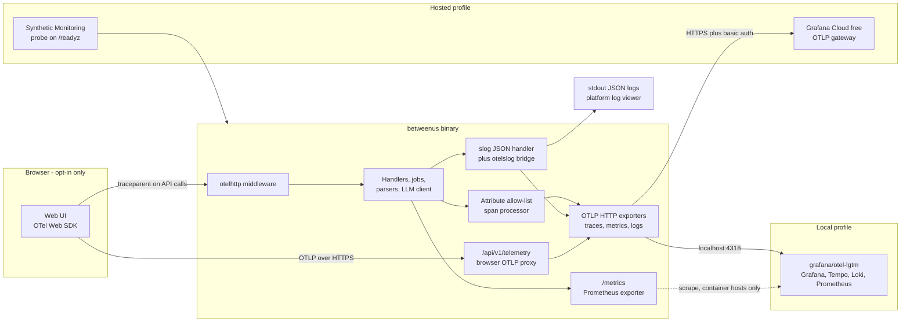
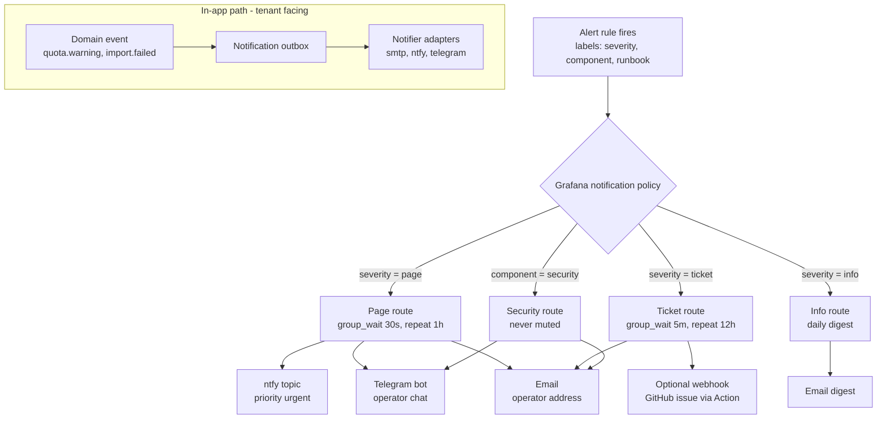

# Between Us — Observability, Monitoring and Alerting

| Field | Value |
|---|---|
| Document | Observability design (traces, metrics, logs, SLOs, alerts, runbooks) |
| Status | **Draft v0.1 — for review** |
| Date | 2026-10-24 |
| Owner | Platform / operations |
| Implements | NFR-OBS-001 … NFR-OBS-008, NFR-REL-001, NFR-REL-003, NFR-COST-003, PRV-001, PRV-007, K-5 |
| Related | [Requirements](01-requirements.md) · [Architecture](02-architecture.md) · [Data model](03-data-model.md) · [Metrics catalog](04-metrics-catalog.md) · [AI insights](05-ai-insights.md) · [Deployment](07-deployment.md) · [Security & privacy](08-security-privacy.md) · [Notifications](09-notifications.md) · [Roadmap](10-roadmap.md) · [WhatsApp format](parsers/whatsapp.md) · [Telegram format](parsers/telegram.md) |

> **Scope.** This document defines *what* the Go binary and the web UI emit, *where* telemetry goes in each
> deployment profile, *which* SLOs we promise, *which* alerts fire, and *what to do* when they fire.
> Product analytics metrics about chats (M-001…M-027) are a different thing — see the [Metrics catalog](04-metrics-catalog.md).

---

## Table of contents

1. [Principles](#1-principles)
2. [Telemetry data flow](#2-telemetry-data-flow)
3. [OpenTelemetry setup in Go](#3-opentelemetry-setup-in-go)
4. [Traces](#4-traces)
5. [Metrics catalogue](#5-metrics-catalogue)
6. [Logs](#6-logs)
7. [PII-safe telemetry rules](#7-pii-safe-telemetry-rules)
8. [Frontend telemetry (opt-in)](#8-frontend-telemetry-opt-in)
9. [Health and diagnostic endpoints](#9-health-and-diagnostic-endpoints)
10. [Local stack](#10-local-stack)
11. [Hosted stack (Grafana Cloud free)](#11-hosted-stack-grafana-cloud-free)
12. [Dashboards as code](#12-dashboards-as-code)
13. [SLOs and error budgets](#13-slos-and-error-budgets)
14. [Alert rules as code](#14-alert-rules-as-code)
15. [Alert routing](#15-alert-routing)
16. [On-call runbooks](#16-on-call-runbooks)

---

## 1. Principles

1. **OpenTelemetry everywhere, vendor-neutral.** The app speaks only OTLP (and optionally exposes Prometheus
   `/metrics`). Swapping Grafana Cloud for a self-hosted LGTM stack, SigNoz, or Uptrace is a config change.
2. **Content never leaves as telemetry.** Message text, participant names, phone numbers and export file names
   are never span attributes, metric labels or log fields (PRV-007, NFR-OBS-003). Enforced in code, in tests and
   by a log canary alert ([§14](#14-alert-rules-as-code)).
3. **Cardinality is a budget.** The Grafana Cloud free tier allows 10k active metric series. No `tenant_id`,
   `user_id`, `chat_id` or message IDs as metric labels — ever. Per-tenant questions are answered from the
   database or from traces/logs (where the tenant is hashed).
4. **Telemetry failure never breaks the product** (NFR-REL-003). Exporters are asynchronous, bounded and drop on
   overflow; an unreachable collector logs one warning per minute and nothing else.
5. **Local mode is local** (NFR-OBS-008, PRV-001). Default exporter is `none`; when enabled, it points at
   `localhost`. No phone-home, no default remote endpoint.
6. **As code.** Dashboards, alert rules, contact points and SLO definitions live in `deploy/grafana/` and are
   applied by CI, never hand-edited in production.

## 2. Telemetry data flow



| Profile | Traces | Metrics | Logs | Alerting |
|---|---|---|---|---|
| `local` | Off by default; OTLP → `localhost:4318` if enabled | `/metrics` on loopback | stdout (text or JSON) | None (single user) |
| `local-full` | OTLP → `otel-lgtm` | OTLP → `otel-lgtm` (+ scrape) | stdout + OTLP → Loki | Grafana alerting in `otel-lgtm` → Mailpit / ntfy |
| `cloud-free` | OTLP → Grafana Cloud Tempo | OTLP → Grafana Cloud Mimir | OTLP → Grafana Cloud Loki (platform logs are short-lived: Vercel Hobby keeps runtime logs 1 h) | Grafana Cloud alerting + Synthetic Monitoring |

## 3. OpenTelemetry setup in Go

### 3.1 Packages (all Apache-2.0)

| Purpose | Module |
|---|---|
| API / SDK | `go.opentelemetry.io/otel`, `go.opentelemetry.io/otel/sdk`, `.../sdk/metric`, `.../sdk/log` |
| OTLP exporters | `.../exporters/otlp/otlptrace/otlptracehttp`, `.../otlpmetric/otlpmetrichttp`, `.../otlplog/otlploghttp` |
| Prometheus exporter | `go.opentelemetry.io/otel/exporters/prometheus` |
| HTTP server/client | `go.opentelemetry.io/contrib/instrumentation/net/http/otelhttp` |
| Runtime metrics | `go.opentelemetry.io/contrib/instrumentation/runtime` |
| slog bridge | `go.opentelemetry.io/contrib/bridges/otelslog` |
| Postgres | `github.com/exaring/otelpgx` (pgx tracer) |
| SQLite | thin wrapper in `internal/store/sqlite` that opens spans per repository method |

### 3.2 Bootstrap

All setup lives in `backend/internal/telemetry` and is called once from `cmd/betweenus`:

```go
// Package telemetry wires OpenTelemetry providers for the whole process.
// Setup returns a shutdown func that MUST be called (and is, via defer in main)
// so buffered spans/metrics/logs are flushed — critical on serverless hosts
// where the instance may be frozen right after the response is sent.
func Setup(ctx context.Context, cfg Config) (shutdown func(context.Context) error, err error)
```

- **Exporter selection** follows the standard OTel env vars (`OTEL_EXPORTER_OTLP_ENDPOINT`,
  `OTEL_EXPORTER_OTLP_HEADERS`, `OTEL_EXPORTER_OTLP_PROTOCOL=http/protobuf`, `OTEL_TRACES_SAMPLER`…), gated by
  `BU_OTEL_ENABLED` (default `false` in `local`, `true` in `cloud-free`). HTTP/protobuf is used everywhere: it
  works through every proxy and free tier and avoids a gRPC dependency in the binary.
- **Batching:** `BatchSpanProcessor` (max queue 2048, export timeout 5 s); periodic metric reader every 30 s
  in-process, **10 s plus force-flush at the end of each pump tick** in serverless mode (`BU_JOBS_MODE=pump`).
- **Views** (cardinality control): `http.server.request.duration` keeps only `http.route` and a derived
  `http.response.status_class` (`2xx`/`3xx`/`4xx`/`5xx`); explicit histogram buckets
  `[0.005, 0.01, 0.025, 0.05, 0.1, 0.25, 0.5, 0.8, 1, 2.5, 5, 10]` s.
- **Propagation:** W3C `traceparent` + `baggage` (baggage is *not* used for any user data).

### 3.3 Resource attributes

| Attribute | Example | Source |
|---|---|---|
| `service.name` | `between-us` | constant (override `OTEL_SERVICE_NAME`) |
| `service.version` | `0.3.1` | ldflags |
| `service.instance.id` | random UUID per process | generated |
| `deployment.environment.name` | `local`, `staging`, `production` | `BU_ENV` |
| `bu.profile` | `local`, `local-full`, `cloud-free` | `BU_PROFILE` |
| `bu.jobs.mode` | `inprocess`, `pump` | `BU_JOBS_MODE` |
| `vcs.ref.head.revision` | git SHA | ldflags |
| `cloud.provider` / `cloud.platform` | `vercel` / `render` / `koyeb` | detected from platform env vars |

### 3.4 Sampling

| Profile | Sampler | Notes |
|---|---|---|
| `local`, `local-full` | `parentbased_always_on` | Volume is tiny. |
| `cloud-free` | Custom `bu_priority` sampler: **100%** for root spans `job.run *`, `import.*`, `llm.*`, `notify.*`; **20%** (`BU_OTEL_SAMPLE_RATIO`) for HTTP requests; always honours a sampled parent. | Keeps every expensive/rare operation while staying far below the 50 GB/month trace allowance. Errors are always visible through metrics and logs even when the trace was not sampled. |

Tail-based sampling (keep all error traces) requires an OTel Collector; it is documented as an option for
self-hosted operators but not used on the free profile, which has no always-on process for a collector.

## 4. Traces

### 4.1 Span naming conventions

Names are low-cardinality and follow OTel semantic conventions where they exist.

| Area | Span name | Kind | Key attributes (allow-listed) |
|---|---|---|---|
| HTTP server | `{METHOD} {http.route}` e.g. `GET /api/v1/chats/{chatID}/metrics` | Server | `http.request.method`, `http.route`, `http.response.status_code`, `url.scheme`, `bu.tenant.hash` |
| HTTP client | `{METHOD}` | Client | `server.address`, `http.response.status_code` |
| DB | `{db.operation.name} {db.collection.name}` e.g. `SELECT messages` | Client | `db.system.name`, `db.operation.name`, `db.collection.name`, `bu.db.rows` — **never** `db.query.text` with literals; parameterised text only |
| Import pipeline | `import.detect`, `import.parse`, `import.normalize`, `import.store`, `import.rollup` | Internal | `bu.import.platform`, `bu.import.format`, `bu.import.lines`, `bu.import.messages`, `bu.import.skipped`, `bu.import.bytes` |
| Jobs | `job.run {job.type}` e.g. `job.run rollup.rebuild` | Consumer | `bu.job.type`, `bu.job.attempt`, `bu.job.outcome`, `bu.job.queue_delay_ms` |
| Pump tick | `job.pump` | Internal | `bu.pump.budget_ms`, `bu.pump.jobs_processed` |
| Analytics | `analytics.query {window.kind}` | Internal | `bu.window.kind`, `bu.window.days`, `bu.cache.hit` |
| LLM | `{gen_ai.operation.name} {gen_ai.request.model}` e.g. `chat llama3.1:8b` | Client | `gen_ai.provider.name`, `gen_ai.request.model`, `gen_ai.usage.input_tokens`, `gen_ai.usage.output_tokens`, `bu.ai.feature`, `bu.ai.prompt_version`, `bu.ai.cache.hit` |
| Retrieval | `retrieval.search` | Internal | `bu.retrieval.mode` (`fts`/`vector`/`hybrid`), `bu.retrieval.k`, `bu.retrieval.hits` |
| Citation validator | `ai.validate_citations` | Internal | `bu.ai.claims`, `bu.ai.claims_stripped` |
| Notifications | `notify.send {channel}` | Client | `bu.notify.channel`, `bu.notify.event_type`, `bu.notify.attempt`, `bu.notify.outcome` |

### 4.2 Attribute allow-list

`internal/telemetry/scrub.go` registers a `SpanProcessor` that runs `OnEnd` and **drops any attribute whose key
is not in the allow-list** (`internal/telemetry/allowlist.go`). The allow-list contains:

- OTel semantic-convention keys listed in §4.1 (exact keys, not prefixes);
- `ca.*` keys explicitly enumerated in code (each with a comment explaining why it is safe);
- `exception.type` and a **sanitised** `exception.message` (the error-wrapping helpers in `internal/errs`
  guarantee messages never interpolate user content; parser errors carry line numbers, not lines).

Explicitly **forbidden** and covered by unit tests: `gen_ai.prompt`, `gen_ai.completion`, `gen_ai.input.messages`,
`gen_ai.output.messages` (GenAI content capture stays disabled — `OTEL_INSTRUMENTATION_GENAI_CAPTURE_MESSAGE_CONTENT`
is ignored), `db.query.parameter.*`, `url.query`, `http.request.header.*`, `user.*`, `enduser.*`, file names.

### 4.3 Tenant correlation without leaking identity

In hosted mode `bu.tenant.hash = hex(HMAC-SHA256(BU_TELEMETRY_SALT, tenant_id))[:16]`. Operators can find all
traces for a tenant (by computing the hash in the admin console) but a telemetry vendor cannot map hashes back to
tenants. Locally, the raw tenant ID is used (it never leaves the machine).

## 5. Metrics catalogue

OTel instrument names are shown first; the Prometheus name (as stored in Mimir/Prometheus, after OTLP
translation with unit suffixes) is in the second column. All `ca.*` instruments are defined in
`internal/telemetry/metrics.go` with doc comments.

### 5.1 RED — HTTP API

| OTel name | Prometheus name | Type | Labels | Purpose |
|---|---|---|---|---|
| `http.server.request.duration` | `http_server_request_duration_seconds` | Histogram (s) | `http_route`, `http_response_status_class` | Rate, errors, duration per route; SLO-1, SLO-2 |
| `http.server.active_requests` | `http_server_active_requests` | UpDownCounter | — | Saturation |
| `bu.http.request.body.size` | `bu_http_request_body_size_bytes` | Histogram (By) | `http_route` (upload routes only) | Upload sizes vs limits |
| `bu.ratelimit.rejected` | `bu_ratelimit_rejected_total` | Counter | `scope` (`ip`/`tenant`) | Abuse / noisy neighbour (MT-005, SEC-008) |
| `bu.sse.streams.active` | `bu_sse_streams_active` | UpDownCounter | `feature` | Open Q&A/insight streams |

### 5.2 Runtime and process (USE)

| OTel name | Prometheus name | Type | Purpose |
|---|---|---|---|
| `go.memory.used` | `go_memory_used_bytes` | Gauge | RSS budget (NFR-PERF-001) |
| `go.goroutine.count` | `go_goroutine_count` | Gauge | Leak detection |
| `go.memory.gc.goal` | `go_memory_gc_goal_bytes` | Gauge | GC pressure |
| `process.cpu.time` | `process_cpu_time_seconds_total` | Counter | CPU |
| `bu.build.info` | `bu_build_info` | Gauge = 1 | `version`, `commit`, `go_version`, `profile` labels — deploy markers |

### 5.3 Database

| OTel name | Prometheus name | Type | Labels | Purpose |
|---|---|---|---|---|
| `db.client.operation.duration` | `db_client_operation_duration_seconds` | Histogram | `db_operation_name`, `db_collection_name` | Slow queries |
| `db.client.connection.count` | `db_client_connection_count` | Gauge | `state` (`idle`/`used`) | Pool saturation (Aiven free caps at 20 connections) |
| `bu.db.size` | `bu_db_size_bytes` | Gauge | — | Current DB size (`pg_database_size` / SQLite page count) |
| `bu.db.size.limit` | `bu_db_size_limit_bytes` | Gauge | — | From `BU_DB_SIZE_LIMIT_BYTES` (e.g. 500 MB Supabase free) |
| `bu.db.migration.version` | `bu_db_migration_version` | Gauge | — | Schema version vs binary expectation |

### 5.4 Jobs

| OTel name | Prometheus name | Type | Labels | Purpose |
|---|---|---|---|---|
| `bu.jobs.enqueued` | `bu_jobs_enqueued_total` | Counter | `job_type` | Throughput |
| `bu.jobs.completed` | `bu_jobs_completed_total` | Counter | `job_type`, `outcome` (`succeeded`/`retried`/`failed`/`dead`) | Failure rate |
| `bu.jobs.duration` | `bu_jobs_duration_seconds` | Histogram | `job_type` | Runtime vs serverless budget |
| `bu.jobs.pending` | `bu_jobs_pending` | Gauge | `job_type` | Backlog |
| `bu.jobs.oldest_pending_age` | `bu_jobs_oldest_pending_age_seconds` | Gauge | — | Staleness (SLO-4) |
| `bu.jobs.pump.ticks` | `bu_jobs_pump_ticks_total` | Counter | `trigger` (`client`/`cron`/`synthetic`) | Pump mode health |

Gauges that require a DB query (`pending`, `oldest_pending_age`, `bu.db.size`, quota gauges) are produced by a
**sampler** that runs every 60 s in-process, or once per pump tick / `/readyz` probe in serverless mode, so they
stay fresh even on hosts that scale to zero between requests.

### 5.5 Imports

| OTel name | Prometheus name | Type | Labels | Purpose |
|---|---|---|---|---|
| `bu.import.files` | `bu_import_files_total` | Counter | `platform`, `format`, `outcome` | K-1 import success rate |
| `bu.import.messages` | `bu_import_messages_total` | Counter | `platform` | Volume |
| `bu.import.lines_skipped` | `bu_import_lines_skipped_total` | Counter | `platform`, `reason` (enum) | Parser drift detection |
| `bu.import.duration` | `bu_import_duration_seconds` | Histogram | `platform`, `stage` (`parse`/`store`/`rollup`) | K-2, NFR-PERF-002 |
| `bu.import.file.size` | `bu_import_file_size_bytes` | Histogram | `platform` | Capacity planning |
| `bu.import.format_detected` | `bu_import_format_detected_total` | Counter | `variant` (e.g. `wa_android_dmy_12h`) | Locale mix |

### 5.6 Analytics and AI

| OTel name | Prometheus name | Type | Labels | Purpose |
|---|---|---|---|---|
| `bu.analytics.query.duration` | `bu_analytics_query_duration_seconds` | Histogram | `window_kind` | NFR-PERF-003 |
| `bu.cache.requests` | `bu_cache_requests_total` | Counter | `cache` (`rollup`/`insight`/`summary`), `result` (`hit`/`miss`) | Cost efficiency |
| `gen_ai.client.operation.duration` | `gen_ai_client_operation_duration_seconds` | Histogram | `gen_ai_provider_name`, `gen_ai_request_model`, `gen_ai_operation_name` | LLM latency |
| `gen_ai.client.token.usage` | `gen_ai_client_token_usage` | Histogram | `gen_ai_provider_name`, `gen_ai_request_model`, `gen_ai_token_type` | Token volume |
| `bu.llm.requests` | `bu_llm_requests_total` | Counter | `provider`, `model`, `feature`, `outcome` (`ok`/`error`/`rate_limited`/`timeout`) | LLM error rate |
| `bu.llm.cost` | `bu_llm_cost_usd_total` | Counter (USD, estimated from a price table) | `provider`, `model` | Budget alert (NFR-COST-003) |
| `bu.llm.time_to_first_token` | `bu_llm_time_to_first_token_seconds` | Histogram | `provider`, `feature` | NFR-PERF-005 / SLO-5 |
| `bu.ai.citations` | `bu_ai_citations_total` | Counter | `result` (`valid`/`stripped`/`answer_rejected`) | K-3 grounding quality |
| `bu.retrieval.duration` | `bu_retrieval_duration_seconds` | Histogram | `mode` | Q&A latency breakdown |

### 5.7 Notifications, tenancy, auth, security

| OTel name | Prometheus name | Type | Labels | Purpose |
|---|---|---|---|---|
| `bu.notify.sent` | `bu_notify_sent_total` | Counter | `channel`, `event_type`, `outcome` | Delivery health (FR-NOT-004) |
| `bu.notify.outbox.pending` | `bu_notify_outbox_pending` | Gauge | `channel` | Backlog |
| `bu.notify.outbox.oldest_age` | `bu_notify_outbox_oldest_age_seconds` | Gauge | — | SLO-6 |
| `bu.notify.provider.quota_remaining` | `bu_notify_provider_quota_remaining` | Gauge | `channel`, `provider` | Free email quotas (e.g. 100/day) |
| `bu.tenants.active` | `bu_tenants_active` | Gauge | `plan` | Usage |
| `bu.tenants.over_quota_threshold` | `bu_tenants_over_quota_threshold` | Gauge | `resource` (`chats`/`messages`/`llm_tokens`/`storage`), `threshold` (`0.8`/`1.0`) | Count of tenants near quota (MT-005) |
| `bu.auth.attempts` | `bu_auth_attempts_total` | Counter | `provider`, `outcome` | Brute force (SEC-008) |
| `bu.egress.blocked` | `bu_egress_blocked_total` | Counter | `destination_class` (`llm`/`telemetry`/`mail`/`other`) | PRV-001 egress guard |
| `bu.frontend.events` | `bu_frontend_events_total` | Counter | `kind` (`error`/`vital`) | Opt-in RUM volume |

### 5.8 Series budget

| Family | Approx. active series |
|---|---|
| HTTP histogram (~40 routes × 4 status classes × 14 bucket/sum/count) | ~2,200 |
| DB histogram (~25 operation/table pairs × 14) | ~350 |
| Jobs, imports, AI, notifications | ~1,200 |
| Runtime + build info | ~60 |
| **Total target** | **≤ 4,000** (40% of the 10k free allowance, leaves room for synthetic monitoring metrics) |

A CI check (`make metrics-budget`) runs the app against fixtures, scrapes `/metrics`, and fails if the series
count exceeds 4,000.

## 6. Logs

### 6.1 Schema

Logs are emitted with `log/slog` using a JSON handler to stdout and, when OTel is enabled, mirrored through
the `otelslog` bridge (so Loki receives them with trace correlation).

| Field | Type | Example | Notes |
|---|---|---|---|
| `time` | RFC 3339 nano | `2026-10-24T18:01:02.123Z` | UTC |
| `level` | string | `INFO` | `DEBUG` never enabled in hosted production |
| `msg` | string | `import completed` | **Constant string**, never formatted with user data |
| `service`, `version`, `env` | string | `between-us`, `0.3.1`, `production` | |
| `component` | string | `ingest.whatsapp` | Package-level logger |
| `trace_id`, `span_id` | hex | | From context |
| `request_id` | string | `01JB…` (ULID) | Also returned as `X-Request-ID` |
| `tenant_hash`, `user_hash` | hex(16) | | Hosted; raw IDs locally |
| `http.route`, `http.method`, `http.status`, `duration_ms` | | | Access log line, one per request |
| `job_id`, `job_type`, `attempt` | | | Job logs |
| `import_id`, `platform`, `lines`, `skipped` | | | Import summary |
| `error.kind`, `error.message` | string | `parse.date_ambiguous`, `ambiguous date order at line 1832` | Sanitised (§7) |

### 6.2 Levels and volume

- `INFO`: one access line per request (sampled to 10% for `2xx` on hot read routes in hosted mode), one line per
  job outcome, lifecycle events.
- `WARN`: retried jobs, degraded dependencies (LLM down, telemetry unreachable — rate-limited to 1/min/kind).
- `ERROR`: failed jobs, 5xx, panics (recovered by middleware, logged with stack).
- Logs budget: well below the 50 GB/month Loki free allowance; expected < 1 GB/month for a personal instance.

## 7. PII-safe telemetry rules

These rules apply to spans, metrics, logs and frontend events. They are enforced by code structure, lint, tests
and an alert.

| # | Rule | Enforcement |
|---|---|---|
| R-1 | Never record message text, quoted lines, participant display names, phone numbers, emails, or Q&A question/answer text. | Allow-list processor (§4.2); `internal/telemetry` has no API that accepts arbitrary strings as attributes. |
| R-2 | Never record export **file names** (`WhatsApp Chat with <Name>.txt` contains a name). Record `platform`, `format`, `bytes`. | Upload handler discards the original filename before logging. |
| R-3 | Log messages are constants; dynamic values go in typed fields from the allow-list. | `sloglint` (no-format, static-msg) in CI. |
| R-4 | Errors wrap with `errs.Kind` codes; user content is never interpolated into `error.Error()`. | Code review checklist + unit tests on parser errors. |
| R-5 | No raw IDs of tenants/users in hosted telemetry; use HMAC hashes. | `telemetry.TenantAttr(ctx)` helper is the only way to attach tenant info. |
| R-6 | Request/response bodies and headers (incl. `Authorization`, cookies) are never logged. | Access-log middleware logs a fixed field set. |
| R-7 | Prompt/completion content is never captured (GenAI semconv content capture off). | Forbidden-key test (§4.2). |
| R-8 | A **canary test** imports a fixture containing the sentinel string `BU-PII-CANARY-7f3a`, runs every endpoint and job with telemetry going to an in-memory exporter, and fails if the sentinel appears anywhere. | `go test ./internal/telemetry/... -run TestPIICanary` in CI. |
| R-9 | Production log canary: a LogQL alert fires if logs contain JSON keys typical of content (`"text":`, `"body":`, `"content":`) or the canary string. | Alert `SensitiveDataInLogs` (§14). |

## 8. Frontend telemetry (opt-in)

NFR-OBS-007. Off by default; the user (or workspace admin in hosted mode) enables it in **Settings → Privacy →
Help improve reliability**.

- **SDK:** OpenTelemetry JS Web (`@opentelemetry/sdk-trace-web`, fetch instrumentation, `web-vitals`), lazy
  loaded only after consent so it adds nothing to the initial bundle (NFR-PERF-004).
- **Collected:** JS errors (type, sanitised message, stack with source-mapped frames resolved server-side), Core
  Web Vitals (LCP, INP, CLS), route **templates** (`/chats/:chatId/insights`, never concrete IDs), API call spans.
- **Never collected:** DOM text, input values, session replay, screenshots, query strings, chat or participant
  names.
- **Transport:** OTLP/HTTP to the app's own `POST /api/v1/telemetry/otlp` proxy, which authenticates the
  session, re-applies the allow-list, rate-limits, and forwards to the configured backend. The browser never holds
  a telemetry vendor token, and CSP `connect-src` stays limited to the app's own origin.
- **Trace propagation:** `traceparent` is added only to requests to the app's API origin
  (`propagateTraceHeaderCorsUrls` = API origin), so browser and backend spans join one trace.
- **Sampling:** 100% of errors, 10% of navigations.

## 9. Health and diagnostic endpoints

NFR-OBS-004. Served by every profile; none require authentication except `/metrics` in hosted mode.

| Endpoint | Purpose | Checks | Success | Failure |
|---|---|---|---|---|
| `GET /healthz` | Liveness | Process is serving HTTP. No dependencies. | `200 {"status":"ok"}` | (no response) |
| `GET /readyz` | Readiness and synthetic probe target | DB ping (≤ 1 s), schema version ≥ binary's required version, in-process worker heartbeat < 2 min (`inprocess` mode), runs the gauge sampler (§5.4) | `200 {"status":"ready","checks":{...}}` | `503` with per-check `ok`/`fail` and a short reason code — no hostnames, DSNs or secrets |
| `GET /version` | Build info | — | `200 {"version","commit","built_at","go","profile","jobs_mode"}` | — |
| `GET /metrics` | Prometheus scrape | — | Prometheus text format | Disabled unless `BU_METRICS_ENABLED=true`; bound to loopback in `local`; requires `Authorization: Bearer $BU_METRICS_TOKEN` when exposed publicly |
| `GET /debug/pprof/*` | Profiling | — | Go pprof | Only when `BU_PPROF_ENABLED=true` **and** bound to loopback |

`/healthz`, `/readyz` and `/version` are also mounted under `/api/` (e.g. `/api/readyz`) so that deployments
where the web host rewrites only `/api/*` to the API (the `cloud-free` profile) can probe the full path through
the rewrite.

LLM, mail and telemetry backends are deliberately **not** readiness dependencies (NFR-REL-003): their health is
reported as metrics and surfaced as degraded-mode banners in the UI.

## 10. Local stack

The `local-full` profile (see [Deployment §3](07-deployment.md#3-profile-local-full-docker-compose)) uses
Docker Compose profiles so you only start what you need:

```bash
docker compose -f deploy/compose/docker-compose.yml --profile observability --profile mail up -d
```

| Service | Image | Ports | Purpose |
|---|---|---|---|
| `otel-lgtm` | `grafana/otel-lgtm:<pinned tag>` | `3000` Grafana UI, `4317` OTLP gRPC, `4318` OTLP HTTP | All-in-one Grafana + Tempo + Loki + Prometheus + OTel Collector for development |
| `blackbox` | `prom/blackbox-exporter:<pinned tag>` | `9115` | Local synthetic probe of `/readyz` (mirrors hosted Synthetic Monitoring) |
| `mailpit` | `axllent/mailpit:<pinned tag>` | `1025` SMTP, `8025` UI | Catches all outgoing mail, including alert emails |
| `ntfy` (optional) | `binwiederhier/ntfy:<pinned tag>` | `8090` | Local push-notification server for alert routing tests |

App configuration for this stack:

```bash
BU_OTEL_ENABLED=true
OTEL_EXPORTER_OTLP_ENDPOINT=http://localhost:4318
OTEL_EXPORTER_OTLP_PROTOCOL=http/protobuf
BU_METRICS_ENABLED=true
```

Dashboards and alert rules from `deploy/grafana/` are mounted into the container's Grafana provisioning
directories, so the local stack shows exactly what production shows. Alert contact points in local mode point
at Mailpit (`smtp://mailpit:1025`) and the local ntfy topic.

## 11. Hosted stack (Grafana Cloud free)

Verified limits (2026-10-24, [grafana.com/pricing](https://grafana.com/pricing/)): **10k active metric series,
50 GB logs, 50 GB traces, 14-day retention, 3 active users, 100k synthetic API test executions per month**.
See the full matrix in [Deployment §5](07-deployment.md#5-free-tier-matrix-verified).

Setup (automated in `deploy/grafana/` via the Grafana Terraform provider or `grafanactl`, run from CI):

1. Create a Grafana Cloud stack in the region closest to the API host.
2. Create an **access policy** with scopes `metrics:write`, `logs:write`, `traces:write` and a token; store it as
   a sensitive env var on the API host:
   ```bash
   OTEL_EXPORTER_OTLP_ENDPOINT=https://otlp-gateway-<region>.grafana.net/otlp
   OTEL_EXPORTER_OTLP_HEADERS=Authorization=Basic <base64(instanceID:token)>
   ```
3. Create a second, read/write token for CI (`dashboards:write`, `alerts:write`) — never deployed to the app.
4. Create a **Synthetic Monitoring HTTP check** on `https://<api-host>/readyz`, every 60 s from one probe
   location (43,200 executions/month — within the 100k allowance, leaving room for a 5-minute check on the web
   origin). This is what makes MTTD ≤ 5 min possible on hosts that scale to zero (K-5).
5. Apply contact points and notification policies (§15).

**Serverless specifics:** on Vercel the process can be frozen after a response, so the app force-flushes all
providers at the end of each pump tick and on `SIGTERM`; metric temporality is set to **delta** for counters
exported from short-lived instances (Grafana Cloud's OTLP endpoint accepts delta and converts), avoiding
counter resets being misread as drops.

## 12. Dashboards as code

All dashboards are Grafana JSON models in `deploy/grafana/dashboards/`, templated on `$env` and `$datasource`,
version-controlled and applied by CI (NFR-OBS-005).

| File | Audience | Panels |
|---|---|---|
| `overview.json` | Everyone | Golden signals, SLO status, active alerts, deploy markers (`bu_build_info` changes), synthetic uptime |
| `api-red.json` | Engineer | Per-route rate / error ratio / p50-p95-p99, status class split, rate-limit rejections, SSE streams |
| `slo.json` | Operator | SLO-1…SLO-7 attainment, remaining error budget, burn rates (1 h / 6 h / 3 d) |
| `jobs-imports.json` | Engineer | Queue depth by type, oldest pending age, outcomes, duration vs 300 s serverless budget, import success ratio (K-1), skipped-line reasons, format variants |
| `llm-ai.json` | Engineer / cost owner | Requests and errors by provider/model, TTFT, tokens in/out, estimated cost per day vs budget, cache hit ratio, citation validation (K-3) |
| `notifications.json` | Operator | Sent/failed by channel and event, outbox backlog and age, provider quota remaining |
| `runtime-db.json` | Engineer | Memory vs 60 MB idle target, goroutines, GC, DB pool, slow queries, DB size vs free-tier limit |
| `tenants-quotas.json` | Operator | Active tenants by plan, tenants over 80%/100% quota by resource, auth outcomes, egress blocks |
| `frontend.json` | Engineer | Opt-in RUM: error rate, LCP/INP/CLS percentiles by route template |
| `logs-explore.json` | Engineer | Saved LogQL queries (errors by component, panics, slow requests by `trace_id`) |

## 13. SLOs and error budgets

Measured over a rolling **30 days**. SLO definitions live in `deploy/grafana/slo/*.yaml` and generate recording
rules + burn-rate alerts.

| ID | SLI (good / valid events) | Objective | Error budget (30 d) | Source requirement |
|---|---|---|---|---|
| SLO-1 | API availability: non-`5xx` responses / all responses on `/api/v1/*`, combined with synthetic `probe_success` | **99.5%** | 0.5% ≈ 3 h 36 min | NFR-REL-001 |
| SLO-2 | Dashboard latency: analytics requests < 0.8 s / analytics requests (hosted) | **95%** | 5% | NFR-PERF-003 |
| SLO-3 | Import success: import jobs `succeeded` / import jobs finished | **98%** | 2% | K-1 |
| SLO-4 | Job freshness: jobs started < 5 min after enqueue (inprocess) or by the next pump tick (pump) | **99%** | 1% | NFR-REL-002 |
| SLO-5 | Q&A responsiveness: first token < 3 s (hosted LLM) / Q&A requests | **90%** | 10% | NFR-PERF-005 |
| SLO-6 | Notification delivery: delivered < 10 min after event / notifications | **99%** | 1% | FR-NOT-004 |
| SLO-7 | Detection: outage-to-alert time | **≤ 5 min** | — | K-5 |

**Error budget policy.** If an SLO has consumed > 50% of its budget mid-window, feature work on the affected
component pauses in favour of reliability work; at 100%, only fixes and rollbacks ship until the budget recovers.
Cold starts on free tiers count against SLO-1 and SLO-2 intentionally — they are real user experience.

## 14. Alert rules as code

Grafana-managed alert rules live in `deploy/grafana/alerts/*.yaml` (provisioning format); identical
Prometheus-format rule groups live in `deploy/prometheus/rules/*.yaml` for operators running vanilla
Prometheus + Alertmanager. Every rule has labels `severity` (`page` / `ticket` / `info`), `component`,
`runbook` (anchor in §16) and `slo` where applicable.

Shorthand used below:

```promql
# Recording rules (deploy/prometheus/rules/recording.yaml)
ca:http_requests:rate5m       = sum(rate(http_server_request_duration_seconds_count{http_route=~"/api/v1/.*"}[5m]))
ca:http_errors:rate5m         = sum(rate(http_server_request_duration_seconds_count{http_route=~"/api/v1/.*",http_response_status_class="5xx"}[5m]))
ca:http_error_ratio:rate5m    = ca:http_errors:rate5m / ca:http_requests:rate5m
# …and the same for 30m, 1h, 6h windows (ca:http_error_ratio:rate30m, :rate1h, :rate6h)
```

| Alert | Severity | Expression | For | Runbook |
|---|---|---|---|---|
| `ApiHighErrorRate` | page | `ca:http_error_ratio:rate5m > 0.05 and ca:http_requests:rate5m > 0.05` | 5m | [RB-1](#rb-1-apihigherrorrate) |
| `SloFastBurn` (SLO-1) | page | `ca:http_error_ratio:rate1h > (14.4 * 0.005) and ca:http_error_ratio:rate5m > (14.4 * 0.005)` | 2m | [RB-2](#rb-2-slofastburn--sloslowburn) |
| `SloSlowBurn` (SLO-1) | ticket | `ca:http_error_ratio:rate6h > (6 * 0.005) and ca:http_error_ratio:rate30m > (6 * 0.005)` | 15m | [RB-2](#rb-2-slofastburn--sloslowburn) |
| `ApiLatencyP95High` (SLO-2) | ticket | `histogram_quantile(0.95, sum by (le) (rate(http_server_request_duration_seconds_bucket{http_route=~"/api/v1/chats/.*/(metrics\|rollups).*"}[10m]))) > 0.8` | 15m | [RB-3](#rb-3-apilatencyp95high) |
| `JobBacklogStale` (SLO-4) | page | `max(bu_jobs_oldest_pending_age_seconds) > 900` | 5m | [RB-4](#rb-4-jobbacklogstale) |
| `JobFailureRateHigh` | ticket | `sum(rate(bu_jobs_completed_total{outcome=~"failed\|dead"}[30m])) / sum(rate(bu_jobs_completed_total[30m])) > 0.10 and sum(increase(bu_jobs_completed_total{outcome=~"failed\|dead"}[30m])) >= 5` | 10m | [RB-5](#rb-5-jobfailureratehigh) |
| `ImportFailureSpike` (SLO-3) | ticket | `sum(increase(bu_import_files_total{outcome="failed"}[1h])) / sum(increase(bu_import_files_total[1h])) > 0.05 and sum(increase(bu_import_files_total[1h])) >= 5` | 0m | [RB-6](#rb-6-importfailurespike) |
| `LlmErrorRateHigh` | ticket | `sum(rate(bu_llm_requests_total{outcome!="ok"}[10m])) / sum(rate(bu_llm_requests_total[10m])) > 0.20 and sum(rate(bu_llm_requests_total[10m])) > 0` | 10m | [RB-7](#rb-7-llmerrorratehigh) |
| `LlmDailyCostBudget` | ticket | `sum(increase(bu_llm_cost_usd_total[24h])) > ${BU_LLM_DAILY_BUDGET_USD}` (templated at apply time; default `0` on the free profile, i.e. any paid usage alerts) | 0m | [RB-8](#rb-8-llmdailycostbudget) |
| `TenantQuota80` | info | `sum(bu_tenants_over_quota_threshold{threshold="0.8"}) > 0` — operator digest only; the **tenant** is notified in-app by the Notifier (`quota.warning` event) | 1h | [RB-9](#rb-9-tenantquota80) |
| `DbSizeNearLimit` | ticket | `max(bu_db_size_bytes) / max(bu_db_size_limit_bytes) > 0.80` | 30m | [RB-10](#rb-10-dbsizenearlimit--dbsizecritical) |
| `DbSizeCritical` | page | `max(bu_db_size_bytes) / max(bu_db_size_limit_bytes) > 0.95` | 5m | [RB-10](#rb-10-dbsizenearlimit--dbsizecritical) |
| `SyntheticCheckFailing` (SLO-7) | page | Hosted: `avg_over_time(probe_success{job="ca-readyz"}[3m]) < 0.67` (2 of 3 probes failed) · Local: same on blackbox exporter | 1m | [RB-11](#rb-11-syntheticcheckfailing) |
| `NotificationOutboxStuck` (SLO-6) | ticket | `max(bu_notify_outbox_oldest_age_seconds) > 1800` | 10m | [RB-12](#rb-12-notificationoutboxstuck) |
| `EmailProviderQuotaLow` | ticket | `min(bu_notify_provider_quota_remaining{channel="email"}) < 10` | 0m | [RB-12](#rb-12-notificationoutboxstuck) |
| `PanicDetected` | page | LogQL: `sum(count_over_time({service_name="between-us"} \| json \| level="ERROR" \| msg="panic recovered" [5m])) > 0` | 0m | [RB-13](#rb-13-panicdetected) |
| `SensitiveDataInLogs` | page (security) | LogQL: `sum(count_over_time({service_name="between-us"} \|~ "BU-PII-CANARY-7f3a\|\"(text\|body\|content\|message_text)\"\\s*:" [15m])) > 0` | 0m | [RB-14](#rb-14-sensitivedatainlogs) |
| `AuthBruteForce` | ticket (security) | `sum(rate(bu_auth_attempts_total{outcome="failure"}[10m])) > 1` | 10m | [RB-15](#rb-15-authbruteforce) |
| `EgressBlocked` | ticket (security) | `sum(increase(bu_egress_blocked_total[15m])) > 0` | 0m | [RB-16](#rb-16-egressblocked) |
| `TelemetryDeadman` | ticket | `absent_over_time(bu_build_info[30m])` — **only on `inprocess` hosts**; on scale-to-zero hosts the synthetic check is the dead-man signal | 0m | [RB-17](#rb-17-telemetrydeadman) |

Burn-rate factors follow the multi-window, multi-burn-rate method (Google SRE Workbook): a 14.4× burn exhausts
2% of a 30-day budget in 1 hour; 6× exhausts 5% in 6 hours. All thresholds are parameters in
`deploy/grafana/alerts/values.yaml` so operators can tune them per environment.

## 15. Alert routing

Contact points are provisioned from `deploy/grafana/contact-points.yaml`; secrets (SMTP password, ntfy token,
Telegram bot token) come from CI secrets, never from the repo.



| Contact point | Implementation | Free option |
|---|---|---|
| Email | Grafana SMTP / Grafana Cloud built-in email | Grafana Cloud sends alert email itself; locally → Mailpit |
| ntfy | Grafana **webhook** contact point → `https://ntfy.sh/<secret-topic>` (or self-hosted ntfy) with `Authorization: Bearer <token>` and `X-Priority` mapped from severity | ntfy.sh public server or self-hosted (Apache-2.0/GPL-2.0) |
| Telegram | Grafana native **Telegram** contact point (bot token + chat ID) | Bot API is free |
| GitHub issue (optional) | Webhook → `repository_dispatch` → Action creates/updates an issue labelled `alert` | GitHub Actions free on public repos |

Two paths exist on purpose: **operator alerts** go through Grafana (works even when the app is down);
**tenant-facing notifications** go through the app's Notifier and outbox ([Notifications](09-notifications.md)).
Silences and maintenance windows are created in Grafana and, for planned work, by CI during deploys
(`ApiHighErrorRate` is silenced for 5 minutes around a production promotion).

## 16. On-call runbooks

Each runbook: **Meaning → Impact → Diagnose → Mitigate → Follow-up**. Links point to dashboards in §12.

### RB-1 ApiHighErrorRate
- **Meaning:** > 5% of API requests returned `5xx` over 5 minutes.
- **Impact:** Users see errors; SLO-1 budget burning.
- **Diagnose:** `api-red.json` → which routes? Check `overview.json` deploy marker (did a release just go out?).
  Open an exemplar trace from the error panel; look for DB errors (`db.client.operation.duration` spike), DB
  connection exhaustion (Aiven free: 20 connections), or provider outage (Supabase/Vercel status pages).
- **Mitigate:** Recent deploy → instant rollback ([Deployment §11](07-deployment.md#11-upgrades-and-rollback)).
  Connection exhaustion → lower `BU_DB_MAX_CONNS`, use the provider's pooler. Paused DB (Supabase free pauses
  after 7 days idle) → restore from the Supabase dashboard.
- **Follow-up:** Post-incident note in `docs/incidents/` if budget burn > 10%.

### RB-2 SloFastBurn / SloSlowBurn
- **Meaning:** The availability error budget is being consumed 14.4× (fast) or 6× (slow) faster than sustainable.
- **Impact:** At fast burn, the monthly budget is gone in ~2 days.
- **Diagnose:** `slo.json`; correlate with RB-1 and RB-11. Slow burn is often cold-start timeouts or one flaky route.
- **Mitigate:** As RB-1. For cold starts, check that the synthetic check is running (it doubles as a warmer) and
  that the function region matches the DB region.
- **Follow-up:** Apply the error-budget policy (§13).

### RB-3 ApiLatencyP95High
- **Meaning:** p95 of analytics endpoints > 0.8 s for 15 minutes.
- **Diagnose:** `api-red.json` → route; trace exemplars → slow span. Typical causes: rollup cache miss on a
  very large chat, missing index after a migration, DB on a different region than the function, CPU-starved
  free container (Koyeb free is 0.1 vCPU).
- **Mitigate:** Rebuild rollups (`betweenus jobs enqueue rollup.rebuild --chat <id>` via admin console),
  add/repair index, co-locate regions.
- **Follow-up:** Add a regression benchmark for the slow query.

### RB-4 JobBacklogStale
- **Meaning:** The oldest pending job waited > 15 minutes.
- **Impact:** Imports/insights appear stuck; SLO-4.
- **Diagnose:** `jobs-imports.json` → job types; check `bu_jobs_pump_ticks_total` (pump mode: are clients/cron
  ticking?), worker heartbeat in `/readyz` (inprocess mode), and whether a single job is repeatedly timing out
  at the 300 s serverless limit.
- **Mitigate:** Trigger a manual pump (`POST /api/v1/admin/jobs/pump`), restart the container, or move a poison
  job to `dead` from the admin console.
- **Follow-up:** If a job type exceeds its time budget, split it into smaller resumable steps.

### RB-5 JobFailureRateHigh
- **Meaning:** > 10% of jobs failed or were dead-lettered over 30 minutes (and at least 5).
- **Diagnose:** Logs filtered by `job_type` and `error.kind`; traces for `job.run *`.
- **Mitigate:** Fix forward or roll back; retry dead jobs once the cause is fixed (`admin → jobs → retry dead`).
- **Follow-up:** Add a test reproducing the failure mode.

### RB-6 ImportFailureSpike
- **Meaning:** > 5% of import files failed in the last hour.
- **Diagnose:** `jobs-imports.json` → `bu_import_lines_skipped_total` by `reason`, `bu_import_format_detected_total`
  by variant. A new variant or a spike in `date_ambiguous`/`unknown_line_format` usually means WhatsApp/Telegram
  changed their export format.
- **Mitigate:** Ask affected users (via the in-app "report a format" flow, which sends only a redacted line
  *pattern*) for samples; add a fixture and a parser rule ([WhatsApp format](parsers/whatsapp.md)).
- **Follow-up:** New golden test per new variant (NFR-MNT-002).

### RB-7 LlmErrorRateHigh
- **Meaning:** > 20% of LLM calls failed, timed out or were rate-limited for 10 minutes.
- **Impact:** AI features degrade to deterministic mode (FR-AI-007); dashboards are unaffected.
- **Diagnose:** `llm-ai.json` by provider/model and `outcome`. `rate_limited` → free-tier quota (Groq/OpenRouter/
  Gemini daily caps); `timeout` → local Ollama overloaded or model not pulled.
- **Mitigate:** Switch the workspace to a fallback provider, lower concurrency (`BU_LLM_MAX_CONCURRENCY`), or
  pull the model (`ollama pull <model>`).
- **Follow-up:** Revisit cache hit ratio; precompute summaries off-peak.

### RB-8 LlmDailyCostBudget
- **Meaning:** Estimated LLM spend in 24 h exceeded the configured budget (default $0 on the free profile).
- **Diagnose:** `llm-ai.json` → cost by model; `tenants-quotas.json` → tenants with high `llm_tokens` usage.
- **Mitigate:** Lower per-tenant token quotas, disable paid models in workspace policy, or set provider-side spend
  caps.
- **Follow-up:** Update the price table in `internal/ai/pricing.go` if estimates drifted.

### RB-9 TenantQuota80
- **Meaning:** One or more tenants passed 80% of a quota. Tenants were already notified in-app.
- **Mitigate:** None required; review for abuse patterns or for a plan/quota adjustment.

### RB-10 DbSizeNearLimit / DbSizeCritical
- **Meaning:** Database is above 80% / 95% of the free-tier size limit (Supabase free: 500 MB; Aiven free: 1 GB;
  Neon free: 1 GB/project).
- **Impact:** At the limit, the provider may make the DB read-only — imports fail.
- **Diagnose:** `runtime-db.json`; run `betweenus admin db-usage` for top tables and top tenants by bytes.
- **Mitigate:** Run retention jobs (PRV-005), `VACUUM (FULL)` on bloated tables during a quiet window, drop
  embeddings for archived chats, tighten free-plan message quotas, or move to a larger free provider.
- **Follow-up:** Revisit `NFR-PERF-006` per-tenant defaults.

### RB-11 SyntheticCheckFailing
- **Meaning:** `/readyz` failed from the synthetic probe in 2 of the last 3 checks.
- **Impact:** Probable full outage.
- **Diagnose:** Response code in the check result: `503` → read the `checks` body (DB? migrations?); timeout →
  platform outage or cold-start failure; `404` → misrouted deploy. Check provider status pages.
- **Mitigate:** Roll back; restore paused DB; re-run migrations job if schema version check fails.
- **Follow-up:** Record MTTD/MTTR for K-5.

### RB-12 NotificationOutboxStuck
- **Meaning:** A notification has been pending > 30 minutes, or the email provider's daily quota is nearly used.
- **Diagnose:** `notifications.json` by channel; outbox rows' `last_error` (admin console). Common: free email
  quota reached (Resend free 100/day, Brevo free 300/day), SMTP blocked by host (Render free blocks outbound
  ports 25/465/587 — use an HTTP API adapter), revoked Telegram bot token.
- **Mitigate:** Switch channel/provider in config, raise backoff, or defer non-critical digests.
- **Follow-up:** See [Notifications §6](09-notifications.md#6-retries-backoff-and-dead-letter).

### RB-13 PanicDetected
- **Meaning:** A handler or job panicked (recovered by middleware).
- **Diagnose:** Loki → the panic log line (stack is included, with no request body) → `trace_id` → trace.
- **Mitigate:** Roll back if it affects a hot path; otherwise fix forward.
- **Follow-up:** Regression test; never ship `recover()` that swallows without logging.

### RB-14 SensitiveDataInLogs
- **Meaning:** Logs contain the PII canary or content-like JSON keys. **Treat as a security incident.**
- **Diagnose:** Identify the component/line from the matching log entries (view them only in Grafana; do not copy
  them elsewhere).
- **Mitigate:** Hot-fix the leaking log statement; delete the affected log streams in Loki/Grafana Cloud
  (retention is 14 days on the free tier, but delete proactively); rotate any secrets that may have leaked.
- **Follow-up:** Incident record per [Security & privacy](08-security-privacy.md); assess notification duties
  under GDPR/DPDP; add a test that would have caught it.

### RB-15 AuthBruteForce
- **Meaning:** Sustained failed sign-ins (> 1/s for 10 minutes).
- **Mitigate:** Confirm lockout and rate limits are active (SEC-008); block offending IP ranges in the platform
  firewall (Vercel WAF allows 10 IP blocks on Hobby).
- **Follow-up:** Review audit log for successful sign-ins from the same sources.

### RB-16 EgressBlocked
- **Meaning:** The egress guard blocked an outbound connection to a destination not in the allow-list (PRV-001).
- **Diagnose:** Log field `destination_class` and component. In local mode this indicates a misconfiguration or
  an unexpected dependency making network calls.
- **Mitigate:** Fix configuration, or remove the offending dependency.
- **Follow-up:** Extend the egress integration test.

### RB-17 TelemetryDeadman
- **Meaning:** An always-on host stopped sending metrics for 30 minutes.
- **Diagnose:** Is the app up (`/healthz`)? Is the Grafana Cloud token expired/revoked? Check app WARN logs for
  exporter errors.
- **Mitigate:** Rotate the token, redeploy.
