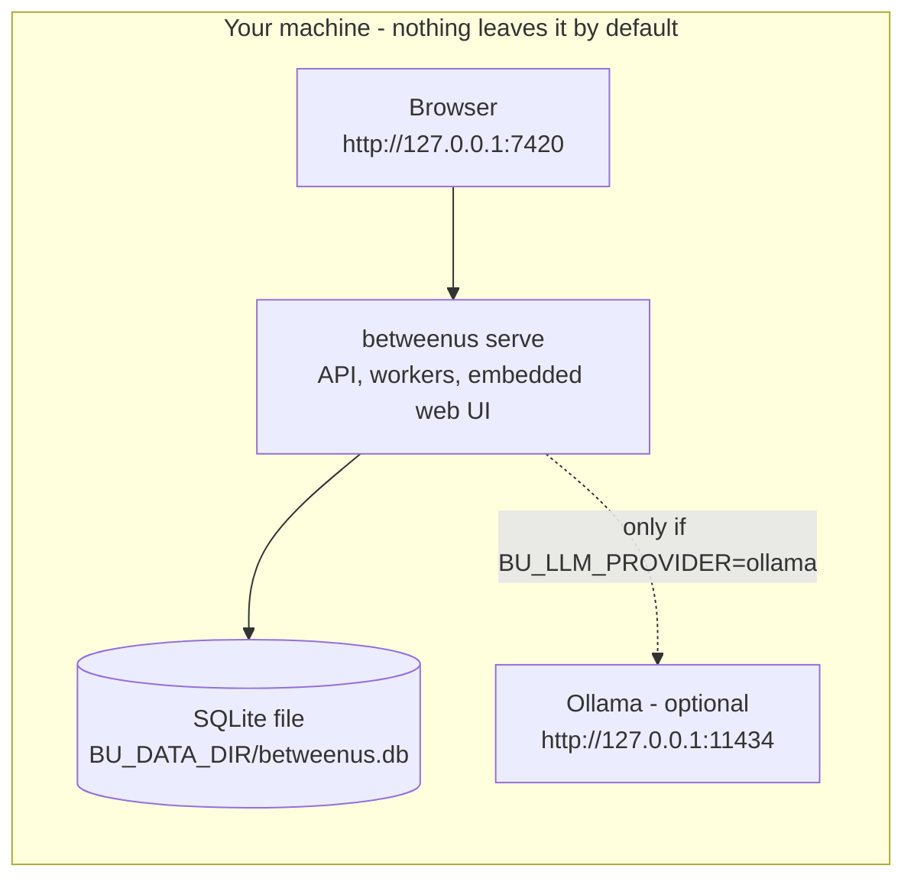
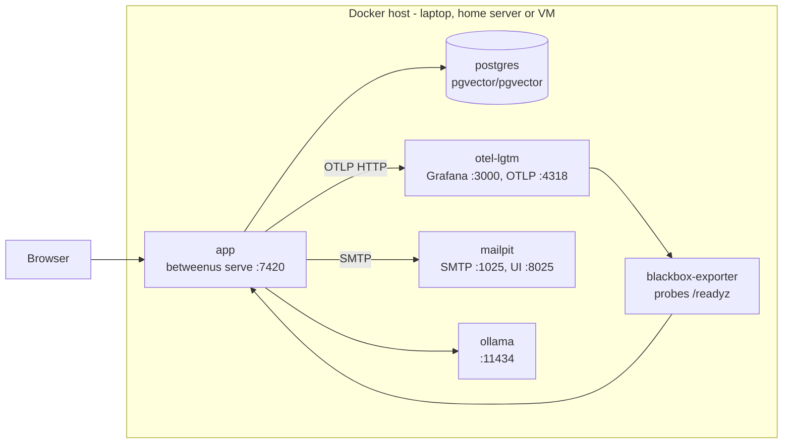
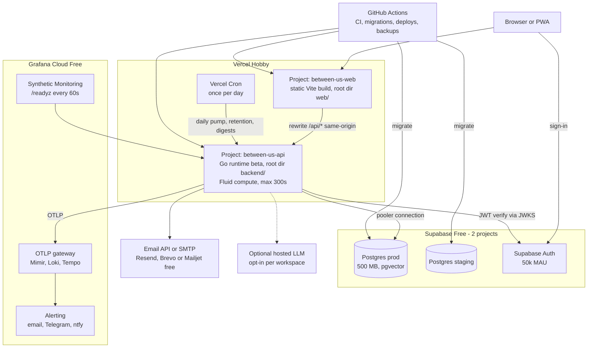
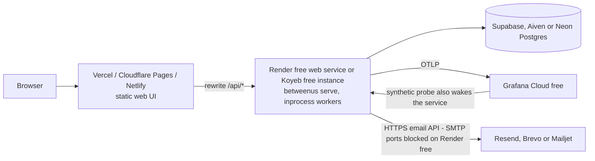
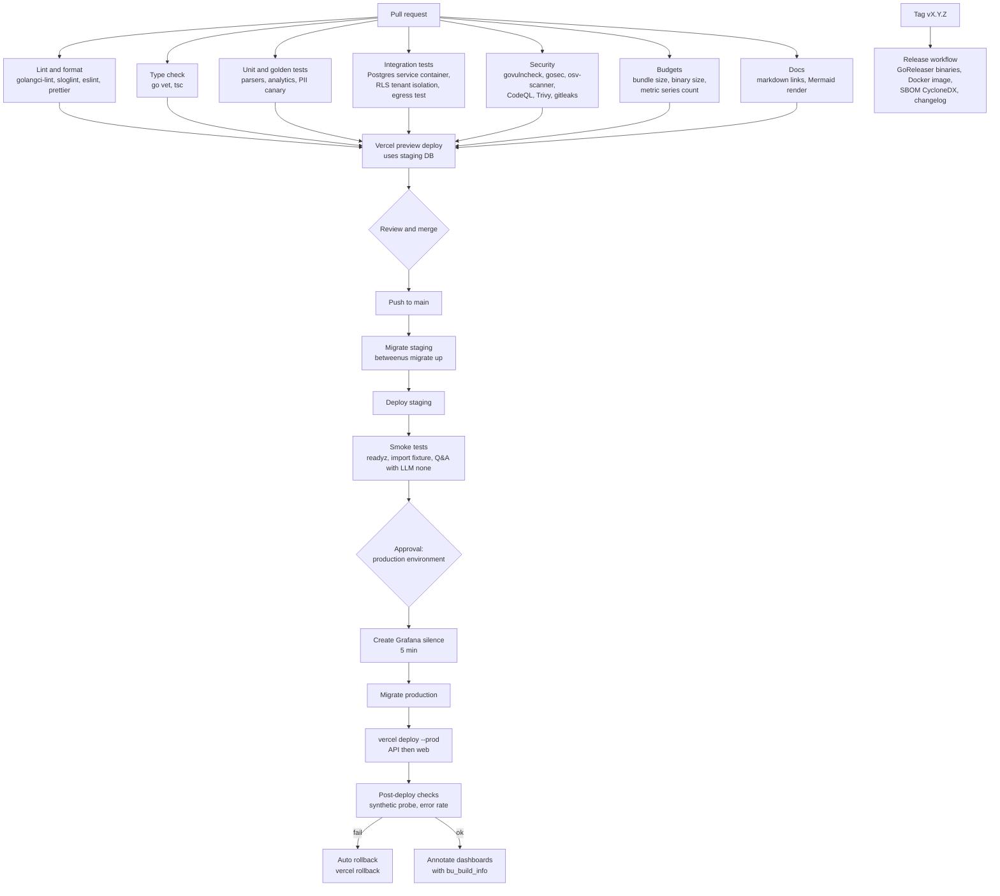

# Between Us — Deployment Guide

| Field | Value |
|---|---|
| Document | Deployment profiles, free-tier matrix, step-by-step cloud setup, CI/CD, operations |
| Status | **Draft v0.1 — for review** |
| Date | 2026-10-24 (free-tier facts verified on this date — re-verify before relying on them) |
| Owner | Platform / operations |
| Implements | G-5, G-6, NFR-COST-001 … 004, NFR-REL-004, NFR-REL-005, NFR-MNT-001, NFR-MNT-006, SEC-005, PRV-001, MVP acceptance criterion 9 |
| Related | [Requirements](01-requirements.md) · [Architecture](02-architecture.md) · [Data model](03-data-model.md) · [Metrics catalog](04-metrics-catalog.md) · [AI insights](05-ai-insights.md) · [Observability](06-observability.md) · [Security & privacy](08-security-privacy.md) · [Notifications](09-notifications.md) · [Roadmap](10-roadmap.md) · [WhatsApp format](parsers/whatsapp.md) · [Telegram format](parsers/telegram.md) |

---

## Table of contents

1. [Profiles at a glance](#1-profiles-at-a-glance)
2. [Profile: local](#2-profile-local)
3. [Profile: local-full (Docker Compose)](#3-profile-local-full-docker-compose)
4. [Profile: cloud-free (reference)](#4-profile-cloud-free-reference)
5. [Free-tier matrix (verified)](#5-free-tier-matrix-verified)
6. [Alternatives matrix](#6-alternatives-matrix)
7. [Step-by-step: deploy cloud-free](#7-step-by-step-deploy-cloud-free)
8. [Environment variable reference](#8-environment-variable-reference)
9. [CI/CD pipeline](#9-cicd-pipeline)
10. [Database migrations on deploy](#10-database-migrations-on-deploy)
11. [Upgrades and rollback](#11-upgrades-and-rollback)
12. [Secrets management](#12-secrets-management)
13. [Backups and their privacy implications](#13-backups-and-their-privacy-implications)
14. [Keeping free tiers awake](#14-keeping-free-tiers-awake)
15. [Adding a custom domain later](#15-adding-a-custom-domain-later)
16. [Cost guardrails](#16-cost-guardrails)

---

## 1. Profiles at a glance

All profiles run **the same `betweenus` binary**; behaviour is selected by `CA_*` environment variables.

| Profile | Who it's for | Runs | Database | Jobs | Auth | Telemetry | Cost |
|---|---|---|---|---|---|---|---|
| `local` | Individuals, privacy-first (default) | One binary, web UI embedded | SQLite file | `inprocess` | `local` single user | Off (or localhost) | $0 |
| `local-full` | Developers, self-hosters on a home server/VM | Docker Compose | PostgreSQL + pgvector | `inprocess` | `local` or `oidc` | `otel-lgtm` | $0 |
| `cloud-free` | A hosted personal / small-group instance | Vercel (web + Go API) | Supabase or Aiven Postgres | `pump` | `supabase` | Grafana Cloud free | $0 |
| `cloud-free-container` | Same, if you prefer a long-running process | Vercel/Cloudflare Pages (web) + Render or Koyeb (API) | Supabase / Aiven / Neon | `inprocess` (+ pump endpoint) | `supabase` | Grafana Cloud free | $0 |

> **Commercial use.** Vercel Hobby is restricted to *non-commercial, personal use* (verified 2026-10-24,
> [Hobby plan](https://vercel.com/docs/plans/hobby)). If the hosted instance will serve paying users, host the web
> UI on Cloudflare Pages or Netlify and the API on a container host, or move to a paid plan. See Q-1 in the
> [Requirements](01-requirements.md#16-open-questions).

## 2. Profile: local



```bash
# Download a release binary (or `make build`), then:
betweenus serve
```

Defaults in this profile:

| Setting | Default | Why |
|---|---|---|
| Listen address | `127.0.0.1:7420` | Loopback only; exposing on a LAN requires `BU_HTTP_ADDR=0.0.0.0:7420` **and** `BU_AUTH_PROVIDER=local` with a passphrase. |
| Data directory | macOS `~/Library/Application Support/betweenus`, Linux `~/.local/share/betweenus`, Windows `%APPDATA%\betweenus` | One folder to back up or delete. |
| LLM | `none` until configured | FR-AI-007 deterministic mode works out of the box. |
| Telemetry | Off | NFR-OBS-008. |
| Egress | Allow-list = loopback only | PRV-001; violations increment `bu_egress_blocked_total` and are refused. |
| Auth | Single implicit user; optional passphrase lock | FR-ADM-001. |

Optional local LLM:

```bash
brew install ollama        # or see ollama.com for Linux/Windows
ollama pull llama3.1:8b    # chat model (any Ollama model works)
ollama pull nomic-embed-text
BU_LLM_PROVIDER=ollama BU_LLM_MODEL=llama3.1:8b BU_EMBED_MODEL=nomic-embed-text betweenus serve
```

## 3. Profile: local-full (Docker Compose)



`deploy/compose/docker-compose.yml` uses Compose **profiles** so each piece is optional:

```bash
cp .env.example .env    # then edit
docker compose -f deploy/compose/docker-compose.yml \
  --profile postgres --profile observability --profile mail --profile ai up -d
```

| Service | Image (pin exact tags in the compose file) | Profile |
|---|---|---|
| `app` | built from `deploy/docker/Dockerfile` (distroless, non-root, ~25 MB) | always |
| `postgres` | `pgvector/pgvector:pg17` | `postgres` |
| `otel-lgtm` | `grafana/otel-lgtm` | `observability` |
| `blackbox` | `prom/blackbox-exporter` | `observability` |
| `mailpit` | `axllent/mailpit` | `mail` |
| `ollama` | `ollama/ollama` | `ai` |
| `ntfy` | `binwiederhier/ntfy` | `push` (optional) |

Without `--profile postgres` the app uses SQLite in a named volume, which makes `local-full` usable as a
"local + observability" setup too.

## 4. Profile: cloud-free (reference)



Key design choices for this profile:

- **Two Vercel projects from one monorepo.** The Go preset requires `go.mod` at the project root, so the API
  project's Root Directory is `backend/`; the web project's is `web/`. The web project **rewrites `/api/*`** to the
  API project, so the browser sees one origin (first-party cookies, no CORS, simple CSP).
- **`BU_JOBS_MODE=pump`.** Vercel Hobby cron runs at most **once per day** with ±59 min precision, so it cannot
  drive a job queue. Instead, while an import or insight job is running, the UI polls
  `POST /api/v1/jobs/{id}/pump`, and each call processes work for up to `BU_PUMP_BUDGET_MS` (default 20 s, well
  under the 300 s Hobby maximum) before returning progress. The daily cron handles retention, digests and
  orphaned jobs; the synthetic `/readyz` probe also advances due jobs (bounded to 2 s).
- **Supabase's two free projects** become `staging` and `production`.
- **App tables live in a non-exposed schema** (`app`), not `public`, so Supabase's auto-generated Data API
  (PostgREST) cannot reach them with the public anon key; the app connects as a dedicated non-owner role so RLS is
  enforced (MT-002; see [Data model](03-data-model.md)).

`cloud-free-container` swaps the API project for a container host:



Trade-offs: no 300 s function cap and true background workers, but the container sleeps when idle (Render: after
15 min, ~1 min to wake; Koyeb: after 1 h), which pauses in-process workers. The pump endpoint stays enabled in every
mode, so a polling UI still makes progress after wake-up.

## 5. Free-tier matrix (verified)

All rows verified on **2026-10-24** unless marked *unverified*. Free tiers change; CI includes a monthly
reminder issue to re-verify this table.

### 5.1 Web, API and compute

| Service | Free allowance (key limits) | Caveats relevant to us | Source |
|---|---|---|---|
| **Vercel Hobby** | 1M function invocations, 4 active-CPU hours, 360 GB-hrs provisioned memory, 100 GB fast data transfer, 1M CDN requests / month; function max duration **300 s**; 100 deployments/day; 200 projects | **Non-commercial personal use only.** Over-limit features pause until 30 days pass. Runtime logs kept **1 hour**. Cron: up to 100 jobs but **once per day**, ±59 min precision. Hobby projects **cannot connect to repos owned by GitHub organisations** — keep the repo under a personal account. | [Hobby plan](https://vercel.com/docs/plans/hobby), [Limits](https://vercel.com/docs/limits), [Cron usage](https://vercel.com/docs/cron-jobs/usage-and-pricing) |
| **Vercel Go runtime** | Available on all plans, **Beta**. Runs a standard `net/http` server listening on `$PORT` (Go preset) or per-file `/api/*.go` handlers. Go version from `go.mod`. | Beta status is a risk; the container profile is the fallback. | [Go runtime](https://vercel.com/docs/functions/runtimes/go) |
| **Cloudflare Pages** | 500 builds/month, 1 concurrent build, 20,000 files/site, 25 MiB max asset | Static web only. Bandwidth and commercial-use terms not stated on the limits page (*unverified*). | [Pages limits](https://developers.cloudflare.com/pages/platform/limits/) |
| **Cloudflare Workers Free** | 100,000 requests/day, **10 ms CPU** per request, 128 MB memory | Not a fit for the Go API (CPU cap, no native Go server); usable only for edge redirects. | [Workers limits](https://developers.cloudflare.com/workers/platform/limits/) |
| **Netlify Free** | **300 credits** (credit-based plan; e.g. bandwidth 20 credits/GB, production deploy 15 credits) | Credit period and overage behaviour not stated on the pricing page (*partially unverified*). Viable static host for the web UI. | [Netlify pricing](https://www.netlify.com/pricing/) |
| **Render Free web service** | 750 instance-hours / workspace / month; spins down after **15 min** idle, ~1 min spin-up | **Outbound ports 25, 465, 587 blocked** → SMTP impossible, use an HTTP email API. Ephemeral filesystem (no SQLite). RAM/CPU not stated. Free Postgres **expires after 30 days** → do not use it as the DB. | [Render free](https://render.com/docs/free) |
| **Koyeb Free instance** | 1 per organisation: 512 MB RAM, 0.1 vCPU, 2 GB SSD; Frankfurt or Washington D.C.; scales to zero after **1 h** idle | Cannot be a worker service; no volumes. Secondary sources report that since Feb 2026 new sign-ups require a card and default to the paid Pro plan (*unverified on koyeb.com*). | [Koyeb instances](https://www.koyeb.com/docs/reference/instances) |
| **GitHub Actions** | **Free for public repos** on standard runners; private repos on GitHub Free: 2,000 min/month, 500 MB artifacts | Without a payment method, usage simply stops at the quota (no surprise bills). | [Actions billing](https://docs.github.com/en/billing/concepts/product-billing/github-actions) |

### 5.2 Database and auth

| Service | Free allowance | Caveats | Source |
|---|---|---|---|
| **Supabase Free** | 500 MB DB per project, 1 GB file storage, 5 GB egress, **50,000 auth MAU**, 2 active projects, 500k Edge Function invocations | **Pauses after 1 week of inactivity**; **no automatic backups** on Free. pgvector is available as an extension. Direct DB host may be IPv6-only — use the Supavisor pooler connection string from IPv4 environments (Vercel, GitHub Actions) (*verify in your project's Connect dialog*). | [Supabase pricing](https://supabase.com/pricing) |
| **Aiven Free PostgreSQL** | 1 CPU, 1 GB RAM, **1 GB disk**, single node, backups included; no time limit; no card required | **max_connections = 20**, no connection pooling, one free PG service per org; may be powered off when idle (with notice); region/cloud chosen by Aiven. pgvector on the free plan not explicitly confirmed (*unverified*). No auth service — pair with Supabase Auth or `local`/`oidc`. | [Aiven PG free tier](https://aiven.io/docs/products/postgresql/concepts/pg-free-tier), [Aiven free plans](https://aiven.io/docs/platform/concepts/free-plan) |
| **Neon Free** | 1 GB storage per project (20 GB total), 100 CU-hours per project, 100 projects; pgvector included; no card | Compute **suspends after 5 min** idle (always on for Free) → cold-start latency on first query. | [Neon pricing](https://neon.com/pricing) |

### 5.3 Observability

| Service | Free allowance | Caveats | Source |
|---|---|---|---|
| **Grafana Cloud Free** | **10k active metric series**, 50 GB logs, 50 GB traces, 50 GB profiles, **14-day retention**, 3 active users, 3 IRM users, 100k synthetic API test executions, 10k browser test executions, 50k frontend sessions / month | Free-tier alerting limits not listed on the pricing page (*unverified*); we stay well inside them with ~20 rules. | [Grafana pricing](https://grafana.com/pricing/) |
| **Self-hosted LGTM** (`grafana/otel-lgtm`) | Unlimited (your hardware) | Dev/small-scale image, not HA. | FOSS (AGPL-3.0 components) |

### 5.4 Notifications

| Service | Free allowance | Caveats | Source |
|---|---|---|---|
| **Resend Free** | 3,000 emails/month, **100/day**, 3 custom domains, SMTP relay + API | Sending from your own address requires a verified domain (i.e. after you add a custom domain). | [Resend pricing](https://resend.com/pricing) |
| **Brevo Free** | **300 emails/day**, transactional SMTP relay + API | Brevo branding on emails; figures from multiple 2026 secondary sources (pricing page did not render) — *treat as unverified*. | [Brevo review 2026](https://dreamlit.ai/blog/brevo-review) |
| **Mailjet Free** | **200/day, 6,000/month**, API + SMTP relay + webhooks | Mailjet logo on free sends. | [Mailjet pricing](https://www.mailjet.com/pricing/) |
| **Amazon SES** | $0.10 per 1,000 emails + $0.12/GB attachments | **No standing free quota** any more; new AWS accounts get up to $200 credits for 6 months. Requires a card. | [SES pricing](https://aws.amazon.com/ses/pricing/) |
| **ntfy.sh** (public) | Free; 15 MB attachments (100 MB per visitor), attachments expire after 3 h | Daily message cap per visitor not documented on the current docs page (*unverified*; older configs show 500/day). Self-host for guaranteed limits. | [ntfy publish docs](https://docs.ntfy.sh/publish/) |
| **Telegram Bot API** | Free; ~1 msg/s per chat, ~30 msg/s overall, 20 msg/min per group | Paid broadcasts only needed beyond 30 msg/s. | [Bot FAQ](https://core.telegram.org/bots/faq) |
| **SMS Gateway for Android** (FOSS) | Free software (Apache-2.0); you pay your carrier's SMS rates | Local, cloud (`api.sms-gate.app`) or private server modes. | [GitHub](https://github.com/capcom6/android-sms-gateway) |
| **Textbelt** | 1 free SMS/day with `key=textbelt`; FOSS self-hosted version uses email-to-SMS gateways | Testing only. | [textbelt.com](https://textbelt.com/) |
| **Twilio trial** | Trial credit; sends only to verified numbers with a trial prefix | Exact credit amount *unverified* (help page did not render). | [Twilio trial](https://help.twilio.com/articles/223136107-How-does-Twilio-s-Free-Trial-work-) |

### 5.5 Hosted LLM free tiers (opt-in only — PRV-003)

| Service | Free allowance | Privacy caveat | Source |
|---|---|---|---|
| **Groq** (Developer/free) | Per-model limits, e.g. `openai/gpt-oss-20b`: 30 RPM, 1K RPD, 8K TPM, 200K TPD | Check current limits in the Groq console per model. | [Groq rate limits](https://console.groq.com/docs/rate-limits) |
| **Google Gemini API** (unpaid) | Per-model limits shown in AI Studio | **Unpaid use: Google uses inputs/outputs to improve products and human reviewers may read them; terms say not to submit sensitive or personal information.** (EEA/UK/CH: paid-tier data terms apply, but apps for users there must use paid services.) → The app **blocks unpaid Gemini for chat content by default**. | [Gemini API terms](https://ai.google.dev/gemini-api/terms) |
| **OpenRouter** `:free` models | 20 RPM; **50 requests/day** (< 10 credits purchased) or 1,000/day (≥ 10 credits purchased) | Data policy varies by upstream provider; free-model providers may log prompts. | [OpenRouter limits](https://openrouter.ai/docs/api/reference/limits) |
| **Ollama** (local) | Unlimited, your hardware | Data never leaves the machine. **Default.** | FOSS (MIT) |

## 6. Alternatives matrix

Every external dependency has a free hosted option and a FOSS self-hosted option (NFR-COST-002, NFR-COST-004).

| Capability | Reference (free) | Free alternatives | FOSS self-hosted |
|---|---|---|---|
| Static web hosting | Vercel Hobby | Cloudflare Pages, Netlify, GitHub Pages (static only) | Served by the Go binary itself (`embed`) or Caddy/nginx |
| API compute | Vercel Go Functions | Render free, Koyeb free | Any VM / home server with Docker |
| Postgres | Supabase Free | Aiven Free, Neon Free | `pgvector/pgvector` container |
| Auth | Supabase Auth | — | Built-in `local`; Keycloak, Zitadel, Authentik via `oidc`; self-hosted Supabase GoTrue |
| Telemetry | Grafana Cloud Free | — | `grafana/otel-lgtm`, full LGTM stack, SigNoz, Uptrace |
| Error tracking (optional) | — | — | GlitchTip (Sentry-compatible) |
| Email | Resend / Brevo / Mailjet free | Gmail SMTP with an app password (personal instances) | Stalwart, Mailu, Mailcow, Postal (relay through a smarthost) |
| Push | ntfy.sh, Telegram bot | — | Self-hosted ntfy |
| SMS | — | Textbelt (1/day) | SMS Gateway for Android (private server mode) |
| LLM | Ollama (local) | Groq, OpenRouter free, Gemini (non-sensitive only) | Ollama, llama.cpp server, vLLM |
| CI/CD | GitHub Actions (public repo) | — | Forgejo/Gitea Actions, Woodpecker CI |
| Backups target | Your own machine | Object storage free allowances (*unverified per provider*) | MinIO/Garage, restic repository |

## 7. Step-by-step: deploy cloud-free

Prerequisites: a **personal** GitHub account (Vercel Hobby cannot link org-owned repos), and free accounts on
Vercel, Supabase, Grafana Cloud and one email provider. No payment card is needed for any of these at the time of
verification.

### Step 1 — Repository

1. Push this repository to GitHub under your personal account. Public repos get unlimited Actions minutes and
   free CodeQL (Q-6).
2. Enable branch protection on `main`: required checks `ci / backend`, `ci / web`, `ci / security`, and 1 review
   (or self-review for solo projects).
3. Create GitHub **Environments** `staging` and `production`; add a required reviewer on `production`.

### Step 2 — Databases (Supabase)

1. Create two projects: `between-us-staging` and `between-us-prod`, in the same region you will use for the
   API functions.
2. In each project, open **Connect** and copy:
   - the **transaction pooler** string (port `6543`) → `BU_DB_DSN` for the app (serverless-friendly);
   - the **session pooler** string (port `5432`) → `BU_DB_MIGRATE_DSN` for migrations (needs session-level advisory
     locks).
3. The first migration (run in step 5) creates the `app` schema, the `vector` extension, the non-owner role
   `bu_app` and RLS policies. Set the `bu_app` password via the migration secret `BU_DB_APP_PASSWORD`, then point
   `BU_DB_DSN` at `bu_app`, not at `postgres`.
4. **Auth** → URL configuration: Site URL = your web URL (`https://between-us-web.vercel.app`), add the staging
   preview URL pattern to redirect URLs. Disable sign-ups that you don't want (e.g. allow only email + password
   or magic link). Copy the project URL → `BU_SUPABASE_URL`; the API verifies JWTs via the project's JWKS endpoint
   (`BU_SUPABASE_JWKS_URL`).
5. **Data API**: ensure the `app` schema is **not** in the exposed schemas list.

*Aiven alternative:* create a free PostgreSQL service, copy the service URI (with `sslmode=require`), set
`BU_DB_MAX_CONNS=5` (20 total connections, no pooler), and use `BU_AUTH_PROVIDER=local` or `oidc`.

### Step 3 — Grafana Cloud

1. Create a stack; create an access policy token with `metrics:write`, `logs:write`, `traces:write` →
   `OTEL_EXPORTER_OTLP_ENDPOINT` and `OTEL_EXPORTER_OTLP_HEADERS` (see
   [Observability §11](06-observability.md#11-hosted-stack-grafana-cloud-free)).
2. Create a CI token with dashboard/alert write scopes → GitHub secret `GRAFANA_CI_TOKEN`, plus `GRAFANA_URL`.
3. Contact points: your email, a Telegram bot token + chat ID, and an ntfy topic (stored as GitHub secrets; the
   `deploy-observability` job applies them).

### Step 4 — Email provider

Create a Resend, Brevo or Mailjet account and an **API key** (preferred over SMTP: works from every host,
including Render free where SMTP ports are blocked). Until you have a custom domain, see
[Notifications §9](09-notifications.md#9-deliverability) for sender-address limits.

### Step 5 — Vercel API project

1. **Add New → Project** → import the repo → Root Directory `backend/` → Framework preset **Go**.
2. Build command: `go build -trimpath -ldflags "-s -w -X main.version=$VERCEL_GIT_COMMIT_SHA" -o server ./cmd/betweenus`
   (the binary starts in `serve` mode when no subcommand is given and listens on `$PORT`).
3. Function region: same region as Supabase. Max duration: 300 s (Hobby maximum).
4. Environment variables (mark secrets as **Sensitive**): see [§8](#8-environment-variable-reference); at minimum
   `BU_PROFILE=cloud-free`, `BU_ENV`, `BU_DB_DSN`, `BU_AUTH_PROVIDER=supabase`, `BU_SUPABASE_URL`,
   `BU_SUPABASE_JWKS_URL`, `BU_JOBS_MODE=pump`, `BU_PUMP_SECRET`, `BU_PUBLIC_BASE_URL`, `BU_TELEMETRY_SALT`,
   `BU_OTEL_ENABLED=true`, OTLP vars, email vars.
5. Disable Vercel's automatic **production** deployments for this project (`git.deploymentEnabled` for `main` =
   false in `backend/vercel.json`); production is promoted by GitHub Actions *after* migrations (step 8).
   Preview deployments for PRs stay on and use the staging database.
6. `backend/vercel.json` also declares the daily cron: `{"crons":[{"path":"/api/v1/internal/cron/daily","schedule":"17 3 * * *"}]}`
   — the handler verifies Vercel's `CRON_SECRET` bearer header.

### Step 6 — Vercel web project

1. New project → same repo → Root Directory `web/` → preset **Vite**.
2. `web/vercel.json` rewrites API calls to the API project so the app is same-origin:
   ```json
   {
     "rewrites": [
       { "source": "/api/:path*", "destination": "https://between-us-api.vercel.app/api/:path*" },
       { "source": "/(.*)", "destination": "/index.html" }
     ],
     "headers": [
       { "source": "/(.*)", "headers": [
         { "key": "Strict-Transport-Security", "value": "max-age=63072000; includeSubDomains" },
         { "key": "X-Content-Type-Options", "value": "nosniff" },
         { "key": "Referrer-Policy", "value": "no-referrer" }
       ]}
     ]
   }
   ```
   (CSP is set by the API on HTML responses in local mode and by this file in hosted mode; the full policy is in
   [Security & privacy](08-security-privacy.md).)
3. Env vars: `VITE_SUPABASE_URL`, `VITE_SUPABASE_ANON_KEY` (public by design; RLS + non-exposed schema protect data).

### Step 7 — Synthetic check and dashboards

1. Grafana Cloud → Synthetic Monitoring → HTTP check on `https://between-us-web.vercel.app/api/readyz`
   (through the rewrite, so the whole path is tested), every 60 s, one probe location.
2. Run the `deploy-observability` workflow once to push dashboards, alert rules and contact points.

### Step 8 — First release

1. Merge to `main` → CI runs → the `deploy` workflow migrates **staging**, deploys to staging (preview alias),
   runs smoke tests, then waits for approval on the `production` environment → migrates **production** →
   `vercel deploy --prod` for API, then web.
2. Smoke test: `/api/readyz` returns 200; sign up; import a synthetic fixture from `backend/testdata/`; see the
   import trace in Grafana Tempo; trigger a test alert (`betweenus admin test-alert`) and receive it.

## 8. Environment variable reference

All app settings use the `CA_` prefix (12-factor). Standard `OTEL_*` variables are honoured as-is. The
commented `.env.example` at the repo root will mirror this table, which is the **authoritative reference** for all docs.

| Variable | Default | Profiles | Description |
|---|---|---|---|
| `BU_PROFILE` | `local` | all | `local`, `local-full`, `cloud-free`, `cloud-free-container` — sets safe defaults for everything below |
| `BU_MODE` | `local` for `local`, else `hosted` | all | `local` = single implicit tenant/user; `hosted` = multi-tenant |
| `BU_ENV` | `local` | all | `local`, `staging`, `production` (telemetry `deployment.environment.name`) |
| `BU_HTTP_ADDR` | `127.0.0.1:7420` | all | Listen address; `PORT` (set by Vercel/Render/Koyeb) overrides the port |
| `BU_PUBLIC_BASE_URL` | `http://127.0.0.1:7420` | all | External URL used in emails, OAuth redirects, unsubscribe links |
| `BU_DATA_DIR` | OS-specific | local | SQLite file, keys, optional kept exports |
| `BU_DB_DRIVER` | `sqlite` | all | `sqlite` or `postgres` |
| `BU_DB_DSN` | `file:$BU_DATA_DIR/betweenus.db` | all | App connection (Postgres: non-owner `bu_app` role) |
| `BU_DB_MIGRATE_DSN` | = `BU_DB_DSN` | postgres | Owner/session connection used only by `betweenus migrate` |
| `BU_DB_MAX_CONNS` | `10` (`5` serverless) | postgres | Pool size; keep low on Aiven free (20 total) |
| `BU_DB_SIZE_LIMIT_BYTES` | unset | hosted | Free-tier DB size for `DbSizeNearLimit` (e.g. `524288000`) |
| `BU_MIGRATE_ON_START` | `true` local, `false` hosted | all | Auto-migrate at boot (local) vs CI-driven (hosted) |
| `BU_JOBS_MODE` | `inprocess` | all | `inprocess` or `pump` |
| `BU_JOBS_CONCURRENCY`, `BU_JOBS_PER_TENANT` | `2`, `2` | inprocess | Worker goroutines; max concurrent jobs per tenant (fairness) |
| `BU_PUMP_BUDGET_MS` | `20000` | pump | Max work per pump call |
| `BU_PUMP_SECRET` | — | pump | Shared secret for cron/synthetic-triggered pumps |
| `CRON_SECRET` | — | Vercel | Set by you; Vercel sends it as a bearer token to cron paths |
| `BU_AUTH_PROVIDER` | `local` | all | `local`, `supabase`, `oidc` |
| `BU_SESSION_SECRET` | generated (local) | local auth | Session cookie signing key (32+ bytes) |
| `BU_SUPABASE_URL`, `BU_SUPABASE_JWKS_URL` | — | supabase | Project URL and JWKS for JWT verification |
| `BU_OIDC_ISSUER`, `BU_OIDC_CLIENT_ID`, `BU_OIDC_CLIENT_SECRET` | — | oidc | Generic OIDC provider |
| `BU_UPLOAD_MAX_BYTES` | `524288000` | all | Total export size cap (500 MB); uploads arrive in ≤ 4 MB parts (FR-ING-016) |
| `BU_KEEP_RAW_EXPORTS` | `false` | all | Opt-in to keep original exports (FR-ING-014) |
| `BU_RATE_LIMIT_RPS` | `10` | hosted | Per-tenant request rate (SEC-008) |
| `BU_CORS_ORIGINS` | empty (same-origin) | hosted | Only needed if web and API are on different origins without a rewrite |
| `BU_QUOTA_CHATS`, `BU_QUOTA_MESSAGES`, `BU_QUOTA_LLM_TOKENS_MONTH` | `5`, `500000`, provider-specific | hosted | Default per-tenant quotas (MT-005, NFR-PERF-006); lower `BU_QUOTA_MESSAGES` on a 500 MB free DB — see [Data model sizing](03-data-model.md#8-sizing-vs-free-tiers) |
| `BU_MASTER_KEY` | — | P2 | Key-encryption key for per-tenant envelope encryption (MT-006, SEC-002) |
| `BU_LLM_PROVIDER` | `none` | all | `none`, `ollama`, `openai-compatible`, `anthropic` |
| `BU_LLM_BASE_URL` | provider default | all | e.g. `http://127.0.0.1:11434`, `https://api.groq.com/openai/v1` |
| `BU_LLM_API_KEY` | — | hosted LLMs | Secret |
| `BU_LLM_MODEL`, `BU_LLM_FAST_MODEL` | — | all | Main and cheap model (emotion labels, routing); see [AI insights](05-ai-insights.md) |
| `BU_EMBED_PROVIDER`, `BU_EMBED_MODEL` | `none`, — | all | Embeddings; `none` = full-text search only |
| `BU_LLM_TIMEOUT` | `120s` | all | Per-request timeout; keep below the function limit in `pump` mode |
| `BU_LLM_REDACT_PII` | `true` | hosted LLMs | Redact PII before sending to hosted providers (PRV-003) |
| `BU_LLM_DEBUG_CAPTURE` | `false` | local only | Write rendered prompts to a local file; refused in hosted mode |
| `BU_PROMPT_DIR`, `BU_LEXICON_DIR` | embedded | local | Override embedded prompt templates / sentiment lexicons |
| `BU_LLM_MAX_CONCURRENCY` | `2` | all | Per-process cap |
| `BU_LLM_DAILY_BUDGET_USD` | `0` | hosted | Cost alert threshold; `0` = alert on any paid usage |
| `BU_LLM_ALLOW_UNPAID_TRAINING_PROVIDERS` | `false` | hosted | Must be `true` to allow providers whose free tier trains on inputs (e.g. unpaid Gemini) |
| `BU_EGRESS_ALLOWLIST` | loopback (local) | all | Comma-separated hosts the app may call (PRV-001) |
| `BU_OTEL_ENABLED` | `false` local, `true` hosted | all | Master switch for OTLP export |
| `BU_OTEL_SAMPLE_RATIO` | `0.2` | hosted | HTTP trace sampling ratio |
| `BU_TELEMETRY_SALT` | — | hosted | HMAC salt for `tenant_hash`/`user_hash` |
| `BU_METRICS_ENABLED`, `BU_METRICS_TOKEN`, `BU_METRICS_ADDR` | `false`, —, — | all | Prometheus `/metrics`, its bearer token, optional separate listener |
| `BU_PPROF_ENABLED` | `false` | all | pprof on loopback only |
| `BU_LOG_LEVEL`, `BU_LOG_FORMAT` | `info`, `text` local / `json` hosted | all | slog settings |
| `OTEL_EXPORTER_OTLP_ENDPOINT`, `OTEL_EXPORTER_OTLP_HEADERS`, `OTEL_EXPORTER_OTLP_PROTOCOL` | — | all | Standard OTel exporter config |
| `BU_NOTIFY_CHANNELS` | `log` | all | Enabled channels: `email`, `push` (ntfy), `telegram`, `sms`, `log` |
| `BU_EMAIL_TRANSPORT` | `smtp` | all | `smtp` or `api` |
| `BU_EMAIL_API_PROVIDER`, `BU_EMAIL_API_KEY` | — | api | `resend`, `brevo`, `mailjet` |
| `BU_SMTP_HOST`, `BU_SMTP_PORT`, `BU_SMTP_USERNAME`, `BU_SMTP_PASSWORD`, `BU_SMTP_TLS` | Mailpit `localhost:1025` in local-full | smtp | `BU_SMTP_TLS`: `starttls`, `implicit`, `none` (dev only) |
| `BU_EMAIL_FROM`, `BU_EMAIL_REPLY_TO` | — | email | Sender identity |
| `BU_EMAIL_DAILY_LIMIT` | provider-specific | email | Local counter to respect free quotas |
| `BU_NTFY_URL`, `BU_NTFY_TOKEN` | — | ntfy | Server URL and access token |
| `BU_TELEGRAM_BOT_TOKEN` | — | telegram | Bot token (secret) |
| `BU_SMS_GATEWAY_URL`, `BU_SMS_GATEWAY_USERNAME`, `BU_SMS_GATEWAY_PASSWORD` | — | P3 | Android SMS gateway |

## 9. CI/CD pipeline

Workflows in `.github/workflows/`: `ci.yml` (every PR/push), `deploy.yml` (main), `release.yml` (tags),
`deploy-observability.yml` (changes under `deploy/grafana/`), `backup.yml` (scheduled), `verify-free-tiers.yml`
(monthly reminder issue).



Notes:

- PR previews never touch production data; the staging database contains only synthetic fixtures.
- `vercel deploy` from Actions uses `VERCEL_TOKEN`, `VERCEL_ORG_ID`, `VERCEL_PROJECT_ID_API`,
  `VERCEL_PROJECT_ID_WEB` (environment secrets).
- Release artefacts: `betweenus_<os>_<arch>` for macOS (arm64/amd64), Linux (amd64/arm64), Windows (amd64),
  with the web UI embedded; cosign signing in P2 (SEC-007).

## 10. Database migrations on deploy

- Tool: `goose`, migrations in `backend/migrations/{postgres,sqlite}/` (forward-only, NFR-REL-004).
- **Local:** `BU_MIGRATE_ON_START=true` — on startup the binary first copies the SQLite file to
  `betweenus.db.bak-<fromVersion>`, then migrates inside a transaction.
- **Hosted:** migrations run from GitHub Actions (`betweenus migrate up`) using `BU_DB_MIGRATE_DSN`, holding a
  Postgres advisory lock so concurrent runs are impossible. The app never migrates itself in hosted mode
  (serverless instances would race).
- **Expand → migrate → contract.** Every schema change must be compatible with the previous app version
  (add nullable columns, backfill in a job, switch reads, drop later in a separate release). This is what makes
  app-only rollback safe.
- `/readyz` fails with `schema_behind` if the DB version is older than the binary requires, so a deploy that
  skipped migrations is caught by the synthetic check within minutes.

## 11. Upgrades and rollback

| Profile | Upgrade | Rollback |
|---|---|---|
| `local` | Replace the binary (or `betweenus self-update` in P2); migrations auto-run with a pre-migration backup copy | Restore the previous binary **and** the `.bak-<version>` DB copy |
| `local-full` | `docker compose pull && docker compose up -d` (pinned tags bumped by PR) | Re-pin the previous tag; restore Postgres from the last `pg_dump` if a migration must be undone |
| `cloud-free` | CI pipeline (§9) | `vercel rollback` / "Instant Rollback" to the previous production deployment (app only — schema stays, safe because of expand/contract) |
| `cloud-free-container` | Render/Koyeb auto-deploy from a release tag or image | Redeploy the previous image tag |

## 12. Secrets management

- **Never in the repo** (SEC-005). `.gitignore` excludes `.env*` except `.env.example`; `gitleaks` runs in CI.
- **Hosted runtime secrets** live in Vercel (type *Sensitive* — not readable after save) or the container host's
  secret store. **CI secrets** live in GitHub Environment secrets, scoped to `staging` / `production`.
- **Local:** `.env` file (0600) or OS keychain integration (P2). The local session secret and future master key
  are generated on first run into `BU_DATA_DIR/keys/` with 0600 permissions.
- **Optional encrypted config in git:** SOPS + age (both FOSS) for operators who want GitOps for secrets.
- **Rotation:** every secret has a documented rotation procedure in `docs/runbooks/rotate-secrets.md` (P2); JWT
  verification via JWKS means Supabase key rotation needs no app change.
- The Supabase `service_role` key is **not used** by the app at all.

## 13. Backups and their privacy implications

Supabase Free has **no automatic backups**; Aiven Free includes backups (retention not documented); Neon has
point-in-time history within its free limits. The project therefore ships its own backup path.

| Aspect | Design |
|---|---|
| Mechanism | `betweenus admin backup` → `pg_dump --format=custom` of the `app` schema → streamed through **age** encryption (recipient public key) → never written unencrypted to disk |
| Where it runs | **Recommended:** on the operator's own machine via cron/launchd (`scripts/backup.sh`). **Optional:** the `backup.yml` workflow — only in a **private** repository, because artifacts of public repos can be downloaded by others (even though encrypted, size and timing leak) |
| Where it's stored | Operator-controlled storage (local disk, NAS, a restic repository, or object storage you control) |
| Retention | 7 daily + 4 weekly → maximum age **35 days** |
| Key handling | age **private key never in CI**; only the public recipient is a secret in CI. Losing the private key = losing backups (documented) |
| Restore drill | Quarterly: restore into the staging project and run `betweenus admin verify-restore` (row counts, RLS checks) |
| Local profile | The DB is a single file; back up `BU_DATA_DIR` with any tool (Time Machine, restic). Encrypted SQLite (P2) protects copies |

**Privacy implications (PRV-006).** A deleted chat disappears from the live DB within 24 h but survives in
encrypted backups until they age out (≤ 35 days). This is disclosed in the privacy notice and the deletion
confirmation dialog. Restores re-apply a **deletion ledger** (IDs of erased chats/tenants, no content) so restored
data that was previously erased is purged again immediately. Backups are Restricted data: only the operator holds
the decryption key.

## 14. Keeping free tiers awake

| Provider | Idle behaviour | What keeps it awake |
|---|---|---|
| Supabase Free | Pauses after 1 week of inactivity; restore from dashboard | Real usage; the 60 s synthetic `/readyz` check performs a DB ping as part of normal health checking |
| Aiven Free | May be powered off after inactivity (with notice) | Same synthetic check; power back on from the console |
| Neon Free | Compute suspends after 5 min (by design) | Nothing needed — it resumes on the next query (first query slower) |
| Render Free | Spins down after 15 min; ~1 min cold start | Not recommended to defeat; accept cold starts or use Vercel |
| Koyeb Free | Scales to zero after 1 h | Same as Render |

**Terms-of-service note.** The synthetic check exists for **monitoring** (K-5, SLO-7) and is the same check any
production system runs. Pinging solely to circumvent a provider's idle policy may conflict with its fair-use terms;
operators should read the current terms of each provider. If a provider objects, reduce the check to every
5–10 minutes or accept pausing for a personal instance (data is preserved while paused).

## 15. Adding a custom domain later

No domain is required: the app works on `*.vercel.app`. When you buy one (e.g. `example.com`):

1. **Web:** Vercel → web project → Settings → Domains → add `example.com` and `www.example.com`. Create the DNS
   records Vercel shows (typically an `A` record for the apex and a `CNAME` for subdomains; use the exact values
   displayed in the dashboard, which can be project-specific). Vercel issues TLS automatically.
2. **API:** keep it behind the web rewrite (recommended — nothing to change), or add `api.example.com` to the API
   project / Render / Koyeb with a `CNAME` to the host they show, then set `BU_CORS_ORIGINS=https://example.com`.
3. **App config:** update `BU_PUBLIC_BASE_URL`, the rewrite `destination` if you used an API subdomain, Supabase
   Auth Site URL and redirect URLs, the Grafana synthetic check URL, and OAuth client redirect URIs (`oidc`).
4. **Cookies:** keep host-only cookies (no `Domain=` attribute) unless the API is on a separate subdomain.
5. **Email:** verify the domain with your email provider and publish **SPF**, **DKIM** and **DMARC** records
   (see [Notifications §9](09-notifications.md#9-deliverability)); switch `BU_EMAIL_FROM` to
   `notifications@mail.example.com`.
6. **HSTS preload** only after everything works on HTTPS for a few weeks.

## 16. Cost guardrails

The reference deployment is designed so that exceeding a free tier causes **degradation, not a bill**:

| Guardrail | How |
|---|---|
| No payment methods | Don't add cards to Vercel, Supabase, Grafana Cloud, GitHub. Hobby/free tiers then pause or stop at limits instead of billing. |
| LLM spend | Default provider `ollama`/`none`; per-tenant token quotas (MT-005); `LlmDailyCostBudget` alert at `$0`; provider-side spend caps where offered. |
| DB size | `BU_DB_SIZE_LIMIT_BYTES` + `DbSizeNearLimit` alert at 80%; per-tenant message quotas (default 5 chats / 500k messages, NFR-PERF-006); raw exports not stored (FR-ING-014). |
| Function usage | Pump budget per call (20 s) and rate limits keep active-CPU well under 4 h/month for personal use; `vercel` usage dashboard checked by the monthly verification issue. |
| Telemetry | Series budget ≤ 4,000 enforced in CI; log sampling; trace sampling 20% for HTTP. |
| Email | `BU_EMAIL_DAILY_LIMIT` counter below the provider cap; digests deferred when near the limit. |
| CI | Public repo (free minutes); caches; skip heavy jobs on docs-only changes. |
| Visibility | `overview.json` has a "free-tier headroom" row (DB size, series count, email quota, LLM cost). |
