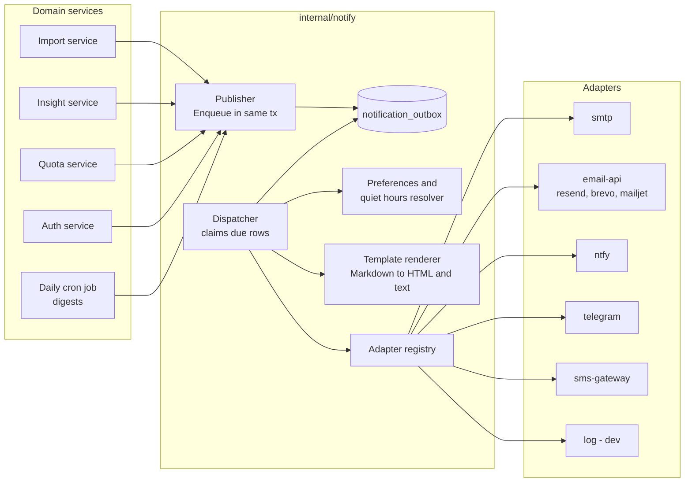
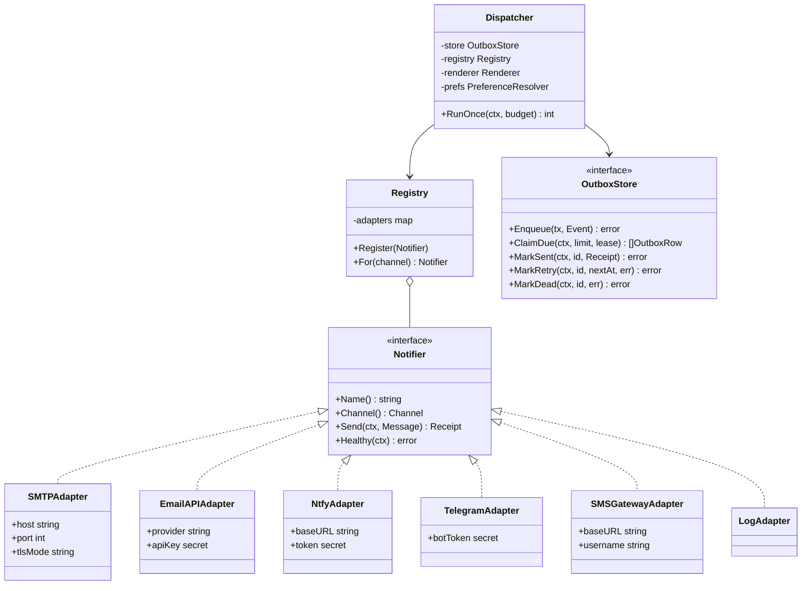
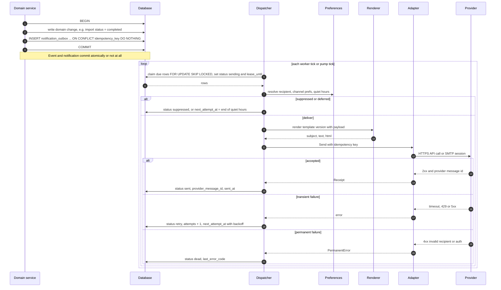

# Between Us — Notifications

| Field | Value |
|---|---|
| Document | Notification subsystem design (Notifier, adapters, outbox, templates, preferences, providers) |
| Status | **Draft v0.1 — for review** |
| Date | 2026-10-24 (provider limits verified on this date) |
| Owner | Platform |
| Implements | FR-NOT-001 … FR-NOT-008, FR-AI-009, NFR-OBS-006, NFR-REL-003, NFR-COST-002, PRV-007 |
| Related | [Requirements](01-requirements.md) · [Architecture](02-architecture.md) · [Data model](03-data-model.md) · [Metrics catalog](04-metrics-catalog.md) · [AI insights](05-ai-insights.md) · [Observability](06-observability.md) · [Deployment](07-deployment.md) · [Security & privacy](08-security-privacy.md) · [Roadmap](10-roadmap.md) · [WhatsApp format](parsers/whatsapp.md) · [Telegram format](parsers/telegram.md) |

---

## Table of contents

1. [Goals and principles](#1-goals-and-principles)
2. [Architecture](#2-architecture)
3. [Notifier interface and adapters](#3-notifier-interface-and-adapters)
4. [Event catalogue](#4-event-catalogue)
5. [Transactional outbox](#5-transactional-outbox)
6. [Retries, backoff and dead-letter](#6-retries-backoff-and-dead-letter)
7. [Templates](#7-templates)
8. [Preferences, quiet hours and unsubscribe](#8-preferences-quiet-hours-and-unsubscribe)
9. [Deliverability](#9-deliverability)
10. [Provider comparison](#10-provider-comparison)
11. [Configuration examples](#11-configuration-examples)
12. [Testing](#12-testing)

---

## 1. Goals and principles

1. **Pluggable by configuration** (FR-NOT-001): channels are enabled with `BU_NOTIFY_CHANNELS`; adding a provider
   means adding one adapter file, never touching domain code.
2. **Free and self-hostable first** (NFR-COST-002): SMTP to any mailbox, HTTP email APIs with free tiers, ntfy,
   Telegram bots, and a FOSS Android SMS gateway.
3. **Never lose, never duplicate** (FR-NOT-004): every notification is written to an outbox in the same database
   transaction as the event that caused it, and delivered at-least-once with idempotency keys so providers that
   support them deliver effectively once.
4. **No chat content in notifications by default.** Email, push and SMS travel through third parties. Notifications
   contain counts, statuses and deep links — never message text, participant names or AI-generated narrative —
   unless the user explicitly opts in for a digest (§4.2) (PRV-007, [Security & privacy](08-security-privacy.md)).
5. **Notification failure never breaks the product** (NFR-REL-003): delivery is asynchronous; a provider outage
   only delays notifications and raises `NotificationOutboxStuck` ([Observability §14](06-observability.md#14-alert-rules-as-code)).
6. **Two paths:** tenant-facing notifications go through this subsystem; operator alerts go through Grafana
   contact points (they must work when the app is down). Both can reuse the same ntfy topic / Telegram bot.

## 2. Architecture



The **Dispatcher** runs as an in-process worker (`BU_JOBS_MODE=inprocess`) or inside each pump tick and the daily
cron (`pump`), using the same job infrastructure as imports ([Architecture](02-architecture.md)).

## 3. Notifier interface and adapters

### 3.1 Go interface

```go
// Package notify delivers user- and operator-facing notifications through
// pluggable channel adapters. Domain code never calls adapters directly: it
// enqueues an Event via Publisher inside its own DB transaction (outbox pattern).
package notify

// Channel identifies a delivery medium. Values are stable and stored in the DB.
type Channel string

const (
    ChannelEmail    Channel = "email"
    ChannelPush     Channel = "push"     // ntfy
    ChannelTelegram Channel = "telegram"
    ChannelSMS      Channel = "sms"
)

// Message is a fully rendered, channel-ready notification. It contains no chat
// content unless the originating event was explicitly marked ContentOptIn.
type Message struct {
    ID             string            // outbox row ID (ULID)
    IdempotencyKey string            // stable across retries; forwarded to providers that support it
    Channel        Channel
    To             Recipient         // resolved address: email, ntfy topic, Telegram chat ID, E.164 phone
    Subject        string            // email subject / push title
    TextBody       string            // always present (plain-text fallback, SMS, push)
    HTMLBody       string            // email only
    Priority       Priority          // low, normal, high, urgent (maps to ntfy priority, email headers)
    Links          []Link            // deep links rendered as buttons/actions
    Headers        map[string]string // e.g. List-Unsubscribe
}

// Receipt is what an adapter learned from the provider.
type Receipt struct {
    ProviderMessageID string
    AcceptedAt        time.Time
}

// Notifier is implemented by every channel adapter.
type Notifier interface {
    // Name is the adapter's stable identifier, e.g. "smtp", "resend", "ntfy".
    Name() string
    // Channel reports which channel this adapter serves.
    Channel() Channel
    // Send delivers one message. It MUST return a *PermanentError for failures that
    // retrying cannot fix (invalid address, auth revoked, content rejected) and a
    // plain error for transient ones (timeouts, 429, 5xx). It must honour ctx.
    Send(ctx context.Context, m Message) (Receipt, error)
    // Healthy performs a cheap credential/connectivity check for /readyz details
    // and the admin console. It must not send a message.
    Healthy(ctx context.Context) error
}

// PermanentError marks a delivery failure that must not be retried.
type PermanentError struct{ Reason string; Err error }
```

### 3.2 Class diagram



### 3.3 Adapters

| Adapter | Channel | Phase | Implementation notes |
|---|---|---|---|
| `smtp` | email | MVP | `github.com/wneessen/go-mail` (MIT); STARTTLS or implicit TLS; works with any SMTP relay (Brevo, Mailjet, Resend SMTP, Gmail app password) and self-hosted mailboxes; Mailpit in dev. **Will not work on Render free** (outbound 25/465/587 blocked). |
| `email-api` | email | MVP | Thin HTTP clients for **Resend**, **Brevo** and **Mailjet** transactional APIs (one file each, ~100 lines). Forwards `IdempotencyKey` where the provider supports it (Resend `Idempotency-Key` header). Works from every host. |
| `ntfy` | push | P2 (FR-NOT-005) | `POST {BU_NTFY_URL}/{topic}` with `Title`, `Priority`, `Click`, `Actions` headers and `Authorization: Bearer`. Per-user topics are random 128-bit strings generated by the app (topics on public ntfy.sh are guessable only if you choose weak names). |
| `telegram` | telegram | P2 (FR-NOT-005) | Bot API `sendMessage` (parse mode `MarkdownV2`, inline-keyboard deep links). Linking: user clicks `https://t.me/<bot>?start=<one-time-code>`; the bot's webhook (`POST /api/v1/integrations/telegram/webhook`, verified with `X-Telegram-Bot-Api-Secret-Token`) maps the chat ID to the user. Respects ~1 msg/s per chat. |
| `sms-gateway` | sms | P3 (FR-NOT-006) | **SMS Gateway for Android** (Apache-2.0): `POST /message` with `textMessage` + `phoneNumbers`, basic auth; local, cloud or private-server mode. A `twilio` adapter is optional for operators willing to pay. SMS is limited to security codes and critical alerts (cost + privacy). |
| `log` | any | MVP | Writes the rendered message metadata (never bodies in hosted mode) to the log; the default in `local` so nothing leaves the machine. |
| `webhook` | any | P3 (FR-API-005) | HMAC-signed JSON POST; shares the outbox and retry machinery. |

Adapters are constructed from config at startup; a misconfigured enabled adapter fails `/readyz` details with
`notify_<name>: misconfigured` but does not fail readiness overall.

## 4. Event catalogue

### 4.1 Events

| Event type | Trigger | Default channels | User can disable? | Content |
|---|---|---|---|---|
| `import.completed` | Import job succeeded | in-app; email if the import took > 2 min | Yes | Chat display label chosen by the user, message count, date range, link |
| `import.failed` | Import job failed permanently | in-app, email | Yes | Error code + human hint, link to import report |
| `insight.ready` | Long-running insight/summary finished | in-app; push if enabled | Yes | Feature + window ("Monthly summary for March is ready"), link |
| `digest.weekly` / `digest.monthly` | Daily cron, per user preference (FR-AI-009, P2) | email (opt-in) | Opt-in | Metrics deltas only by default; AI narrative only with content opt-in (§4.2) |
| `quota.warning` | Tenant reaches 80% of a quota (MT-005, NFR-COST-003) | in-app, email to owners/admins | No (owners) | Resource, usage %, link to settings |
| `quota.exceeded` | 100% of a quota | in-app, email | No (owners) | Resource, what is blocked |
| `security.new_signin` | Sign-in from a new device/IP class | email | **No** | Time, coarse location/UA, "not you?" link |
| `security.password_changed`, `security.mfa_changed` | Credential change | email | **No** | Time, link |
| `workspace.invite` | Member invited (FR-ADM-003, P2) | email | n/a (invitee) | Inviter name, workspace name, accept link |
| `workspace.role_changed` | Role change | email | Yes | New role |
| `export.ready` | Data export finished (FR-ADM-006) | email, in-app | No | Expiring download link (no attachment) |
| `account.deletion_scheduled` | Account/workspace deletion requested (MT-009) | email | **No** | Deletion date, cancel link |
| `retention.upcoming` | Retention policy will delete chats in 7 days (PRV-005) | email to owners | No | Count of chats affected |
| `ops.test` | `betweenus admin test-alert` | configured operator channels | n/a | Static text |

### 4.2 Content opt-in

Digests can include AI-written narrative ("You two talked most about travel this week") only if the user enables
**Settings → Notifications → Include insight text in emails**, which shows a notice that the text will pass through
the configured email provider. The outbox row then carries `content_opt_in = true`; otherwise the renderer refuses
to include any field tagged `sensitive` in the template data.

## 5. Transactional outbox

The outbox table is defined in the [Data model](03-data-model.md); the fields the dispatcher relies on:

| Column | Purpose |
|---|---|
| `id` (ULID), `tenant_id`, `user_id` | Identity and isolation (RLS applies) |
| `event_type`, `channel`, `template`, `template_version`, `locale` | What to render and where |
| `payload` (JSONB / JSON text) | Template data — IDs, counts, labels; **no message content** unless `content_opt_in` |
| `content_opt_in` | See §4.2 |
| `idempotency_key` | `sha256(event_type, aggregate_id, channel, recipient, dedupe_window)` — **unique**, so re-enqueueing the same event is a no-op |
| `status` | `pending` → `sending` → `sent` · or `retry` / `dead` / `suppressed` (preferences, quiet hours, unsubscribed) |
| `attempts`, `next_attempt_at`, `lease_until`, `last_error_code` | Retry state; `last_error_code` is a code, never provider response bodies that might echo content |
| `provider`, `provider_message_id`, `sent_at` | Receipt |



Store specifics:

- **PostgreSQL:** `SELECT … FROM app.notification_outbox WHERE status IN ('pending','retry') AND next_attempt_at <= now()
  ORDER BY next_attempt_at LIMIT $1 FOR UPDATE SKIP LOCKED`, then update to `sending` with
  `lease_until = now() + interval '2 minutes'` in the same transaction. Rows stuck in `sending` past their lease are
  reclaimed (crash safety).
- **SQLite:** single writer — the claim is one `UPDATE … SET status='sending', lease_until=… WHERE id IN (SELECT …
  LIMIT ?) RETURNING *` statement.
- **Pump mode:** each pump tick spends at most 2 s of its budget on the outbox; the daily cron drains the rest.

## 6. Retries, backoff and dead-letter

| Attempt | Delay before attempt (± 20% jitter) |
|---|---|
| 1 | immediate |
| 2 | 30 s |
| 3 | 2 min |
| 4 | 10 min |
| 5 | 1 h |
| 6 | 6 h |
| 7 | 24 h |
| after 7 | `dead` |

- A provider `Retry-After` header overrides the schedule when longer.
- **Rate-limit awareness:** adapters track a per-provider token bucket (`BU_EMAIL_DAILY_LIMIT`, Telegram 1 msg/s per
  chat). When a free email quota is exhausted for the day, rows move to `retry` with `next_attempt_at` = provider
  quota reset, and `bu_notify_provider_quota_remaining` drops to 0 (alert `EmailProviderQuotaLow`).
- **Priority lanes:** `security.*` and `account.*` are claimed before everything else and **bypass** quiet hours
  and digest deferral; digests are claimed last and are the first to be deferred when quota is low.
- **Dead-letter:** `dead` rows stay 30 days for inspection in the admin console (`retry`, `discard`), then are
  purged by retention. A dead `security.*` notification also writes an audit-log entry.
- **Fallback channel:** if a user's preferred channel is dead-lettered (e.g. Telegram bot blocked by the user),
  security events are re-enqueued on email.

## 7. Templates

FR-NOT-008. Templates live in the repo and are versioned with the code:

```text
backend/internal/notify/templates/
  import.completed/
    en.md          # front matter + Markdown body
    hi.md          # optional locales; falls back to en
  security.new_signin/
    en.md
  _layout/
    email.html     # html/template wrapper: header, footer, unsubscribe, preheader
    email.txt
```

Template file format:

```markdown
---
version: 3
subject: "Your import of {{.ChatLabel}} is ready"
push_title: "Import finished"
priority: normal
sensitive_fields: []            # renderer rejects payload keys tagged sensitive unless content_opt_in
---
Hi {{.UserFirstName}},

We imported **{{.MessageCount | number}} messages** ({{.From | date}} – {{.To | date}}).

[Open the dashboard]({{.Links.Dashboard}})
```

Rendering pipeline:

1. Go `text/template` fills the Markdown with payload data (all values HTML-escaped later; Markdown-special
   characters in user-chosen labels are escaped by a `md` helper).
2. **goldmark** (MIT) converts Markdown → HTML with raw HTML **disabled**; the result is wrapped in
   `_layout/email.html` via `html/template` (auto-escaping) with inline CSS for email clients.
3. A plain-text version is produced from the same Markdown (links rendered as `text <url>`), used for the text/plain
   part, push bodies, Telegram (re-escaped to MarkdownV2) and SMS (truncated to 160 chars with a link).
4. `template_version` is stored on the outbox row; golden tests snapshot every template × locale × channel.

## 8. Preferences, quiet hours and unsubscribe

FR-NOT-007 (P2; MVP ships email on/off per event group).

| Setting | Scope | Default |
|---|---|---|
| Per event group × channel toggle (imports, insights, digests, quota, workspace) | user | email on for imports/quota, push off, digests off |
| Verified channels (email address, ntfy topic, Telegram link, phone) | user | email from sign-up |
| Quiet hours (start, end, IANA timezone) | user | off |
| Digest cadence (weekly / monthly, day, hour) | user | off |
| Content opt-in for digests (§4.2) | user | off |
| Allowed channels for the workspace | tenant admin | all configured |

- **Quiet hours:** non-urgent notifications are deferred to the end of the window (in the user's timezone); security
  and account events are never deferred.
- **Unsubscribe:** every non-mandatory email includes a signed one-click link
  (`/u/{token}`, token = HMAC over `user_id`, `event_group`, `expiry`) plus `List-Unsubscribe` and
  `List-Unsubscribe-Post: List-Unsubscribe=One-Click` headers (RFC 8058). Mandatory security/account emails are
  marked as such in the footer and cannot be unsubscribed.
- **Suppression list:** hard bounces and spam complaints received via provider webhooks
  (`POST /api/v1/integrations/email/{provider}/events`, signature-verified) suppress the address until the user
  re-verifies it.

## 9. Deliverability

### 9.1 Without a custom domain (initial free deployment)

You cannot authenticate a sending domain you don't own, so deliverability is limited:

| Option | Works? | Notes |
|---|---|---|
| Resend with its test sender | Testing only | Resend requires a verified domain to send to arbitrary recipients. |
| Brevo / Mailjet with a **verified single sender** (e.g. your Gmail address) | Yes, low volume | Mail is sent *as* `you@gmail.com` by a third party, which fails DMARC alignment for `gmail.com`; expect spam-folder placement or rejection at some receivers. Acceptable for a personal instance where the main recipient is you. |
| **Gmail SMTP with an app password** | Yes, personal use | Mail is genuinely from Gmail, so it is aligned and lands well; requires 2-step verification on the account; Gmail's sending limits apply (*not verified here*). Best option for a single-user hosted instance. |
| Self-hosted mailbox on a home IP / VPS | Usually not | Residential and many cloud IPs are blocklisted or have port 25 blocked; use a relay (smarthost). |

### 9.2 With a custom domain (later)

1. Use a dedicated subdomain for app mail, e.g. `mail.example.com`, so its reputation is isolated.
2. Verify the domain with the provider and publish the records it gives you:
   - **SPF:** `TXT mail.example.com "v=spf1 include:<provider-spf> -all"`
   - **DKIM:** the provider's `CNAME`/`TXT` selector records
   - **DMARC:** `TXT _dmarc.example.com "v=DMARC1; p=none; rua=mailto:dmarc@example.com"` → move to
     `p=quarantine` then `p=reject` once reports are clean
   - Optional: custom return-path / bounce domain `CNAME`, **MTA-STS** and **TLS-RPT** for inbound if you also
     receive mail.
3. Set `BU_EMAIL_FROM="Between Us <notifications@mail.example.com>"` and a monitored `BU_EMAIL_REPLY_TO`.
4. Keep complaint rates low: one-click unsubscribe (§8), no unsolicited digests, bounce suppression — these also
   satisfy the bulk-sender requirements large mailbox providers enforce.

## 10. Provider comparison

Verified 2026-10-24 unless marked; full sourcing in [Deployment §5.4](07-deployment.md#54-notifications).

### 10.1 Hosted (free tiers)

| Provider | Channel | Free allowance | API | SMTP | Notes |
|---|---|---|---|---|---|
| **Resend** | email | 3,000/month, **100/day**, 3 domains | ✔ (idempotency keys) | ✔ | Needs a domain for real use. [pricing](https://resend.com/pricing) |
| **Brevo** | email | **300/day** (*secondary sources*) | ✔ | ✔ | Brevo branding on free. [review](https://dreamlit.ai/blog/brevo-review) |
| **Mailjet** | email | **200/day, 6,000/month** | ✔ | ✔ | Mailjet logo on free. [pricing](https://www.mailjet.com/pricing/) |
| **Amazon SES** | email | No standing free quota; $0.10 / 1,000 | ✔ | ✔ | Cheapest at scale; card required. [pricing](https://aws.amazon.com/ses/pricing/) |
| **Gmail SMTP** | email | Personal account limits (*unverified*) | — | ✔ | App password + 2FA; personal instances only. |
| **ntfy.sh** | push | Free; daily cap not documented (*unverified*) | ✔ | — | Apps for Android/iOS/web. [docs](https://docs.ntfy.sh/publish/) |
| **Telegram Bot API** | telegram | Free; ~1 msg/s per chat, ~30 msg/s total | ✔ | — | [FAQ](https://core.telegram.org/bots/faq) |
| **Textbelt** | sms | 1/day (`key=textbelt`) | ✔ | — | Testing only. [site](https://textbelt.com/) |
| **Twilio** | sms | Trial credit; verified numbers only (*unverified amount*) | ✔ | — | Paid afterwards. |

### 10.2 Self-hosted (FOSS)

| Software | License | Role | Fit |
|---|---|---|---|
| **Mailpit** | MIT | Dev SMTP catcher + web UI | Default in `local-full`; never for production |
| **Stalwart Mail Server** | AGPL-3.0 | All-in-one SMTP/IMAP/JMAP server (Rust) | Lightest full mailbox for self-hosters |
| **Mailu** | MIT | Docker-based mail suite | Simple compose deployment |
| **Mailcow** | GPL-3.0 | Docker mail suite with admin UI | Heavier, feature-rich |
| **Postal** | MIT | Outbound-focused mail delivery platform (a self-hosted "SendGrid") | Best match for transactional sending |
| **ntfy** | Apache-2.0 / GPL-2.0 | Push server | Tiny; pair with the ntfy mobile app |
| **SMS Gateway for Android** | Apache-2.0 | Phone as SMS gateway | Private-server mode keeps everything self-hosted |

All self-hosted mail servers still need a clean IP or a relay for outbound deliverability (§9.1). The `smtp` adapter
works with every one of them.

## 11. Configuration examples

```bash
# Local (default): nothing leaves the machine
BU_NOTIFY_CHANNELS=log

# local-full: everything into Mailpit
BU_NOTIFY_CHANNELS=email
BU_EMAIL_TRANSPORT=smtp
BU_SMTP_HOST=mailpit
BU_SMTP_PORT=1025
BU_SMTP_TLS=none
BU_EMAIL_FROM="Between Us <noreply@betweenus.local>"

# cloud-free with Brevo API + Telegram + ntfy
BU_NOTIFY_CHANNELS=email,telegram,push
BU_EMAIL_TRANSPORT=api
BU_EMAIL_API_PROVIDER=brevo
BU_EMAIL_API_KEY=***            # Vercel sensitive env var
BU_EMAIL_DAILY_LIMIT=280        # stay under the 300/day free cap
BU_EMAIL_FROM="Between Us <you@gmail.com>"
BU_TELEGRAM_BOT_TOKEN=***
BU_NTFY_URL=https://ntfy.sh
BU_NTFY_TOKEN=***

# Personal hosted instance via Gmail SMTP
BU_EMAIL_TRANSPORT=smtp
BU_SMTP_HOST=smtp.gmail.com
BU_SMTP_PORT=587
BU_SMTP_TLS=starttls
BU_SMTP_USERNAME=you@gmail.com
BU_SMTP_PASSWORD=***            # Google app password
```

## 12. Testing

| Test | What it proves |
|---|---|
| Outbox atomicity | Rolling back the domain transaction leaves no outbox row; committing leaves exactly one. |
| Idempotency | Enqueuing the same event twice yields one row; adapter receives the same idempotency key on every retry. |
| Retry classification | Each adapter maps provider responses (fixtures recorded with `httptest`) to transient vs permanent correctly. |
| Lease recovery | A dispatcher killed mid-send leaves a `sending` row that is reclaimed after the lease. |
| Quiet hours & DST | Deferral computes the correct local end time across DST transitions. |
| Template golden files | Every template × locale × channel renders identically to the snapshot; no `sensitive` field renders without opt-in. |
| PII canary | The telemetry PII canary ([Observability §7](06-observability.md#7-pii-safe-telemetry-rules)) also runs through notification rendering; the sentinel must never appear in a rendered notification without `content_opt_in`. |
| Mailpit end-to-end | In CI, the compose `mail` profile receives an `import.completed` email with correct headers (`List-Unsubscribe`, `Message-ID`). |
| Egress | With `BU_NOTIFY_CHANNELS=log` in `local`, no outbound connection is attempted (PRV-001). |
