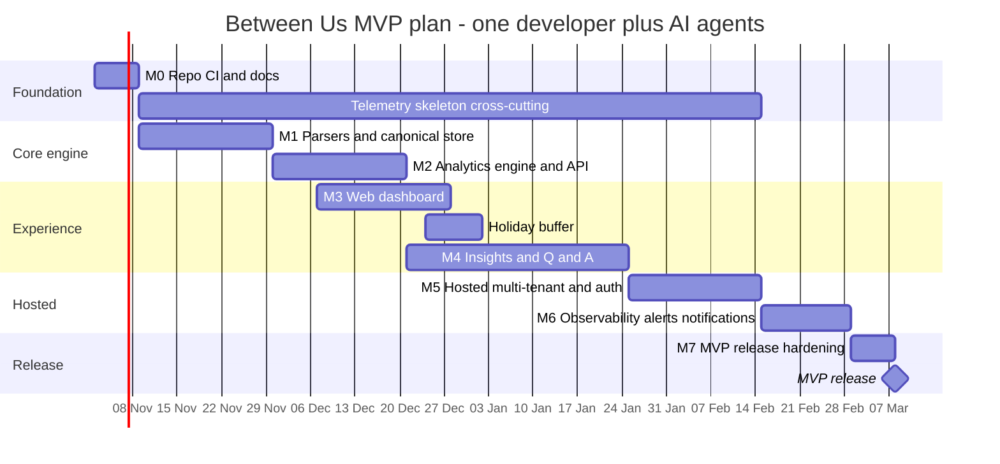

# Between Us — Roadmap

| Field | Value |
|---|---|
| Document | Delivery roadmap: phases, milestones, exit criteria |
| Status | **Draft v0.1 — for review** |
| Date | 2026-10-24 |
| Owner | Product owner |
| Assumptions | One developer working with AI coding agents; start **2026-11-02**; ~18 weeks to MVP (release week of 2027-03-01) including a holiday buffer |
| Related | [Requirements](01-requirements.md) · [Architecture](02-architecture.md) · [Data model](03-data-model.md) · [Metrics catalog](04-metrics-catalog.md) · [AI insights](05-ai-insights.md) · [Observability](06-observability.md) · [Deployment](07-deployment.md) · [Security & privacy](08-security-privacy.md) · [Notifications](09-notifications.md) · [WhatsApp parser](parsers/whatsapp.md) · [Telegram parser](parsers/telegram.md) |

> Phases (`MVP`, `P2`, `P3`, `Future`) are defined in [requirements §13](01-requirements.md#13-release-phases).
> Milestones `M0`–`M7` decompose the MVP. Dates are planning estimates, not commitments; re-plan at the end of
> every milestone.

---

## 1. Timeline

| Milestone | Window (planned) | Phase |
|---|---|---|
| M0 Repo, CI, docs | 2026-11-02 → 11-08 | MVP |
| M1 Parsers + canonical store | 11-09 → 11-29 | MVP |
| M2 Analytics engine + API | 11-30 → 12-20 | MVP |
| M3 Web dashboard | 12-07 → 12-27 (overlaps M2 once the OpenAPI contract is frozen) | MVP |
| M4 Insights + Q&A | 12-21 → 2027-01-24 (includes holiday buffer) | MVP |
| M5 Hosted multi-tenant + auth | 2027-01-25 → 02-14 | MVP |
| M6 Observability, alerts, notifications hardening | 02-15 → 02-28 | MVP |
| M7 MVP release | 03-01 → 03-07 | MVP |
| P2 | 2027 Q2 | P2 |
| P3 | 2027 H2 | P3 |

---

## 2. Milestones

### M0 — Repository, CI and documentation

| | |
|---|---|
| **Deliverables** | Monorepo layout (`backend/`, `web/`, `deploy/`, `docs/`); Go module + `betweenus version`; Vite React TS app skeleton; `Makefile`/`justfile` with `dev`, `test`, `lint`, `build`; GitHub Actions: lint, test, build, security gates (govulncheck, gosec, osv-scanner, gitleaks, CodeQL); Conventional Commits + changelog tooling; `.env.example`; `SECURITY.md`, `CONTRIBUTING.md`, `LICENSE` (Apache-2.0); ADR template and first ADRs; this doc set linked from README. |
| **Requirements** | NFR-MNT-001, NFR-MNT-004, NFR-MNT-005, NFR-MNT-006, SEC-005, SEC-007 (scanning part) |
| **Exit criteria** | Fresh clone → `make dev` runs an empty API + web page; CI green on `main`; all docs render on GitHub. |
| **Parallel split** | Agent A: Go skeleton + CI. Agent B: web skeleton + lint/format. Agent C: ADRs + `SECURITY.md`/`CONTRIBUTING.md`. No shared files except root `Makefile` (owned by A). |
| **Status** | **Done 2026-10-24** on branch `feat/m0-foundation`. Verified locally: `make check`, `make dev`, `make run`, `make docker`. The "CI green on `main`" criterion is pending until the repo is pushed to GitHub. |

### M1 — Parsers and canonical store

| | |
|---|---|
| **Deliverables** | `ingest` package with `Parser` interface ([telegram.md §7](parsers/telegram.md#7-parser-interface-contract)); WhatsApp parser (all variants, date-order inference, sender lexicon, markers); Telegram JSON streaming parser; zip handling with limits; synthetic fixture generator + golden tests + fuzz targets; `store` interface with SQLite implementation and goose migrations for tenants/users/chats/participants/imports/messages; fingerprint de-dup and incremental import; `betweenus import <file>` CLI; import report. |
| **Requirements** | FR-ING-001 (CLI), FR-ING-002…014, FR-LIB-002 (delete, store side), NFR-PERF-002, NFR-REL-002, NFR-REL-004, NFR-MNT-002, NFR-MNT-003, SEC-003 (upload), MT-001 (schema carries `tenant_id`) |
| **Exit criteria** | All fixtures in both parser fixture matrices pass; 200 MB synthetic WhatsApp export imports under the memory ceiling; re-import adds zero rows; fuzzers run 10 min with no crash. |
| **Parallel split** | Agent A: WhatsApp parser + fixtures. Agent B: Telegram parser + fixtures. Agent C: store + migrations + import orchestration. Contract (`ingest.Message`, `Parser`, `Sink`) is written first by the lead and frozen; agents only touch their own packages. |
| **Status** | **Done 2026-10-24** on branch `feat/m1-ingest`, built exactly as split above (three parallel agents after a contract commit). Measured: 100k-message import in ~5 s (budget 15 s); 192 MB WhatsApp export parsed with 41 MB peak RSS and a 1M-message import at 66 MB (ceiling 150 MB); re-import adds 0 rows, including with a different timezone; both fuzzers ran 10 min clean after fixing two findings. |
| **Carried forward** | To M2: message-browser cursor as a `(sent_at, ordinal)` pair; SQLite insert throughput (~37k rows/s, 1M messages take ~2 min) and on-disk size (~640 B/message; UUIDs as 16-byte BLOBs would save ~190 B). To M3: structured `SuggestedUTCOffset` in the import report. To M5: `CreateTenant` on the store interface. Backlog: selecting two participants from a Telegram group (FR-ING-012). |

### M2 — Analytics engine and API

| | |
|---|---|
| **Deliverables** | Sessionisation, turns, response-time engine; daily rollups per participant with mergeable sketches; window aggregation for day/week/month/year/all/custom in IANA timezones (DST-safe); metrics M-001…M-027 (deterministic, lexicon sentiment incl. emoji and romanised-Hindi lexicons); prev-window comparison; OpenAPI 3.1 spec for chats, imports, messages, metrics; `betweenus serve` with stdlib routing, middleware (request id, recovery, CORS, security headers, rate limit); generated TS client; jobs table with `inprocess` mode. |
| **Requirements** | FR-ANA-001…003, FR-ANA-006, FR-API-001, FR-API-002, FR-LIB-001, FR-LIB-003 (API), FR-LIB-004, FR-AI-007 (deterministic part), NFR-PERF-003, NFR-OBS-004 |
| **Exit criteria** | Hand-computed expected values match for every metric across five window types incl. a DST boundary (acceptance criterion 3); dashboard endpoint p95 ≤ 300 ms locally on a 1M-message synthetic chat. |
| **Parallel split** | Agent A: sessionisation + response time + rollups. Agent B: text metrics (words, emoji, lexicons, sentiment). Agent C: HTTP layer + OpenAPI + TS client generation. Shared: `metrics` result types (lead owns). |

### M3 — Web dashboard

| | |
|---|---|
| **Deliverables** | Import flow (drag-drop, detection result, participant mapping, timezone, consent screen, report); chat library; window selector with stepping and comparison; charts (volume, share of voice, response-time distribution, heatmap, sentiment, streak calendar, gaps, top emoji/words) lazy-loaded; drill-down to messages; virtualised message browser with search and permalinks; light/dark; PWA manifest; a11y pass with tabular chart fallbacks; Go `embed` of the built UI. |
| **Requirements** | FR-ING-001 (UI), FR-ING-008, FR-ING-011 (UI), FR-ING-012 (UI), FR-LIB-001…004, FR-ANA-001…006, PRV-002, NFR-PERF-004, NFR-UX-001…004 |
| **Exit criteria** | A non-technical tester imports a fixture and answers 5 scripted questions using only the UI; Lighthouse a11y ≥ 95; initial JS ≤ 250 KB gzipped. |
| **Parallel split** | Agent A: import flow + library. Agent B: dashboard + charts. Agent C: message browser + search. Shared design tokens and the generated API client are read-only for agents. |

### M4 — Insights and Q&A

| | |
|---|---|
| **Deliverables** | `LLMProvider` interface with `ollama`, `openai-compatible`, `anthropic`, `none`; prompt registry with versions; hierarchical summaries (day → week → month → year) with caching; relationship profile; mood and mind; topic timeline; citation validator; Q&A orchestrator (analytic tools + FTS + optional embeddings via pgvector hosted / brute-force cosine locally) with SSE streaming; PII redaction; prompt-injection mitigations; sensitive-content panel; token accounting. |
| **Requirements** | FR-AI-001…007, FR-API-003, PRV-003, SEC-004, NFR-PERF-005, NFR-COST-003 |
| **Exit criteria** | Acceptance criteria 4 and 5: `none` mode fully usable; with Ollama, every claim cites an in-window message; injection test suite (synthetic hostile chats) passes; Q&A answers include citations in ≥ 95% of an evaluation set. |
| **Parallel split** | Agent A: provider adapters + token accounting. Agent B: summaries, relationship, mood and mind + validator. Agent C: Q&A orchestrator + retrieval. Agent D (evaluation): builds the synthetic evaluation set and injection suite independently of A–C to avoid teaching to the test. |

### M5 — Hosted multi-tenant and auth

| | |
|---|---|
| **Deliverables** | PostgreSQL store implementation with RLS policies; `AuthProvider` with `local` and `supabase`; workspaces, memberships (owner role), quotas and rate limits; `pump` job mode for serverless; Vercel (web + Go functions) and container-host deployment templates; Supabase/Aiven setup scripts; audit log; DSAR export and workspace/account deletion; erase and retention jobs. |
| **Requirements** | FR-ADM-001, FR-ADM-002, FR-ADM-004…006, MT-001…005, MT-007, MT-009, SEC-001, SEC-006, SEC-008, PRV-004…006, NFR-COST-001, NFR-COST-004, NFR-REL-005 |
| **Exit criteria** | Acceptance criterion 7 (tenant isolation suite incl. RLS meta-test) and 9 (free deploy from docs); 100k-message import completes in pump mode within free-tier function limits. |
| **Parallel split** | Agent A: Postgres store + RLS + isolation tests. Agent B: auth providers + sessions + workspaces. Agent C: pump mode + deployment templates. Agent D: audit, DSAR, erasure, retention. |

### M6 — Observability, alerts and notifications hardening

| | |
|---|---|
| **Deliverables** | Complete OTel instrumentation (HTTP, DB, jobs, LLM, notifier) with attribute allow-list; `/metrics`; business metrics; Grafana dashboards + alert rules as code; local `grafana/otel-lgtm` compose profile; Grafana Cloud free wiring; synthetic uptime check; `Notifier` with `smtp` + `log` adapters, transactional outbox, templates; alert routing to email/ntfy; frontend opt-in telemetry; egress allow-list + test. |
| **Requirements** | NFR-OBS-001…008, NFR-REL-001, NFR-REL-003, FR-NOT-001…004, FR-NOT-008, PRV-001, PRV-007, K-5 |
| **Exit criteria** | Acceptance criteria 6 and 8: zero egress in local mode; a forced error fires an alert delivered within 5 min; trace of an import shows parse → store → rollup spans; no message content found by a telemetry-scrub test. |
| **Parallel split** | Agent A: instrumentation + scrub tests. Agent B: dashboards/alerts as code + compose profile. Agent C: notifier + outbox + templates. |

> Telemetry is not left until M6: a minimal tracer, `slog` JSON logger and `/healthz` land in M0–M2
> ("Telemetry skeleton" bar in the Gantt). M6 completes and hardens it.

### M7 — MVP release

| | |
|---|---|
| **Deliverables** | Full acceptance-criteria run (requirements §14); performance benchmarks published; threat model review; docs pass; release binaries for macOS/Linux/Windows (amd64/arm64) via GoReleaser; container image; SBOM; changelog; hosted demo on free tier with synthetic data only. |
| **Requirements** | All MVP items; K-1…K-5 baselines measured |
| **Exit criteria** | Every MVP acceptance criterion passes in CI or a recorded manual check; no open critical/high security findings. |
| **Parallel split** | Agent A: release engineering. Agent B: docs and screenshots. Agent C: independent verification run of acceptance criteria (must not be an agent that implemented the features). |

---

## 3. Post-MVP phases

### P2 — Team & polish (target 2027 Q2)

Roles and invites (MT-004 full, FR-ADM-003), envelope encryption and local passphrase encryption (MT-006,
SEC-002), TOTP MFA (MT-008), Telegram HTML parser (FR-ING-015), media inventory (FR-ING-020), bookmarks/tags
(FR-LIB-005), exports and printable reports (FR-ANA-007), range comparison (FR-ANA-008), notable events
(FR-AI-008), digests (FR-AI-009), ntfy/Telegram notifications and preferences (FR-NOT-005, FR-NOT-007),
admin console (FR-ADM-007), API keys (FR-API-004), signed releases (SEC-007), audit hash chain.

### P3 — Breadth (target 2027 H2)

Media analysis with local vision models, voice-note transcription with whisper.cpp, group chats, more
platforms via the parser plugin interface (FR-ING-021), SMS adapter (FR-NOT-006), SSO/SAML (MT-008),
outbound webhooks (FR-API-005).

### Future

Native/mobile apps, live Telegram sync (FR-ING-030), shareable reports (privacy-reviewed), multi-chat
comparisons.

---

## 4. Working model for parallel agents

- **Contract first.** Each milestone begins with the lead (human + primary agent) writing the shared
  interfaces/types and OpenAPI changes; parallel agents start only after these are merged.
- **One owner per file.** Agents work in separate git worktrees/branches and own disjoint packages; shared
  files (root `Makefile`, `go.mod`, `package.json`, migrations index) are changed only by the lead.
- **Tests as the hand-off.** Every agent's task ends with tests passing in CI; the lead merges.
- **Independent verification.** Evaluation and acceptance agents (M4-D, M7-C) never implement the features
  they verify.
- **Docs move with code.** Any change to behaviour updates the relevant doc and requirement IDs in the same PR.

---

## 5. Dependencies

| Dependency | Needed by | Note |
|---|---|---|
| Canonical message schema + `Parser` contract | M1 agents, M2 | Frozen at M1 start. |
| OpenAPI contract for metrics | M3 | Frozen mid-M2 so M3 can overlap. |
| Daily rollups | M2 metrics, M4 statistical context | |
| Local Ollama model choice (e.g. 7–8B instruct + embedding model) | M4 | Validate on Apple Silicon and 16 GB RAM. |
| Free-tier accounts (Vercel, Supabase or Aiven, Grafana Cloud, SMTP provider) | M5, M6 | Owner creates accounts; verify limits in [07-deployment.md](07-deployment.md). |
| Open questions Q-1…Q-7 | Various | All resolved 2026-10-24 ([requirements §16](01-requirements.md#16-open-questions)). |

## 6. Risks to the schedule

| Risk | Effect | Mitigation |
|---|---|---|
| WhatsApp format variety larger than expected | M1 slips | Time-box variants; ship with report-a-shape flow; add variants in patch releases. |
| LLM quality on small local models | M4 quality bar missed | Hierarchical summaries keep prompts short; allow hosted provider opt-in; evaluation set guides prompt iteration. |
| Free-tier limits block pump-mode imports | M5 slips | Container-host profile (Render/Koyeb) as fallback; client-side pre-chunking. |
| Single-developer bandwidth and holidays | Overall slip | Holiday buffer in plan; parallel agents for well-bounded packages; cut Could-priority items first. |
| Scope creep from P2/P3 ideas | MVP slips | Strict MoSCoW; new ideas go to the P2 backlog with an ID. |
| RLS + serverless connection pooling quirks (session vars with poolers) | M5 slips | Use transaction-scoped `SET LOCAL app.tenant_id` inside every transaction; test against the provider's pooler early (spike in M2). |
