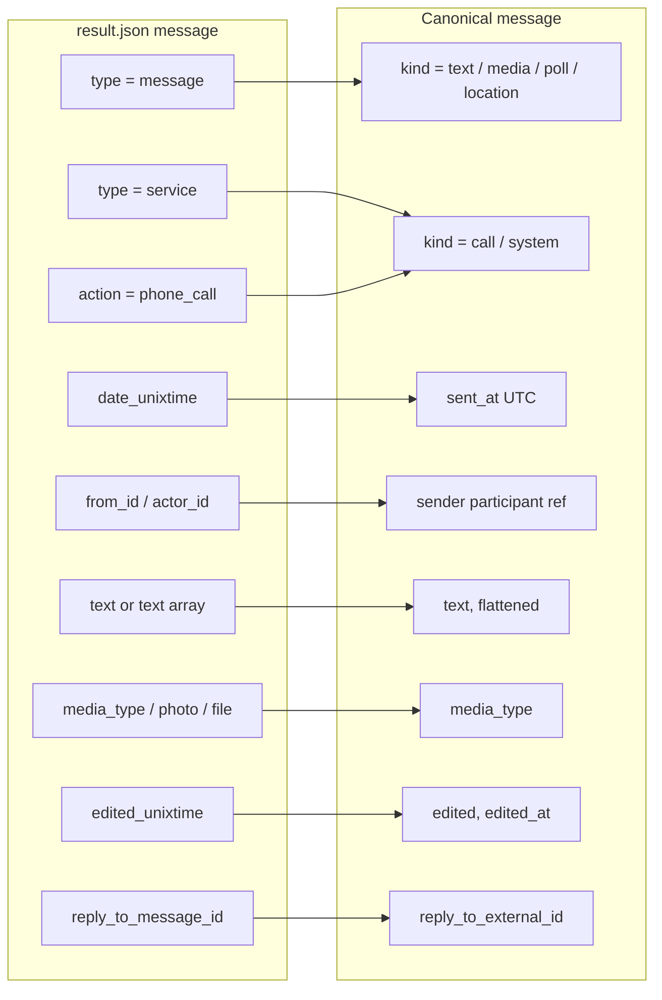

# Telegram Export Format — Parser Specification

| Field | Value |
|---|---|
| Document | Parser specification: Telegram Desktop `result.json` exports + canonical message schema + `Parser` contract |
| Status | **Draft v0.1 — for review** |
| Date | 2026-10-24 |
| Owner | Ingestion component (`backend/internal/ingest/telegram`, `backend/internal/ingest`) |
| Requirements | FR-ING-002, FR-ING-006, FR-ING-007, FR-ING-009, FR-ING-010, FR-ING-011, FR-ING-012, FR-ING-013, FR-ING-015, FR-ING-021 |
| Related | [Requirements](../01-requirements.md) · [Architecture](../02-architecture.md) · [Data model](../03-data-model.md) · [Metrics catalog](../04-metrics-catalog.md) · [Security & privacy](../08-security-privacy.md) · [WhatsApp parser](whatsapp.md) |

> Unlike WhatsApp, Telegram's JSON export is structured and timestamps are absolute, so the parser is mostly a
> mapping exercise. The hard parts are (1) memory — exports can be hundreds of MB — and (2) the many optional,
> loosely-typed fields. All examples are synthetic (Alice, Bob; invented IDs).

---

## 1. How users export

- Export is available **only in Telegram Desktop** (Windows/macOS/Linux). Mobile apps cannot export.
- **Single chat:** open the chat → ⋮ → *Export chat history* → untick media types (MVP needs none) →
  *Format:* **Machine-readable JSON** → *Export*. Output folder `ChatExport_YYYY-MM-DD/` containing
  `result.json` (+ media folders if selected).
- **Whole account:** *Settings → Advanced → Export Telegram data* → JSON. Output contains a top-level
  `chats.list[]` with many chats; the parser lists the `personal_chat` entries and lets the user pick one
  (§4.3).
- *Format: HTML* produces `messages.html`, `messages2.html`, … — supported in `P2` (FR-ING-015) via an HTML
  tokenizer; this document specifies JSON only.
- The user may upload `result.json` directly or zip the whole `ChatExport_*` folder; the zip path applies
  the same archive limits as WhatsApp ([whatsapp.md §1.1](whatsapp.md#11-archive-handling-fr-ing-005)).

---

## 2. `result.json` structure (single-chat export)

```json
{
  "name": "Bob",
  "type": "personal_chat",
  "id": 4242424242,
  "messages": [
    {
      "id": 101,
      "type": "service",
      "date": "2024-01-05T21:40:00",
      "date_unixtime": "1704490800",
      "actor": "Alice",
      "actor_id": "user1111111111",
      "action": "phone_call",
      "duration_seconds": 312,
      "discard_reason": "hangup",
      "text": "",
      "text_entities": []
    },
    {
      "id": 102,
      "type": "message",
      "date": "2024-01-05T21:41:05",
      "date_unixtime": "1704490865",
      "from": "Alice",
      "from_id": "user1111111111",
      "text": "Happy new year!",
      "text_entities": [{ "type": "plain", "text": "Happy new year!" }]
    },
    {
      "id": 103,
      "type": "message",
      "date": "2024-01-05T21:42:10",
      "date_unixtime": "1704490930",
      "edited": "2024-01-05T21:43:00",
      "edited_unixtime": "1704490980",
      "from": "Bob",
      "from_id": "user2222222222",
      "reply_to_message_id": 102,
      "text": ["You too! Look at ", { "type": "link", "text": "https://example.org" }, " 🎉"],
      "text_entities": [
        { "type": "plain", "text": "You too! Look at " },
        { "type": "link", "text": "https://example.org" },
        { "type": "plain", "text": " 🎉" }
      ],
      "reactions": [
        { "type": "emoji", "count": 1, "emoji": "❤", "recent": [{ "from": "Alice", "from_id": "user1111111111", "date": "2024-01-05T21:44:00" }] }
      ]
    },
    {
      "id": 104,
      "type": "message",
      "date": "2024-01-05T21:45:00",
      "date_unixtime": "1704491100",
      "from": "Alice",
      "from_id": "user1111111111",
      "file": "(File not included. Change data exporting settings to download.)",
      "media_type": "voice_message",
      "mime_type": "audio/ogg",
      "duration_seconds": 14,
      "text": "",
      "text_entities": []
    }
  ]
}
```

### 2.1 Top-level fields

| Field | Type | Notes |
|---|---|---|
| `name` | string | Chat title (the other person's display name for personal chats). May be absent for deleted accounts. |
| `type` | string | `personal_chat`, `bot_chat`, `saved_messages`, `private_group`, `private_supergroup`, `public_supergroup`, `private_channel`, `public_channel`. **Only `personal_chat` is analysed in the MVP**; groups follow FR-ING-012; channels and bots are refused with an explanation. |
| `id` | number | Telegram peer ID; used as `chat_external_id` for re-import matching (FR-ING-010). |
| `messages` | array | Chronological. Can contain hundreds of thousands of items. |

### 2.2 Message fields

| Field | Type | Meaning / handling |
|---|---|---|
| `id` | number | Unique within the chat → `external_id`. |
| `type` | `"message"` \| `"service"` | Service messages describe events (calls, pins, history cleared…). |
| `date` | string `YYYY-MM-DDTHH:MM:SS` | Wall-clock time **of the exporting machine**, no offset — used only as a cross-check. |
| `date_unixtime` | string (decimal seconds) | **Source of truth** for `sent_at` (FR-ING-006). Parsed with `strconv.ParseInt`. |
| `edited`, `edited_unixtime` | string | Present when edited → `edited = true`, `edited_at`. |
| `from`, `from_id` | string \| null | Sender display name and stable ID (`user<digits>`, `channel<digits>`). `from` may be `null` for deleted accounts — the ID is still present and is the participant key. |
| `actor`, `actor_id` | string | Sender equivalent for `service` messages. |
| `text` | string \| array | Either a plain string or an array mixing strings and entity objects `{type, text, href?, user_id?}`. Flattened to plain text by concatenating `text` parts. |
| `text_entities` | array | Normalised entity list (always an array). Used to derive link counts (M-018) and mentions; `type` values: `plain`, `bold`, `italic`, `underline`, `strikethrough`, `spoiler`, `code`, `pre`, `text_link`, `link`, `mention`, `mention_name`, `hashtag`, `cashtag`, `bot_command`, `email`, `phone`, `bank_card`, `blockquote`, `custom_emoji`. Unknown types are treated as `plain`. |
| `reply_to_message_id` | number | → `reply_to_external_id`. May reference a message outside the export (deleted or before export range) — kept but unresolved. |
| `forwarded_from`, `saved_from` | string | → `forwarded = true`; forwarded content is **excluded from sentiment and "mood and mind"** of the forwarder (it is not their words) but counted in volume metrics, flagged in the metrics catalog. |
| `via_bot` | string | Flag only. |
| `media_type` | string | `sticker`, `voice_message`, `video_message` (round video), `video_file`, `animation` (GIF), `audio_file`. |
| `photo` | string | Relative path, or the "File not included…" sentence → `media_type = image`. |
| `file`, `file_name`, `mime_type`, `width`, `height`, `thumbnail` | — | Media metadata; path strings beginning with `(File not included` mean the file is absent. Document if `media_type` absent and `file` present. |
| `sticker_emoji` | string | Emoji associated with a sticker → counted in emoji usage (M-015) as `via_sticker`. |
| `duration_seconds` | number | Voice/video/audio length; for `phone_call` service messages, call duration (M-021). |
| `reactions` | array | `{type: "emoji" \| "custom_emoji" \| "paid", count, emoji?, document_id?, recent[]}`. Stored as reaction events (P2 metric); MVP stores counts per message. |
| `poll` | object | `{question, closed, total_voters, answers[]}` → `kind = poll`. |
| `location_information`, `live_location_period_seconds`, `place_name`, `address` | — | → `kind = location`. Coordinates are stored only if the workspace enables it (PRV-004). |
| `contact_information`, `contact_vcard` | — | → `kind = contact`; vCard content is **not** stored (PII minimisation). |
| `self_destruct_period_seconds` | number | Secret/self-destructing media → `media_type` with `view_once = true`. |
| `action` (service) | string | `phone_call` (with `discard_reason`: `missed`, `busy`, `hangup`, `disconnect`), `pin_message`, `clear_history`, `set_messages_ttl`, `screenshot_taken`, `contact_signup`, `edit_chat_theme`, `group_call`, … — mapped in §3. |

---

## 3. Mapping to the canonical schema



| Telegram condition | Canonical `kind` | Extra fields |
|---|---|---|
| `type=message`, non-empty text, no media | `text` | `entities` summary (link/mention counts) |
| `type=message` with `photo` / `media_type` / `file` | `media` | `media_type`, `duration_s`, `caption` = flattened text |
| `type=message` with `poll` | `poll` | question, option count |
| `type=message` with `location_information` | `location` | `live` |
| `type=message` with `contact_information` | `contact` | — |
| `type=service`, `action=phone_call` | `call` | `call_missed = discard_reason in (missed, busy)`, `call_duration_s` |
| `type=service`, any other `action` | `system` | `system_type = action` |
| Telegram has no "deleted" placeholder (deleted messages are simply absent) | — | `deleted` is always `false` for Telegram; metric M-020 reports "n/a" for deleted. |

---

## 4. Streaming decoding in Go (FR-ING-013)

Loading a 300 MB `result.json` with `json.Unmarshal` would need >1 GB RAM. The parser instead walks tokens:

```go
// Package telegram — sketch of the streaming walk (real code carries full doc comments).
dec := json.NewDecoder(bufio.NewReaderSize(r, 1<<20))
dec.UseNumber() // ids can exceed float64 precision in theory; keep them exact.

// 1. Expect '{', then iterate top-level keys until "messages".
//    "name", "type", "id" are decoded into the header struct as they appear.
//    For a full-account export, descend "chats" -> "list" and treat each element
//    as a chat object (header + messages) — see §4.3.
// 2. At "messages": expect '[' then:
for dec.More() {
    var m rawMessage // only the fields we map; unknown fields are skipped by encoding/json
    if err := dec.Decode(&m); err != nil {
        sink.Diagnostic(Diagnostic{Code: "bad_message_json", Offset: dec.InputOffset()})
        return report, fmt.Errorf("telegram: decode message: %w", err) // JSON is not resumable mid-array
    }
    batch = append(batch, mapToCanonical(m, hdr, opts))
    if len(batch) == opts.BatchSize { sink.Batch(ctx, batch); batch = batch[:0] }
}
```

### 4.1 `text` as string-or-array

`rawMessage.Text` is a `FlexText` type with a custom `UnmarshalJSON`: if the first byte is `"` it decodes a
string; if `[` it decodes `[]json.RawMessage` and, per element, either a string or `{ "text": … }`. The result
is the concatenated plain text. `text_entities` is preferred when present because it is always an array.

### 4.2 Detection (FR-ING-002)

Telegram is detected when the first non-whitespace byte is `{` and, within the first 64 KiB, the token walk
finds a top-level `messages` array whose first element has `date_unixtime`, **or** a `chats.list` structure.
Confidence is 1.0 on structural match; anything else is `unrecognised`.

### 4.3 Full-account exports

A first, cheap pass decodes only `{name, type, id, len(messages)}` per chat (skipping message bodies with
`dec.Decode(&json.RawMessage{})` is avoided — instead message elements are skipped token-by-token to keep
memory flat). The user picks one `personal_chat`; a second pass parses that chat only. Other chats are never
stored (PRV-004).

### 4.4 Memory budget

Peak memory ≈ decoder buffer (1 MiB) + one decoded message + one batch (default 2 000 canonical messages,
≈ 2–4 MB). This meets FR-ING-013 regardless of file size.

---

## 5. Edge cases

| Case | Handling |
|---|---|
| `from` is `null` (deleted account) | Participant keyed by `from_id`; display name "Deleted account". |
| Messages from a third `from_id` in a `personal_chat` (e.g. bot via inline, channel forwards) | Forwarded/bot content keeps the forwarder as sender; a genuinely third sender triggers FR-ING-012. |
| `date` vs `date_unixtime` disagree by a non-whole-hour amount | Diagnostic `clock_mismatch`; `date_unixtime` wins. The whole-hour difference is used to **suggest** the exporter's timezone (FR-ING-009). |
| Messages out of order by `id` | Sorted within a batch; global order enforced by `(sent_at, external_id)` in the store. |
| Empty `text` with no media (e.g. unsupported message types) | `kind = system`, `system_type = unsupported`. |
| Very long `pre`/code entities | Same 64 KiB per-message cap as WhatsApp. |
| Custom emoji entities | `custom_emoji` text (fallback emoji) is counted as emoji. |
| Export truncated (invalid JSON at EOF) | Messages already batched are kept **only if** the user confirms "import partial"; default is to roll back the import transaction (NFR-REL-002). |
| Re-import of the same chat | Matched by `(platform, chat_external_id)`; de-duplicated by `external_id` first, fingerprint second. |

---

## 6. Canonical message schema

Both parsers emit the same Go struct (`ingest.Message`), which maps 1:1 to the `messages` table in
[03-data-model.md](../03-data-model.md). Field names below are the JSON/DB names.

| Field | Type | Description |
|---|---|---|
| `platform` | enum `whatsapp` \| `telegram` | Source platform. |
| `external_id` | string, nullable | Platform message ID (Telegram `id`); null for WhatsApp. |
| `sent_at` | timestamp (UTC) | Absolute send time. |
| `local_time` | string `YYYY-MM-DDTHH:MM:SS` | Wall-clock time as shown in the export, for display and audit. |
| `time_precision` | enum `second` \| `minute` | Android WhatsApp headers lack seconds. |
| `sender_key` | string | Stable per-chat participant key (Telegram `from_id`; WhatsApp normalised sender name / E.164). Resolved to `participant_id` by the importer after FR-ING-008 mapping. |
| `sender_display` | string | Name as it appeared in the export. |
| `kind` | enum `text`, `media`, `call`, `location`, `contact`, `poll`, `deleted`, `system` | Typed event (FR-ING-004). |
| `system_type` | string, nullable | For `kind = system` (see WhatsApp §7.1 / Telegram `action`). |
| `text` | string, nullable | Normalised (NFC) body; markers like `<This message was edited>` removed; captions for media. |
| `media_type` | enum, nullable | `image`, `video`, `video_note`, `voice_note`, `audio`, `sticker`, `gif`, `document`, `contact`, `unknown`. |
| `media_meta` | JSON, nullable | Filename, size, mime, duration, `view_once` (no content). |
| `reply_to_external_id` | string, nullable | Telegram reply target; null for WhatsApp (exports do not include quotes). |
| `forwarded` | bool | Telegram only. |
| `edited` / `edited_at` | bool / timestamp | Edit marker. |
| `deleted` | bool | Deleted placeholder (WhatsApp). |
| `call` | JSON, nullable | `{type: voice\|video, missed, duration_s}`. |
| `reactions` | JSON, nullable | `[{emoji, count}]` (Telegram). |
| `source_line` | int | Line number (WhatsApp) or array index (Telegram) for diagnostics. |
| `fingerprint` | bytes(32) | Dedup key (FR-ING-010); exact definition in [03-data-model.md §7.1](../03-data-model.md#71-message-fingerprint-fr-ing-010). |

---

## 7. `Parser` interface contract

```go
// Package ingest defines the contract every chat-export parser implements.
package ingest

// Detection is the result of sniffing a sample of an upload.
type Detection struct {
    Platform   Platform // whatsapp | telegram
    Variant    string   // e.g. "android-A2", "ios-I3", "telegram-json-single"
    Confidence float64  // 0..1, see parser specs
    Hints      []string // human-readable hints when Confidence is low
}

// Sink receives parser output. Implementations write to the store inside the import
// transaction (or to a staging table in pump mode) and must be safe to call repeatedly.
type Sink interface {
    Batch(ctx context.Context, msgs []Message) error // ordered; len <= Options.BatchSize
    Diagnostic(d Diagnostic)                          // never contains message text (PRV-007)
}

// Parser converts an export stream into canonical messages.
type Parser interface {
    // Detect inspects at most the first 64 KiB of the upload. It must be side-effect free.
    Detect(sample []byte) Detection
    // Parse streams the whole input, emitting batches and diagnostics to sink.
    // It must honour ctx cancellation between batches, use bounded memory (FR-ING-013),
    // and return a Report even when it returns an error.
    Parse(ctx context.Context, src Source, opts Options, sink Sink) (Report, error)
}
```

- `Source` abstracts re-readable input (`Open() (io.ReadCloser, error)`) so two-pass parsers (WhatsApp) can
  rewind; it is backed by a temp file, a zip entry, or — in the browser/WASM future path — a `File`.
- `Options` carries `Timezone *time.Location`, `DateOrder` (when the user resolved ambiguity), `BatchSize`,
  `SelectedChatID` (Telegram full export), `ParticipantFilter` (FR-ING-012), and limits.
- `Report` contains counts (parsed, skipped by reason), detected variant, date order + evidence, participants,
  date range, and warnings — persisted on the `imports` row (FR-ING-011).
- **Pump mode:** `Parse` is resumable by `(source_line or array index)` checkpoint stored on the import job, so a
  serverless step can process a time-boxed slice and return (see [Architecture](../02-architecture.md)).
- New platforms (FR-ING-021) register via `ingest.Register(p Parser)`; detection picks the highest-confidence
  parser above 0.6.

---

## 8. Fixture matrix (golden tests)

Fixtures in `backend/internal/ingest/telegram/testdata/`, synthetic, with `*.expected.json` goldens.

| Fixture | What it proves |
|---|---|
| `personal_basic.json` | Plain string text, two participants, `date_unixtime` authority. |
| `entities_array.json` | `text` array with every entity type; links counted; flattening correct. |
| `edited_replies.json` | `edited_unixtime`, `reply_to_message_id`, reply to missing message. |
| `media_all_types.json` | Every `media_type`, `photo`, documents, "File not included" strings, `sticker_emoji`. |
| `calls_service.json` | `phone_call` with each `discard_reason`; other service actions → `system`. |
| `forwarded.json` | Forwarded messages flagged and excluded from sentiment inputs. |
| `reactions.json` | Emoji, custom-emoji and paid reactions. |
| `deleted_account.json` | `from: null`. |
| `poll_location_contact.json` | Poll, location, live location, contact (vCard dropped). |
| `group_supergroup.json` | Non-personal type → refusal / FR-ING-012 path. |
| `full_account_export.json` | `chats.list` selection, other chats never stored. |
| `clock_mismatch.json` | Timezone suggestion from whole-hour offset. |
| `truncated.json` | Invalid JSON at EOF → rollback unless partial import confirmed. |
| `incremental_v1.json` / `_v2.json` | Re-import de-duplicates by `external_id`. |
| `large_300mb` (generated in CI) | Memory ceiling (FR-ING-013) and throughput (NFR-PERF-002). |

Fuzz target `FuzzDecode` (`./internal/ingest/telegram`) runs alongside the WhatsApp fuzzer; M1 ran it for
10 minutes without a crash.

## 9. Implementation notes (M1)

| Topic | Behaviour |
|---|---|
| Truncated JSON | Complete messages before the break reach the sink, then the parser returns an error; the importer rolls the whole import back (no partial imports in M1). |
| Timezone hint | Emitted as a report warning when `date` and `date_unixtime` disagree by a whole-hour offset. A structured `SuggestedUTCOffset` field is a backlog item. |
| Group / supergroup | Refused with a typed error; selecting two participants from a Telegram group (FR-ING-012) is a backlog item. |
| Video calls | The export does not mark them distinctly, so `Call.Video` is always false. |
| Measured | ~100 MB/s; 300k messages streamed with a 9.2 MiB peak heap. |

