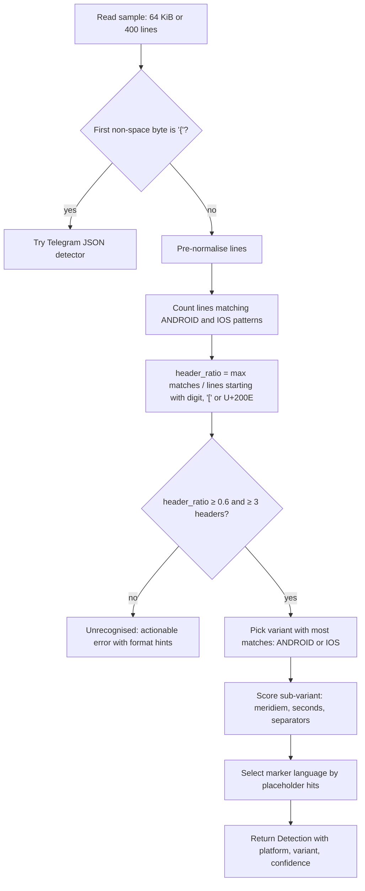
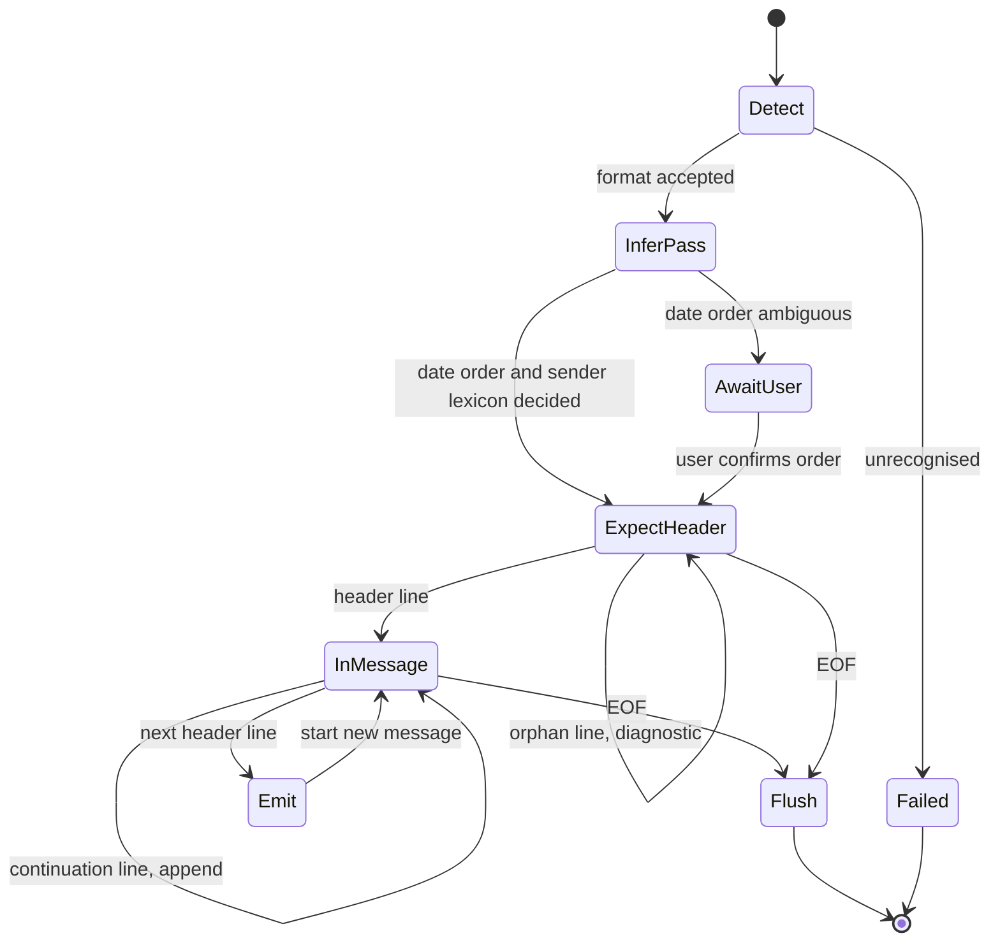

# WhatsApp Export Format — Parser Specification

| Field | Value |
|---|---|
| Document | Parser specification: WhatsApp `.txt` / `.zip` exports |
| Status | **Draft v0.1 — for review** |
| Date | 2026-10-24 |
| Owner | Ingestion component (`backend/internal/ingest/whatsapp`) |
| Requirements | FR-ING-002, FR-ING-003, FR-ING-004, FR-ING-005, FR-ING-007, FR-ING-009, FR-ING-010, FR-ING-011, FR-ING-012, FR-ING-013, FR-ING-014, NFR-MNT-002 |
| Related | [Requirements](../01-requirements.md) · [Architecture](../02-architecture.md) · [Data model](../03-data-model.md) · [Metrics catalog](../04-metrics-catalog.md) · [Security & privacy](../08-security-privacy.md) · [Telegram parser](telegram.md) |

> WhatsApp has **no documented export format**. Everything below is reverse-engineered from exports of
> different app versions, platforms and locales. The parser is therefore *tolerant by design*: it scores
> candidate formats, infers ambiguities statistically, and reports every line it could not attribute
> (FR-ING-011) instead of failing. All example lines use fictional people (Alice, Bob) and invented content.

---

## 1. How users export

| Platform | Steps | Output |
|---|---|---|
| Android | Open chat → ⋮ → *More* → *Export chat* → *Without media* / *Include media* | `WhatsApp Chat with Bob.txt` (without media) or `WhatsApp Chat with Bob.zip` containing the `.txt` plus media files |
| iOS | Open chat → tap contact name → *Export Chat* → *Without Media* / *Attach Media* | Always a `.zip`: `WhatsApp Chat - Bob.zip` containing `_chat.txt` (+ media when attached) |
| WhatsApp Desktop / Web | No export function (as of 2026-10). | — |

Notes:

- The `.txt` is UTF-8, usually without BOM on Android and sometimes **with BOM** (U+FEFF) after being re-saved by
  editors. Line endings may be `\n` (Android/iOS) or `\r\n` (after passing through Windows tools).
- Android caps exports (historically ~40 000 messages *with* media, ~100 000 *without*); iOS caps vary.
  The parser cannot detect truncation, but the import report flags a chat whose first message is not an
  encryption notice/creation event as "possibly truncated at start".
- File names are **never trusted** for detection (FR-ING-002); they are only used as a hint for the default
  chat title ("WhatsApp Chat with Bob" → "Bob").

### 1.1 Archive handling (FR-ING-005)

1. Open the `.zip` with `archive/zip` reading the central directory (no extraction to disk).
2. Select the chat text entry: `_chat.txt` first, otherwise the single `*.txt` entry; more than one `*.txt` →
   ask the user to choose.
3. Enforce limits **before** reading entry bodies: max entries (default 20 000), max declared uncompressed
   total (default 2 GiB), max per-entry compression ratio (default 100:1), and reject entries whose
   name is absolute, contains `..`, or is a symlink (zip-slip guard; see
   [security §5](../08-security-privacy.md#5-upload-hardening)).
4. Media entries are **enumerated, not decompressed** in the MVP: name, size, inferred type from extension
   (counted for M-019; persisted as inventory in P2, FR-ING-020).
5. Executable or script extensions (`.exe`, `.sh`, `.js`, `.apk`, …) are listed in diagnostics and ignored.

---

## 2. Line-header variants

A **message** starts with a header line (timestamp + optional sender) and continues on following lines until
the next header. Known header shapes:

| ID | Platform / era | Shape | Example (synthetic) |
|---|---|---|---|
| `A1` | Android, 12 h, US-style | `M/D/YY, h:mm AM - Sender: text` | `12/31/23, 9:41 PM - Alice: Happy new year!` |
| `A2` | Android, 24 h, UK/IN-style | `DD/MM/YYYY, HH:mm - Sender: text` | `31/12/2023, 21:41 - Bob: You too!` |
| `A3` | Android, dotted date (DE/RU/…) | `DD.MM.YY, HH:mm - Sender: text` | `31.12.23, 21:41 - Alice: Frohes neues!` |
| `A4` | Android, ISO-ish (some locales) | `YYYY-MM-DD, HH:mm - Sender: text` | `2023-12-31, 21:41 - Bob: Hi` |
| `A5` | Android, no comma after date | `DD/MM/YYYY HH:mm - Sender: text` | `31/12/2023 21:41 - Alice: Hi` |
| `A6` | Android ≥ 2023, narrow NBSP before meridiem | `M/D/YY, h:mm PM - Sender: text` | `12/31/23, 9:41 PM - Alice: Hi` |
| `I1` | iOS, 12 h with seconds | `[DD/MM/YY, h:mm:ss AM] Sender: text` | `[31/12/23, 9:41:05 PM] Bob: Hi` |
| `I2` | iOS, 24 h with seconds | `[DD/MM/YYYY, HH:mm:ss] Sender: text` | `[31/12/2023, 21:41:05] Alice: Hi` |
| `I3` | iOS ≥ 17, U+202F before meridiem, U+200E prefix on media lines | `‎[M/D/YY, h:mm:ss PM] Sender: ‎image omitted` | `‎[12/31/23, 9:41:05 PM] Alice: ‎image omitted` |
| `S*` | Any, **system line** (no sender) | header followed directly by text | `12/31/23, 9:40 PM - Messages and calls are end-to-end encrypted. …` |

Observed variations that every regex must tolerate:

- Date separators `/`, `.`, `-`; 1- or 2-digit day/month; 2- or 4-digit year.
- Time separators `:` (universal) and `.` (some Finnish/Danish locales: `21.41`).
- Meridiem tokens: `AM`/`PM`, `am`/`pm`, `a.m.`/`p.m.`, and localised forms (`a. m.`, `μ.μ.`, `午後`, `nachm.`).
  English and the common Latin variants are matched by the regex; other locales are supported via a
  **meridiem table** (`meridiem_tokens.yaml`) so new locales are data, not code.
- Space before meridiem: ASCII space, U+00A0 (NBSP) or U+202F (narrow NBSP).
- Invisible directional marks anywhere in the header: U+200E, U+200F, U+202A–U+202E, U+2066–U+2069, U+FEFF.

### 2.1 Pre-normalisation (applied to each raw line before matching)

1. Strip a leading BOM on the first line.
2. Trim trailing `\r`.
3. Remove invisible marks `[\x{200E}\x{200F}\x{202A}-\x{202E}\x{2066}-\x{2069}\x{FEFF}]` **from the header
   region only** (text bodies keep them for fidelity, but a copy without them is used for matching placeholders).
4. Normalise U+00A0 and U+202F to ASCII space in the header region.

---

## 3. Regex set (Go RE2-compatible)

All patterns are compiled once with `regexp.MustCompile`. RE2 supports named groups `(?P<name>…)`, Unicode
escapes `\x{…}` and inline flags, and guarantees linear-time matching (no catastrophic backtracking on hostile
input — relevant because exports are untrusted, see SEC-003).

```text
# Shared fragments (expanded into the patterns below at build time)
DATE  = (?P<date>\d{1,4}[./-]\d{1,2}[./-]\d{1,4})
TIME  = (?P<time>\d{1,2}[:.]\d{2}(?:[:.]\d{2})?)
MER   = (?:\s?(?P<mer>(?i:[ap]\.?\s?m\.?)))?

# Android: "<date>, <time>[ mer] - <rest>"   (comma optional → covers A5)
ANDROID = ^DATE,?\sTIME MER\s-\s(?P<rest>.*)$

# iOS: "[<date>, <time>[ mer]] <rest>"
IOS     = ^\[DATE,?\sTIME MER\]\s(?P<rest>.*)$

# Sender split inside <rest>: lazy up to the FIRST ": " (refined by §5)
SENDER  = ^(?P<sender>[^:\n]{1,100}?):\s(?P<text>.*)$
```

Explanation:

- `DATE` captures the raw date; component order (DMY/MDY/YMD) is resolved later by inference (§4), not by
  the regex, so a single pattern covers every locale.
- `TIME` accepts optional seconds (iOS) and `.` separators.
- `MER` is optional; when present, the parser converts to 24 h. Localised meridiems not matched by `MER`
  are handled by a second pass that replaces known tokens from `meridiem_tokens.yaml` with `AM`/`PM`
  during pre-normalisation.
- `rest` is either `Sender: text` (message) or plain text (system line). `SENDER` caps sender length at 100
  runes to avoid pathological matches.

---

## 4. Date-order inference (DMY vs MDY vs YMD)

The export does not state its date order, and `03/04/24` is valid as both 3 April and 4 March. The parser
decides once per file:

1. **Collect** the `(a, b, c)` numeric triples from every header in a single pass (cheap; done during the
   detection sample *and* finalised over the full file before any timestamps are emitted — the streaming
   parser buffers only triples, not messages).
2. **YMD rule:** if `a` has 4 digits in ≥ 95% of headers → `YMD`.
3. **Hard evidence:** if any `a > 12` (and `b ≤ 12`) → `DMY`. If any `b > 12` (and `a ≤ 12`) → `MDY`.
   If both occur → file is inconsistent → diagnostic `date_order_conflict`, fall back to step 4.
4. **Monotonicity scoring:** chats are chronological. Parse all headers under each remaining hypothesis and
   count *order violations* (timestamp earlier than the previous header by more than 1 minute — WhatsApp
   may write a few out-of-order lines around clock changes). Choose the hypothesis with fewer violations if
   it beats the other by ≥ 10% relative or ≥ 3 absolute.
5. **Day-span plausibility:** as a tie-breaker, prefer the hypothesis whose distinct-day count is smaller
   relative to the date range (a wrong order scatters messages across months).
6. **Locale hint:** if still tied, use the browser/OS locale supplied by the client (`en-US` → MDY, most
   others → DMY).
7. **Ask the user:** if the hint is absent, the import pauses with a confirmation showing two sample dates
   under each interpretation. The choice is stored on the import record.

Two-digit years are expanded as `2000 + yy` (WhatsApp launched in 2009; no pre-2000 data exists).

The decided order, the evidence used (step number) and the violation counts are written to the import
report (FR-ING-011).

---

## 5. Sender resolution and name edge cases

`SENDER` alone is not sufficient, because sender names can contain `:` and message bodies frequently do.

| Case | Example (synthetic) | Rule |
|---|---|---|
| Phone number sender (contact not saved) | `‪+91 98765 43210‬: hi` | Strip U+202A/U+202C; keep the formatted number as the display name; store a normalised E.164 form as an alias key (FR-ING-008 merge suggestions). |
| Name containing `:` | `Dr: Alice: see you` | Build a **sender lexicon** in pass 1: candidate senders = prefix before the first `": "`, and also before the second `": "`. A candidate is accepted if it occurs as a sender in ≥ 3 headers or ≥ 1% of headers. At match time, prefer the **longest accepted sender** that prefixes `rest`. |
| Name containing ` - ` (Android) | `31/12/2023, 21:41 - Mary - Jane: hi` | Not ambiguous: the regex anchors ` - ` immediately after the time, so the sender is `Mary - Jane`. |
| Body that looks like a sender | `… - Alice: Note: buy milk` | Sender is resolved first (longest accepted), so `Note` is never promoted to a sender unless it reaches the lexicon threshold. |
| "You" as sender | iOS/Android write the exporter's own name, but some system lines say `You deleted this message` | `You`-prefixed **system** lines map to the participant marked "me" (FR-ING-008) or to `self` until confirmed. |
| Renamed contact mid-history | Same person under two names | Not detectable automatically; shown as two senders with a merge suggestion if they never overlap in time. |
| Emoji / RTL names | `🌸 Alice 🌸`, Arabic/Hebrew names | Kept verbatim (NFC-normalised); directional marks stripped from the key, not the display name. |

If more than two human senders are accepted (excluding system lines), FR-ING-012 applies.

---

## 6. Multi-line continuation rules

- Any line that does **not** match `ANDROID` or `IOS` (after pre-normalisation) is a continuation of the
  current message and is appended with `\n`.
- A continuation **before the first header** is an orphan → diagnostic `orphan_line` (line number recorded,
  content never logged — PRV-007).
- Empty lines inside a message are preserved.
- A line that matches a header shape but whose date fails to parse under the decided order is treated as a
  continuation **and** emits `suspicious_header` (protects against a body quoting a timestamp).
- Bodies are capped at 64 KiB per message; overflow is truncated with diagnostic `message_truncated`.

---

## 7. System messages and placeholders (FR-ING-004)

Matching is done on the body with invisible marks removed, case-sensitive unless noted, against a data file
(`whatsapp_markers.<lang>.yaml`). English strings are below; **other UI languages produce translated strings**
(e.g. Spanish `<Multimedia omitido>`, German `<Medien ausgeschlossen>`), so the marker table is per language
and the language is auto-selected by which table yields the most hits in the sample.

### 7.1 Sender-less system lines → `kind = system`

| Marker (English, prefix/contains) | Canonical `system_type` |
|---|---|
| `Messages and calls are end-to-end encrypted` | `encryption_notice` |
| `… changed their phone number to a new number` / `… changed to …` | `number_changed` |
| `Disappearing messages were turned on` / `turned off` / `… uses a default timer` | `disappearing_toggle` |
| `You blocked this contact` / `You unblocked this contact` | `block_toggle` |
| `… is a contact.` / `Your security code with … changed` | `contact_info` / `security_code_changed` |
| `Missed voice call` / `Missed video call` (sender-less variant) | `call_missed` |
| Any other sender-less line | `system_other` (text kept for display, excluded from metrics) |

### 7.2 Sender lines whose body is a placeholder → typed `kind`

| Body marker (English) | Platform | `kind` | `media_type` / flag |
|---|---|---|---|
| `<Media omitted>` | Android | `media` | `unknown` |
| `image omitted` / `video omitted` / `audio omitted` / `sticker omitted` / `GIF omitted` / `document omitted` / `Contact card omitted` | iOS | `media` | `image` / `video` / `audio` / `sticker` / `gif` / `document` / `contact` |
| `IMG-20231231-WA0001.jpg (file attached)` | Android with media | `media` | from extension; filename kept in metadata |
| `<attached: 00000012-PHOTO-2023-12-31-21-41-05.jpg>` | iOS with media | `media` | from token `PHOTO`/`VIDEO`/`AUDIO`/`STICKER`/extension |
| `PTT-20231231-WA0002.opus (file attached)` / `AUDIO` tokens | Both | `media` | `voice_note` |
| `This message was deleted` / `You deleted this message` | Both | `deleted` | `deleted = true` |
| trailing ` <This message was edited>` | Both (2023+) | original kind | `edited = true`; marker removed from text |
| `Missed voice call` / `Missed video call` / `Voice call, 12 min` / `Video call` | Both | `call` | `call_type`, `call_missed`, `call_duration_s` when present |
| `location: https://maps.google.com/?q=…` | Both | `location` | URL kept; coordinates **not** geocoded |
| `Live location shared` | Both | `location` | `live = true` |
| `POLL:` followed by `OPTION: … (n votes)` lines | Both | `poll` | question + options in metadata |
| `null` (whole body) | Android (view-once media) | `media` | `view_once` |
| `Waiting for this message. This may take a while.` | Both | `system` | `undecryptable` |

Placeholders are counted for metrics M-019, M-020 and M-021 but contribute **no words** to M-003 and are
excluded from sentiment (M-022) and text retrieval.

---

## 8. Detection scoring (FR-ING-002)

Detection runs on a sample: the first 64 KiB or 400 lines, whichever is smaller.



`confidence = header_ratio × (1 − 0.5 × conflict_rate)` where `conflict_rate` is the share of sample headers
matching *both* the winning and another variant inconsistently (e.g. mixed 12 h/24 h). Confidence below 0.8
is surfaced to the user in the import report; below 0.6 the import is refused with hints
("This looks like a WhatsApp export but the date format is unusual — please report the first line's *shape*,
e.g. `NN.NN.NN NN:NN - X: …`"). The *shape* is generated client-side by replacing digits with `N` and letters
with `X`, so no content is ever shared (risk mitigation in requirements §15).

---

## 9. Parser state machine



Implementation notes:

- **Two passes over the stream.** Pass 1 (`InferPass`) reads headers only, collecting date triples, sender
  candidates and marker-language hits (memory: O(distinct senders + headers × 3 ints)). Pass 2 parses and
  emits. For `.txt` uploads the server spools the upload to a temp file (or the browser re-reads the `File`);
  for `.zip` the entry is re-opened. This satisfies FR-ING-013 (bounded memory) for 200 MB exports.
- `Emit` classifies the body (§7), computes the canonical fields and the fingerprint (see
  [Telegram §6 — canonical schema](telegram.md#6-canonical-message-schema)), and appends to the current
  batch (default 2 000 messages) handed to the `Sink`.
- `ordinal` for the fingerprint is the 0-based index among messages with identical
  `(sender, timestamp-to-the-minute, normalised text)` so that genuinely repeated messages ("ok", "ok") in the
  same minute are not de-duplicated away (FR-ING-010).

---

## 10. Time handling (FR-ING-009)

- Header times are **device-local wall-clock time with no offset**. The user supplies the IANA timezone at
  import (default: browser timezone). `sent_at` (UTC) is computed with `time.ParseInLocation`.
- **DST gaps** (non-existent local times, e.g. 02:30 on a spring-forward day): shift forward by the gap
  and emit diagnostic `dst_gap_adjusted`.
- **DST overlaps** (ambiguous local times): choose the earlier offset unless that would violate
  monotonicity with the previous message, in which case choose the later offset.
- Android headers without seconds get `:00`; the original precision is kept in `time_precision`
  (`minute` | `second`) so response-time metrics (M-010) can report resolution honestly.
- If the user travelled across time zones, times are as the exporting device showed them; the docs and UI
  state this limitation.

---

## 11. Fixture matrix (golden tests, NFR-MNT-002)

Fixtures live in `backend/internal/ingest/whatsapp/testdata/`, are **100% synthetic** (generated by
`go run ./tools/fixturegen`), and each has an `*.expected.json` golden file of canonical messages plus an
`*.report.json` golden import report. Update goldens with `go test ./... -update`.

| Fixture | Variant(s) | What it proves |
|---|---|---|
| `android_en_us_12h.txt` | A1 | Base Android, MDY inferred by hard evidence (`b > 12`). |
| `android_en_gb_24h.txt` | A2 | DMY by hard evidence, 4-digit year. |
| `android_de_dots.txt` | A3 | Dotted dates, German markers (`<Medien ausgeschlossen>`). |
| `android_iso.txt` | A4 | YMD rule. |
| `android_no_comma.txt` | A5 | Optional comma. |
| `android_202f.txt` | A6 | U+202F before meridiem. |
| `ios_en_seconds.txt` (zipped as `_chat.txt`) | I1 | Brackets, seconds, iOS placeholders. |
| `ios_17_marks.zip` | I3 | U+200E prefixes, U+202F, media placeholder types. |
| `android_with_media.zip` | A1 + `(file attached)` | Media enumeration, zip limits, filename → type. |
| `ios_with_media.zip` | I2 + `<attached: …>` | iOS attachment tokens. |
| `ambiguous_dates.txt` | A1 with all components ≤ 12 | Monotonicity scoring picks the right order; report shows step 4. |
| `ambiguous_needs_user.txt` | Perfectly symmetric dates | Import pauses in `AwaitUser`. |
| `multiline.txt` | A2 | Continuations, empty lines, body quoting a timestamp → `suspicious_header`. |
| `names_with_colon.txt` | A2 | Longest-accepted-sender rule. |
| `phone_sender.txt` | A1 | U+202A/U+202C stripping, E.164 alias. |
| `group_three.txt` | A2 | > 2 senders triggers FR-ING-012 flow. |
| `bom_crlf.txt` | A2 | BOM and `\r\n`. |
| `deleted_edited.txt` | A1, I1 | `deleted`, `edited` flags; marker removed from text. |
| `calls_location_poll.txt` | A2 | Calls, locations, polls, view-once `null`. |
| `system_lines.txt` | A1 | Every §7.1 system type. |
| `dst_london.txt` | A2, `Europe/London`, 2024-03-31 and 2024-10-27 | DST gap and overlap rules. |
| `incremental_v1.txt` / `incremental_v2.txt` | A2 | v2 = v1 + new tail; re-import adds only the tail; repeated "ok" in the same minute survives. |
| `empty.txt`, `garbage.bin`, `zip_bomb.zip`, `zip_slip.zip` | — | Clean refusals with correct error codes. |
| `large_200mb` (generated in CI, not committed) | A2 | FR-ING-013 memory ceiling and NFR-PERF-002 timing benchmark. |

Fuzzing: `go test -fuzz=FuzzParse ./internal/ingest/whatsapp` (whole-file parser) guarantees no panics and
bounded memory on arbitrary input. M1 ran it for 10 minutes without a crash.

## 12. Implementation notes (M1)

Where the implementation in `backend/internal/ingest/whatsapp` refines this spec:

| Topic | Behaviour |
|---|---|
| §4 step 5 tie-break | Prefers the **denser** order (active days per spanned day); a literal reading of the rule picked the wrong order on real-shaped data. |
| §5 colon names | A name containing `": "` (e.g. `Dr: Alice`) is accepted only when it appears in at least half as many headers as its shorter prefix. |
| §5 placeholders | A second segment starting with `<` is never part of a sender name. |
| §7 iOS encryption notice | iOS writes it with the contact as sender; the sender is dropped so it does not count as a message. |
| §7 marker tables | English plus common translations, kept in Go tables (not per-language YAML yet). |
| §6 header-shaped lines with invalid dates | Kept as text of the preceding message (they are usually quoted timestamps), **and counted in a report warning** so a systematic problem (wrong date order, years outside 2000–2100) is never silent. |
| Limits | Lines over 1 MiB are skipped; bodies over 64 KiB are truncated; both appear in the report. |
| Measured | ~200k messages/s parse; 192 MB export parsed in 16 s with 41 MB peak RSS. |

